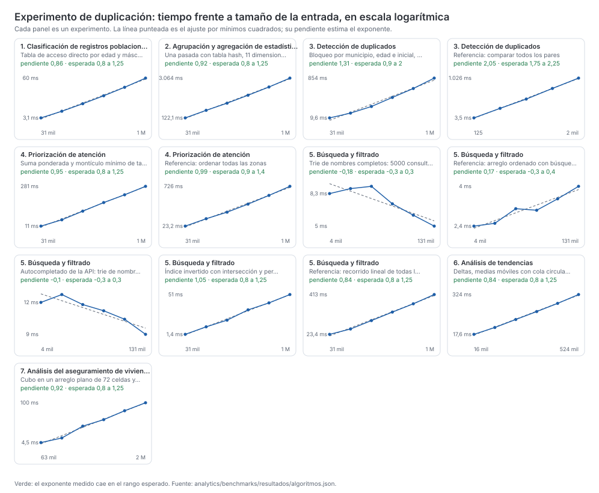

# Algoritmos de ANDES

Los siete algoritmos del proyecto son funciones puras en `backend/src/algorithms/`. No leen la base de datos ni la red: reciben datos y devuelven datos. Así se prueban solos, se miden solos y se reutilizan en el ETL, en la API y en las mediciones.

| Archivo | Contenido |
|---|---|
| `clasificacion.js` | Algoritmo 1: clasificación de registros poblacionales |
| `agregacion.js` | Algoritmo 2: agrupación y agregación en tres niveles territoriales |
| `duplicados.js` | Algoritmo 3: distancia de edición, comparador y detección por bloques |
| `priorizacion.js` y `mayores.js` | Algoritmo 4: puntaje ponderado y selección de las *k* mejores zonas |
| `busqueda.js` | Algoritmo 5: búsqueda binaria, índice invertido y autocompletado |
| `tendencias.js` | Algoritmo 6: variaciones, medias móviles, pendiente y anomalías |
| `aseguramiento.js` | Algoritmo 7: cubo de aseguramiento de viviendas |
| `estructuras/` | Montículo mínimo, conjuntos disjuntos, trie y cola circular |
| `texto.js` | Normalización de nombres y direcciones, compartida por los algoritmos 3 y 5 |
| `supresion.js` | Supresión complementaria de celdas pequeñas, que protege las cifras públicas de los registros desde la fase 5 |

Cada algoritmo se documenta con los diez puntos que pide el enunciado. Las pruebas están en `tests/unit/algoritmos/` (140 pruebas, varias de ellas basadas en propiedades con fast-check y la semilla 20260810). Las mediciones están en `analytics/benchmarks/algoritmos.js`.

## Contenido

- [Cómo se midió](#cómo-se-midió)
- [Resumen de resultados](#resumen-de-resultados)
- [Algoritmo 1. Clasificación de registros poblacionales](#algoritmo-1-clasificación-de-registros-poblacionales)
- [Algoritmo 2. Agrupación y agregación de estadísticas](#algoritmo-2-agrupación-y-agregación-de-estadísticas)
- [Algoritmo 3. Detección de registros duplicados](#algoritmo-3-detección-de-registros-duplicados)
- [Algoritmo 4. Priorización de atención](#algoritmo-4-priorización-de-atención)
- [Algoritmo 5. Búsqueda y filtrado](#algoritmo-5-búsqueda-y-filtrado)
- [Algoritmo 6. Análisis de tendencias](#algoritmo-6-análisis-de-tendencias)
- [Algoritmo 7. Análisis del aseguramiento de viviendas](#algoritmo-7-análisis-del-aseguramiento-de-viviendas)
- [Supresión de celdas pequeñas](#supresión-de-celdas-pequeñas)
- [Estructuras de datos de apoyo](#estructuras-de-datos-de-apoyo)
- [Cómo repetir las mediciones](#cómo-repetir-las-mediciones)

## Cómo se midió

La complejidad teórica se contrastó con un **experimento de duplicación**: cada algoritmo se ejecuta con tamaños que se duplican y se observa cómo crece el tiempo.

| Aspecto | Decisión |
|---|---|
| Equipo | Apple M4 con 10 núcleos y 16 GB, macOS 15 (Darwin 24.6.0), Node.js 24.15.0 |
| Fecha | 19 de noviembre de 2026 |
| Tamaños | Seis tamaños que se duplican. La referencia cuadrática usa cinco tamaños pequeños, de 125 a 2.000. |
| Repeticiones | Cinco por tamaño. Nueve en las consultas de autocompletado, que duran milisegundos, y tres en la referencia cuadrática. |
| Estadístico | La mediana, que no se deja arrastrar por una ejecución lenta aislada |
| Calentamiento | Una ejecución descartada antes de medir, tres en las consultas, para que el motor de JavaScript termine de optimizar el código |
| Memoria | Recolección de basura forzada antes de cada medición (`node --expose-gc`) |
| Datos | Generados con la semilla 20260810, así que cualquier persona obtiene las mismas entradas |

Con los tiempos se calculan dos cosas:

1. **La razón** T(2n)/T(n) entre tamaños consecutivos. Se acerca a 1 si el costo no depende de *n*, a 2 si es lineal, queda algo por encima de 2 si es O(n log n) y se acerca a 4 si es cuadrático.
2. **El exponente** *b* de T(n) ≈ a·nᵇ: la pendiente de la recta de mínimos cuadrados entre log₂ n y log₂ T. Se calcula con `pendienteMinimosCuadrados`, la misma función del algoritmo 6.

Cada experimento declara el rango de exponentes compatible con su complejidad: entre −0,3 y 0,3 para un costo constante, entre 0,8 y 1,25 para uno lineal, entre 0,9 y 1,4 para O(n log n) y entre 1,75 y 2,25 para uno cuadrático. **Los trece experimentos quedaron dentro de su rango.**

Una advertencia de lectura: en los algoritmos lineales el exponente medido queda por debajo de 1, entre 0,84 y 0,95, y la razón empieza en 1,65 y sube hasta cerca de 2. Es lo esperado: con tamaños pequeños pesan más los costos fijos, como crear los mapas, compilar el código y reservar la memoria inicial. Con los tamaños grandes la razón se estabiliza alrededor de 2.

## Resumen de resultados

| Algoritmo | Variante medida | Complejidad | Exponente | Tiempo con el mayor tamaño |
|---|---|---|---|---|
| 1 | Tabla directa y máscara de bits | O(n) | 0,86 | 60 ms con 1.000.000 de registros |
| 2 | Pasada única con tabla hash y 11 dimensiones | O(n·d) | 0,92 | 3,06 s con 1.000.000 de registros |
| 3 | Bloques por municipio, edad e inicial | O(n + Σ bᵢ²) | 1,31 | 854 ms con 1.000.000 de registros |
| 3 | Referencia: todos los pares | O(n²) | 2,05 | 1,03 s con solo 2.000 registros |
| 4 | Suma ponderada y montículo de tamaño 20 | O(m·c + m log k) | 0,95 | 281 ms con 1.000.000 de zonas |
| 4 | Referencia: ordenar todas las zonas | O(m·c + m log m) | 0,99 | 726 ms con 1.000.000 de zonas |
| 5 | Trie de nombres completos | O(L + r) por consulta | −0,18 | 1,0 µs por consulta con 131.072 nombres |
| 5 | Referencia: arreglo ordenado | O(L·log N + r) por consulta | 0,17 | 0,87 µs por consulta con 131.072 nombres |
| 5 | Autocompletado de la API, con palabras interiores | O(L + r) por consulta | −0,10 | 1,7 µs por consulta con 131.072 nombres |
| 5 | Índice invertido | O(k·s) por consulta | 1,05 | 1,0 ms por consulta con 1.000.000 de filas |
| 5 | Referencia: recorrido lineal | O(n) por consulta | 0,84 | 8,3 ms por consulta con 1.000.000 de filas |
| 6 | Deltas, medias móviles, pendiente y anomalías | O(n) | 0,84 | 324 ms con 524.288 puntos |
| 7 | Cubo de 72 celdas | O(n + C) | 0,92 | 100 ms con 2.000.000 de viviendas |

El resultado completo, con los seis tamaños de cada experimento, su mínimo, su máximo y las razones, está en `analytics/benchmarks/resultados/algoritmos.json`.

---



La gráfica se dibuja con `npm run medir:graficas` a partir de `analytics/benchmarks/resultados/algoritmos.json`. [RENDIMIENTO.md](RENDIMIENTO.md) reúne estas mediciones con las de la API, las consultas y el ETL.

## Algoritmo 1. Clasificación de registros poblacionales

### 1. Problema que resuelve

Cada persona registrada debe quedar en un grupo de edad, una condición institucional, una tenencia de vivienda y un conjunto de condiciones de vulnerabilidad. Si cada módulo clasifica a su manera, la población no cuadra entre páginas. Además, las vulnerabilidades no son excluyentes: una persona puede tener discapacidad y ser adulta mayor a la vez.

### 2. Objetivo

Clasificar todos los registros con una sola regla, de forma consistente y en tiempo constante por registro, y contar los que no se pueden clasificar en lugar de adivinar.

### 3. Entradas

- *n* registros con `edad`, `condicion`, `tenencia` y la lista de `vulnerabilidades` declaradas.
- Los catálogos de condiciones institucionales y de tenencias, con su jerarquía (por ejemplo, `RECLUSION` pertenece a `PRIVADA_LIBERTAD`).
- Los cortes de edad: `[10, 18, 60]` para los cuatro grupos de la propuesta y cortes cada cinco años para la pirámide.

### 4. Salidas

Por registro: `grupoEdad`, `quinquenio`, `condicion`, `grupoCondicion`, `tenencia` y una `mascara` de bits con las vulnerabilidades. Las vulnerabilidades que dependen de la edad, adulto mayor y población infantil, se activan aquí y no se guardan en la base de datos. Además, la lista de registros no clasificables con su motivo: `EDAD_INVALIDA`, `CONDICION_DESCONOCIDA`, `TENENCIA_DESCONOCIDA` o `VULNERABILIDAD_DESCONOCIDA`.

### 5. Estructura de datos utilizada

| Estructura | Uso |
|---|---|
| `Uint8Array` de 121 posiciones | Tabla de acceso directo: la posición es la edad y el valor es el grupo |
| `Map` | Catálogos de condiciones y de tenencias, con búsqueda en O(1) esperado |
| Entero de 8 bits | Máscara de vulnerabilidades: el bit *i* encendido significa que la persona tiene la vulnerabilidad *i* |

### 6. Pseudocódigo

```text
PREPARAR tabla[0..120]:
    grupo ← 0
    PARA edad DESDE 0 HASTA 120:
        SI grupo < |cortes| Y edad ≥ cortes[grupo]: grupo ← grupo + 1
        tabla[edad] ← grupo

CLASIFICAR(registro):
    SI registro.edad no es un entero ≥ 0: problema EDAD_INVALIDA
    condicion ← catalogoCondiciones.obtener(registro.condicion)    ; O(1)
    mascara ← 0
    PARA CADA v EN registro.vulnerabilidades:
        mascara ← mascara O_BIT bitDe[v]
    SI hay problemas: DEVOLVER no clasificable con sus motivos
    edad ← mínimo(registro.edad, 120)
    SI edad ≥ 60: mascara ← mascara O_BIT BIT_ADULTO_MAYOR
    SI edad < 18: mascara ← mascara O_BIT BIT_POBLACION_INFANTIL
    DEVOLVER (tabla[edad], quinquenio[edad], condicion, condicion.padre, tenencia, mascara)
```

### 7. Implementación en JavaScript

Archivo: `backend/src/algorithms/clasificacion.js`. Funciones públicas: `crearTablaDeGrupos`, `crearClasificador`, `clasificarRegistros`, `codigosDeMascara` y `tieneVulnerabilidad`.

```js
export function crearTablaDeGrupos(cortes, edadMaxima = EDAD_MAXIMA) {
  const tabla = new Uint8Array(edadMaxima + 1);
  let grupo = 0;
  for (let edad = 0; edad <= edadMaxima; edad += 1) {
    if (grupo < cortes.length && edad >= cortes[grupo]) {
      grupo += 1;
    }
    tabla[edad] = grupo;
  }
  return tabla;
}
```

El clasificador se construye una vez y se aplica a cada registro:

```js
let mascara = 0;
for (const codigo of declaradas) {
  const bit = declarables.get(codigo);
  if (bit === undefined) {
    problemas.push('VULNERABILIDAD_DESCONOCIDA');
  } else {
    mascara |= bit;
  }
}
const edadAcotada = Math.min(edad, EDAD_MAXIMA);
if (edadAcotada >= EDAD_ADULTO_MAYOR) {
  mascara |= BIT_ADULTO_MAYOR;
}
if (edadAcotada < EDAD_MAYORIA) {
  mascara |= BIT_POBLACION_INFANTIL;
}
```

Dónde se usa: en las dimensiones de agregación (`backend/src/models/dimensiones.js`), que el ETL aplica al terminar cada carga.

### 8. Complejidad temporal

- Preparar las tablas: O(E), con E = 121 edades. Es constante porque no depende de *n*.
- Clasificar un registro: O(1) para la edad (una lectura de arreglo), O(1) esperado para cada catálogo y O(v) para las vulnerabilidades declaradas, con *v* ≤ 8.
- Clasificar *n* registros: **Θ(n·v) = Θ(n)**, porque *v* tiene un máximo fijo.

### 9. Complejidad espacial

O(E + |catálogos|) para las tablas, que es constante, y O(1) adicional por registro: la máscara cabe en un entero. La salida de *n* registros ocupa O(n).

### 10. Justificación de su eficiencia

La tabla directa convierte una cadena de comparaciones en una lectura de memoria. Las alternativas son una cadena de `if`, que cuesta O(k) por registro con *k* grupos, o una búsqueda binaria sobre los cortes, que cuesta O(log k). La tabla cuesta O(1) y además sirve sin cambios para los 17 grupos quinquenales de la pirámide.

La máscara de bits refleja que las vulnerabilidades son variables independientes. Preguntar si una persona tiene una vulnerabilidad es una operación `Y` de bits, y la máscara completa ocupa un byte, frente a una lista de textos por persona.

**Medición:** clasificar 1.000.000 de registros toma 60 ms, unos 60 ns por registro. El exponente medido es 0,86 y la razón entre los dos últimos tamaños es 1,98, la de un algoritmo lineal.

| n | 31.250 | 62.500 | 125.000 | 250.000 | 500.000 | 1.000.000 |
|---|---|---|---|---|---|---|
| Mediana (ms) | 3,08 | 5,07 | 8,88 | 16,07 | 30,42 | 60,36 |
| Razón | — | 1,65 | 1,75 | 1,81 | 1,89 | 1,98 |

---

## Algoritmo 2. Agrupación y agregación de estadísticas

### 1. Problema que resuelve

Las estadísticas de población y vivienda se consultan por municipio, por departamento y para el país, y por muchas variables: grupo de edad, sexo, condición, tenencia, salud, vulnerabilidad, semana de registro, estado físico de la vivienda, aseguramiento y otras. Recorrer los registros una vez por cada combinación de nivel y variable sería costoso, y repetir ese recorrido en cada consulta, inviable con cientos de miles de registros.

### 2. Objetivo

Recorrer los registros **una sola vez**, al nivel más fino, y obtener los niveles superiores combinando celdas, sin volver a leer los registros. El resultado se guarda en `analitica.agregados` y se actualiza de forma incremental con cada carga.

### 3. Entradas

- Un flujo de *n* registros con su código de municipio.
- Una lista de *d* dimensiones. Cada dimensión es una función que devuelve una categoría o, si la variable admite varias, una lista de categorías, como las vulnerabilidades.
- Una función de valor que se suma: la edad en las personas, para calcular la edad promedio, y el avalúo en las viviendas.

### 4. Salidas

Celdas con `nivel`, `territorio`, `dimension`, `categoria`, `cantidad`, `suma`, `promedio` y `porcentaje`, en los tres niveles territoriales. La dimensión `total` guarda el total de cada territorio, que sirve de denominador de los porcentajes.

### 5. Estructura de datos utilizada

| Estructura | Uso |
|---|---|
| `Map` con clave compuesta | Una celda por combinación de territorio, dimensión y categoría. La clave une los tres textos con un separador nulo que no puede aparecer en ellos. |
| Objetos `{ cantidad, suma }` | La celda guarda la suma y la cantidad, no el promedio, porque se pueden combinar entre niveles y entre cargas. Un promedio ya calculado no se puede combinar. |

### 6. Pseudocódigo

```text
celdas ← Mapa vacío
PARA CADA registro EN flujo:
    acumular(celdas, registro.municipio, "total", "TOTAL", 1, valor(registro))
    PARA CADA dimension EN dimensiones:
        PARA CADA categoria EN dimension.categorias(registro):
            acumular(celdas, registro.municipio, dimension.nombre, categoria, 1, valor(registro))

COMBINAR(celdas):
    PARA CADA celda EN celdas:
        acumular(municipales, celda.territorio, …)
        acumular(departamentales, primerosDosDigitos(celda.territorio), …)
        acumular(nacionales, "00", …)
    PARA CADA celda EN los tres mapas:
        celda.promedio   ← celda.suma / celda.cantidad
        celda.porcentaje ← celda.cantidad / total del territorio
```

### 7. Implementación en JavaScript

Archivo: `backend/src/algorithms/agregacion.js`. Funciones públicas: `crearAgregador`, `combinarNiveles` y `suprimirCeldasPequenas`.

```js
function acumular(celdas, territorio, dimension, categoria, cantidad, suma) {
  const clave = claveDe(territorio, dimension, categoria);
  const celda = celdas.get(clave);
  if (celda) {
    celda.cantidad += cantidad;
    celda.suma += suma;
  } else {
    celdas.set(clave, { territorio, dimension, categoria, cantidad, suma });
  }
}

export function combinarNiveles(celdasMunicipales) {
  const municipales = new Map();
  const departamentales = new Map();
  const nacionales = new Map();
  for (const celda of celdasMunicipales) {
    const { territorio, dimension, categoria, cantidad, suma } = celda;
    acumular(municipales, territorio, dimension, categoria, cantidad, suma);
    acumular(departamentales, territorio.slice(0, 2), dimension, categoria, cantidad, suma);
    acumular(nacionales, CODIGO_NACIONAL, dimension, categoria, cantidad, suma);
  }
  return [
    ...completar(municipales, NIVELES.municipio, totalesPorTerritorio(municipales)),
    ...completar(departamentales, NIVELES.departamento, totalesPorTerritorio(departamentales)),
    ...completar(nacionales, NIVELES.nacional, totalesPorTerritorio(nacionales)),
  ];
}
```

Dónde se usa:

- **Al terminar cada carga.** El ETL agrega los registros vigentes de esa carga (`etl/cargadores/agregados.js`) y suma las celdas a `analitica.agregados` con `INSERT … ON CONFLICT DO UPDATE SET cantidad = cantidad + EXCLUDED.cantidad`.
- **Al decidir que dos registros son distintos.** El registro que queda vigente se suma con el mismo agregador.
- **Al recalcular.** `npm run etl -- reagregar` reconstruye la tabla desde cero.
- **Para publicar.** `suprimirCeldasPequenas` oculta las celdas con menos de diez registros antes de mostrarlas en el portal público.

### 8. Complejidad temporal

- Pasada sobre los registros: **O(n·d)** esperado, porque cada registro actualiza una celda por categoría de cada dimensión y cada actualización de un `Map` cuesta O(1) esperado. Con *d* fijo (11 dimensiones en las personas), el costo es lineal en *n*.
- Combinar hacia departamento y país: O(g), con *g* celdas municipales. *g* no depende de *n*: está acotado por municipios × categorías.
- Incorporar una carga nueva de *b* registros: O(b·d + g), sin volver a leer las cargas anteriores.

### 9. Complejidad espacial

O(g) celdas. En la base de desarrollo, con 589.690 personas, el resultado ocupa 41.341 celdas en los tres niveles: el espacio depende del número de grupos, no del número de registros.

### 10. Justificación de su eficiencia

| Alternativa | Costo |
|---|---|
| Ordenar los registros por clave y recorrerlos | O(n log n) |
| Un recorrido por cada nivel territorial | O(3·n·d) |
| Un recorrido por cada combinación de nivel y dimensión | O(3·d·n) |
| **Pasada única con tabla hash y combinación** | **O(n·d + g)** |

Guardar suma y cantidad permite la actualización incremental: una carga nueva solo agrega sus registros, y el resultado es idéntico al de recalcular todo. Las pruebas lo comprueban de tres formas: comparan las celdas con la consulta `GROUPING SETS` equivalente en SQL (`analitica.poblacion_por_grupo_de_edad`), comparan el cubo de viviendas con el `CUBE` de SQL y comparan la suma incremental con un recálculo completo.

**Medición:** agregar 1.000.000 de personas en 11 dimensiones y tres niveles toma 3,06 s. Son unas 12 actualizaciones de celda por registro, una por dimensión más las de las vulnerabilidades, que pueden ser varias, a unos 0,25 µs cada una. El exponente es 0,92 y la última razón, 2,05.

| n | 31.250 | 62.500 | 125.000 | 250.000 | 500.000 | 1.000.000 |
|---|---|---|---|---|---|---|
| Mediana (ms) | 122,10 | 224,98 | 402,86 | 766,38 | 1.494,13 | 3.063,61 |
| Razón | — | 1,84 | 1,79 | 1,90 | 1,95 | 2,05 |

---

## Algoritmo 3. Detección de registros duplicados

### 1. Problema que resuelve

Una misma persona o vivienda puede llegar varias veces: en dos archivos, en dos formatos o escrita de forma distinta («Ana María Pérez Gómez» y «Ana Maria Perez Gomes»). Si se cuenta dos veces, las estadísticas inflan la afectación. Es el mismo problema que obligó a la UNGRD a corregir públicamente sus cifras de fallecidos.

### 2. Objetivo

Separar tres situaciones, de la más barata a la más costosa de detectar, sin borrar nunca un registro por una coincidencia dudosa:

1. **Duplicado exacto por identificador.** El mismo documento, comparado por su seudónimo HMAC. Se descarta y se cuenta.
2. **Coincidencia por clave natural.** El mismo nombre normalizado en el mismo bloque.
3. **Duplicado probable.** Una similitud alta entre nombres o direcciones del mismo bloque.

Las situaciones 2 y 3 quedan **en revisión**: no cuentan en las estadísticas hasta que una persona decide si son el mismo registro.

### 3. Entradas

- *n* registros con identificador, cuando existe, y los campos de comparación: nombre y sexo en las personas; números de la dirección, texto de la dirección y zona en las viviendas.
- Una función que asigna a cada registro su **clave de bloque**: municipio, edad e inicial del nombre en las personas, y municipio y las dos primeras palabras de la dirección normalizada en las viviendas (el tipo de vía y su número, como «CL 10»).
- Los pesos de los campos y dos umbrales, definidos en el YAML de cada conjunto: 0,92 y 0,80 para personas, y 0,97 y 0,90 para viviendas.

### 4. Salidas

- Los duplicados exactos, con el registro original de cada uno.
- Los grupos de registros confirmados como el mismo.
- La cola de pares por revisar, con su similitud y el detalle por campo (por ejemplo, «Nombre 96,3 % · Sexo 100 %»).
- El número de comparaciones hechas, que permite medir el beneficio de los bloques.

### 5. Estructura de datos utilizada

| Estructura | Uso |
|---|---|
| `Map` de identificadores vistos | Detección exacta en O(1) esperado |
| `Map` de bloques | Agrupa las posiciones de los registros que comparten clave |
| Dos filas de un `Int32Array` | Distancia de edición de Levenshtein con memoria lineal |
| Conjuntos disjuntos con compresión de camino y unión por rango | Agrupación transitiva: si A coincide con B y B con C, los tres forman un grupo |

### 6. Pseudocódigo

```text
grupos ← ConjuntosDisjuntos(n) ; vistos ← Mapa vacío ; bloques ← Mapa vacío
PARA CADA registro i:
    SI registro.identificador EN vistos:
        grupos.unir(vistos[registro.identificador], i) ; exactos.agregar(i)
        CONTINUAR
    vistos[registro.identificador] ← i
    bloques[claveDeBloque(registro)].agregar(i)

PARA CADA bloque EN bloques:
    PARA CADA par (i, j) DEL bloque:
        s ← comparar(registro[i], registro[j])
        SI s ≥ UMBRAL_DUPLICADO: grupos.unir(i, j)
        SI NO, SI s ≥ UMBRAL_REVISION: revision.agregar(i, j, s)

COMPARAR(a, b):
    acumulado ← suma de los pesos de los campos exactos que coinciden
    PARA CADA campo de texto, con su peso:
        necesario ← lo mínimo que debe aportar este campo para alcanzar UMBRAL_REVISION
        s_campo ← 1 − distanciaDeEdicion(a.campo, b.campo, tope) / largo
        acumulado ← acumulado + peso · s_campo
    DEVOLVER acumulado / sumaDePesos
```

La distancia de edición recibe un **tope**: si la similitud no puede alcanzar el mínimo necesario, el cálculo se detiene en cuanto la distancia lo supera, y solo recorre una banda de ancho 2·tope + 1 alrededor de la diagonal.

### 7. Implementación en JavaScript

Archivo: `backend/src/algorithms/duplicados.js`. Funciones públicas: `distanciaDeEdicion`, `similitudDeTexto`, `crearComparador`, `detectarDuplicados` y `agruparPares`.

```js
for (const miembros of bloques.values()) {
  for (let primero = 0; primero < miembros.length; primero += 1) {
    for (let segundo = primero + 1; segundo < miembros.length; segundo += 1) {
      const uno = miembros[primero];
      const otro = miembros[segundo];
      comparaciones += 1;
      const { valor, detalle } = comparar(registros[uno], registros[otro]);
      if (valor >= umbralDuplicado) {
        grupos.unir(uno, otro);
      } else if (valor >= umbralRevision) {
        revision.push({ uno, otro, similitud: valor, detalle });
      }
    }
  }
}
```

La banda de la distancia de edición:

```js
for (let fila = 1; fila <= filas; fila += 1) {
  const desde = Math.max(1, fila - tope);
  const hasta = Math.min(columnas, fila + tope);
  actual[0] = fila <= tope ? fila : fuera;
  let minimoDeFila = actual[0];
  const letra = larga.charCodeAt(fila - 1);
  for (let columna = desde; columna <= hasta; columna += 1) {
    const sustitucion = anterior[columna - 1] + (letra === corta.charCodeAt(columna - 1) ? 0 : 1);
    const valor = Math.min(anterior[columna] + 1, actual[columna - 1] + 1, sustitucion);
    actual[columna] = valor > fuera ? fuera : valor;
    if (actual[columna] < minimoDeFila) {
      minimoDeFila = actual[columna];
    }
  }
  if (minimoDeFila > tope) {
    return fuera;
  }
  [anterior, actual] = [actual, anterior];
}
```

Dónde se usa: la función en memoria acepta también una clave natural exacta y la trata como duplicado seguro. El ETL es más prudente: solo descarta por el identificador seudonimizado, y la coincidencia de nombre queda en revisión con el motivo `CLAVE_NATURAL`. En el ETL, además, los bloques no viven en memoria sino en la base de datos. Cada registro guarda su `clave_bloque`, que tiene un índice, y al confirmar cada lote una consulta trae los candidatos del mismo bloque, incluidos los de cargas anteriores. `etl/cargadores/duplicados.js` los compara con `crearComparador`. La API agrupa los pares pendientes con `agruparPares`, que usa los conjuntos disjuntos, para mostrar cuántos registros enlaza cada grupo.

### 8. Complejidad temporal

Notación: *L* longitud de los textos, *t* tope de la distancia y *bᵢ* tamaño del bloque *i*.

- Duplicados exactos: O(n) esperado.
- Comparaciones: Σ bᵢ·(bᵢ − 1)/2. Cada una cuesta O(L·t) con la banda, frente a O(L²) sin ella.
- Total: **O(n + Σ bᵢ²·L·t)**. Si las claves se reparten de forma uniforme entre *K* bloques posibles, Σ bᵢ² ≈ n + n²/K: el costo es lineal mientras *n* sea menor que *K* y cuadrático, con una constante dividida por *K*, después.
- Peor caso, con todos los registros en un bloque: O(n²·L·t), igual a comparar todos los pares.
- Agrupar *q* uniones con conjuntos disjuntos: O(q·α(n)), donde α es la inversa de la función de Ackermann, menor que 5 para cualquier tamaño real.

### 9. Complejidad espacial

O(n) para los identificadores vistos, los bloques y los conjuntos disjuntos, más O(L) para las dos filas de la distancia de edición. La cola de revisión ocupa O(p) para *p* pares.

### 10. Justificación de su eficiencia

La medición confirma el análisis. El número de comparaciones se multiplica por casi 4 en cada duplicación (735, 2.697, 10.457, 40.702, 159.576 y 632.827), que es el término n²/K. Pero con 1.000.000 de registros son 632.827 comparaciones, menos de una por registro, frente a las 499.999.500.000 de la comparación exhaustiva.

| n | 31.250 | 62.500 | 125.000 | 250.000 | 500.000 | 1.000.000 |
|---|---|---|---|---|---|---|
| Con bloques (ms) | 9,57 | 16,46 | 34,61 | 96,11 | 265,17 | 853,86 |
| Razón | — | 1,72 | 2,10 | 2,78 | 2,76 | 3,22 |
| Comparaciones | 735 | 2.697 | 10.457 | 40.702 | 159.576 | 632.827 |

La referencia, que compara todos los pares con el mismo comparador, tiene exponente 2,05 y tarda **1,03 s con apenas 2.000 registros**. Extrapolando su razón cuadrática, con 1.000.000 de registros tardaría unas 71 horas. Los bloques lo hacen en 0,85 s.

| n | 125 | 250 | 500 | 1.000 | 2.000 |
|---|---|---|---|---|---|
| Todos los pares (ms) | 3,54 | 13,81 | 51,45 | 235,91 | 1.025,85 |
| Razón | — | 3,90 | 3,73 | 4,59 | 4,35 |

Los bloques no solo son más rápidos, también son más precisos. La medición inyecta un 0,5 % de duplicados con un error de digitación y comprueba cuántos encuentra cada método:

| Registros | Método | Comparaciones | Pares marcados | Duplicados reales encontrados | Exhaustividad | Precisión |
|---|---|---|---|---|---|---|
| 2.000 | Bloques | 8 | 7 | 7 de 7 | 100 % | 100 % |
| 2.000 | Todos los pares | 1.999.000 | 203 | 7 de 7 | 100 % | 3,45 % |
| 1.000.000 | Bloques | 632.827 | 5.674 | 4.975 de 4.975 | 100 % | 87,68 % |

Sin bloques, 196 de los 203 pares marcados son personas distintas con nombres parecidos que no comparten municipio, edad o inicial. El bloque exige que coincidan municipio, edad e inicial, y eso filtra esas falsas coincidencias antes de calcular una sola distancia.

**Limitación conocida.** Un error en la inicial del nombre o en la edad saca a la persona de su bloque, y ese duplicado no se detecta. La segunda alternativa, ordenar por una clave y comparar dentro de una ventana deslizante, cuesta O(n log n + n·w) y tiene el mismo problema con la primera letra.

---

## Algoritmo 4. Priorización de atención

### 1. Problema que resuelve

Ordenar las zonas según su urgencia relativa combinando criterios con unidades distintas (personas, viviendas, unidades de infraestructura), de forma que cualquier persona pueda explicar por qué una zona quedó en su posición.

### 2. Objetivo

Calcular un puntaje entre 0 y 1 por zona, con el aporte de cada criterio, y devolver las *k* zonas de mayor puntaje sin ordenar todas las demás. El resultado es un apoyo analítico: la respuesta siempre incluye el aviso *«Modelo analítico de carácter académico; no constituye una decisión oficial de asignación de ayudas»* y no se publica en el portal.

### 3. Entradas

- *m* zonas con un valor por criterio. Un valor ausente se marca como sin dato.
- *c* criterios con su peso y su sentido: en algunos, como los suministros disponibles, más es mejor y el criterio se invierte.
- El tamaño *k* de la lista.

En la plataforma, los criterios están en `config/priorizacion.yml`.

| Criterio | Fuente | Origen | Peso configurado |
|---|---|---|---|
| Personas afectadas | Reporte municipal oficial | OFICIAL | 0,25 |
| Personas en condición de vulnerabilidad | Agregados de los registros | SIMULADO | 0,20 |
| Viviendas destruidas | Reporte municipal oficial | OFICIAL | 0,20 |
| Infraestructura crítica afectada | Reporte municipal oficial: salud, educación y acueductos | OFICIAL | 0,15 |
| Disponibilidad de suministros | Sin datos en la plataforma | — | 0,10 |
| Capacidad de respuesta | Sin datos en la plataforma | — | 0,10 |

Un criterio sin datos se excluye, y el motivo se devuelve en la respuesta. Su peso se reparte entre los demás al normalizar: con los dos criterios excluidos, los pesos efectivos quedan en 0,3125, 0,25, 0,25 y 0,1875.

### 4. Salidas

Las *k* zonas en orden, cada una con su posición, su puntaje y, por criterio, el valor original, el valor normalizado, el peso, el aporte al puntaje y si le faltaba el dato.

### 5. Estructura de datos utilizada

| Estructura | Uso |
|---|---|
| Arreglo de *m* zonas con *c* valores | La matriz de criterios |
| Arreglo de *c* extremos | El mínimo y el máximo de cada criterio, para normalizar |
| **Montículo binario mínimo de tamaño *k*** | Cola de prioridad. Su raíz es la peor de las *k* mejores zonas vistas hasta el momento. |

### 6. Pseudocódigo

```text
pesos ← peso[c] / suma de los pesos
PARA CADA criterio c: (min[c], max[c]) ← extremos de los valores con dato
PARA CADA zona z:
    puntaje[z] ← 0
    PARA CADA criterio c:
        SI x[z][c] no tiene dato: aporte[z][c] ← 0 ; CONTINUAR
        u ← SI max[c] = min[c] ENTONCES 0 SI NO (x[z][c] − min[c]) / (max[c] − min[c])
        SI c.masEsMejor: u ← 1 − u
        aporte[z][c] ← pesos[c] · u
        puntaje[z]   ← puntaje[z] + aporte[z][c]

monticulo ← MonticuloMinimo(por puntaje y, en empate, por código)
PARA CADA zona z:
    SI monticulo.tamaño < k: monticulo.insertar(z)
    SI NO, SI z es mejor que monticulo.minimo(): monticulo.reemplazarMinimo(z)
DEVOLVER las zonas del montículo de mayor a menor
```

### 7. Implementación en JavaScript

Archivos: `backend/src/algorithms/priorizacion.js` (`normalizarPesos`, `puntuarZonas` y `priorizar`), `backend/src/algorithms/mayores.js` (`seleccionarMayores`) y `backend/src/algorithms/estructuras/monticulo.js` (`MonticuloMinimo`).

```js
export function seleccionarMayores(elementos, cantidad, puntaje, desempatar = sinDesempate) {
  if (cantidad <= 0) {
    return [];
  }
  const comparar = (uno, otro) => puntaje(uno) - puntaje(otro) || desempatar(otro, uno);
  const monticulo = new MonticuloMinimo(comparar);
  for (const elemento of elementos) {
    if (monticulo.tamano < cantidad) {
      monticulo.insertar(elemento);
    } else if (comparar(elemento, monticulo.minimo()) > 0) {
      monticulo.reemplazarMinimo(elemento);
    }
  }
  const seleccionados = [];
  while (monticulo.tamano > 0) {
    seleccionados.push(monticulo.extraerMinimo());
  }
  return seleccionados.reverse();
}
```

Los empates se resuelven por código DIVIPOLA, para que el resultado sea siempre el mismo.

Dónde se usa: la API privada `GET /api/v1/admin/priorizacion` (`backend/src/services/estadisticas.js`), con el permiso `priorizacion:usar`. El mismo montículo elige las diez rutas más consultadas en el panel de ingeniería.

### 8. Complejidad temporal

- Normalizar los pesos: O(c).
- Calcular los extremos y puntuar: **Θ(m·c)**.
- Seleccionar las *k* mejores: **O(m log k)**. Cada inserción o reemplazo en un montículo de tamaño *k* cuesta O(log k).
- Ordenar el resultado: O(k log k).
- Total: O(m·c + m log k). Con *c* y *k* pequeños, lineal en *m*.

### 9. Complejidad espacial

O(m·c) para los aportes de todas las zonas y O(k) para el montículo.

### 10. Justificación de su eficiencia

| Alternativa | Costo | Observación |
|---|---|---|
| Ordenar todas las zonas | O(m log m) | Ordena *m* zonas para usar *k* |
| Selección rápida | O(m) en promedio | No deja ordenadas las *k* elegidas y su peor caso es O(m²) |
| **Montículo de tamaño *k*** | **O(m log k)** | Además permite mantener la lista cuando llega un reporte nuevo |

Como modelo se prefirió la suma ponderada frente a métodos como TOPSIS o AHP: el puntaje se reconstruye con una calculadora, y el aporte de cada criterio explica la posición de cada zona.

**Medición:** con 1.000.000 de zonas el montículo tarda 281 ms y ordenar todas, 726 ms. El montículo es 2,6 veces más rápido, y la razón del ordenamiento sube con el tamaño (2,13 y 2,20 en las dos últimas duplicaciones), que es la huella del factor log m.

| m | 31.250 | 62.500 | 125.000 | 250.000 | 500.000 | 1.000.000 |
|---|---|---|---|---|---|---|
| Montículo, k = 20 (ms) | 11,00 | 18,35 | 37,18 | 74,91 | 141,36 | 281,13 |
| Ordenar todo (ms) | 23,20 | 43,94 | 77,73 | 155,42 | 330,82 | 726,45 |

En la plataforma *m* son los 498 municipios con reporte oficial, y el cálculo completo toma menos de un milisegundo. Las zonas sintéticas de la medición solo sirven para ver el crecimiento.

**Limitaciones conocidas.** La normalización por mínimo y máximo es sensible a valores extremos: un municipio con una cifra muy alta comprime a todos los demás. Además, un criterio sin dato en una zona aporta cero, lo que favorece a la zona en la que falta información. Los valores son absolutos porque la plataforma no tiene la población de cada municipio para calcular tasas por cada mil habitantes. Las tres limitaciones se informan en las notas de la respuesta.

---

## Algoritmo 5. Búsqueda y filtrado

### 1. Problema que resuelve

Dos necesidades de consulta: autocompletar el nombre de un municipio mientras la persona escribe, entre 1.122 municipios con nombres repetidos, tildes y palabras como «San» o «El», y responder filtros combinados por atributo y periodo sin recorrer todas las filas en cada consulta.

### 2. Objetivo

Responder cada tecla en un tiempo que no dependa del tamaño del catálogo, e intersecar filtros empezando por la lista más corta.

### 3. Entradas

- **Autocompletado:** un catálogo de *N* entradas con nombre y código, y el prefijo escrito por la persona.
- **Filtrado:** *n* filas con atributos y una fecha de periodo, los filtros por atributo y el rango de fechas.

### 4. Salidas

- **Autocompletado:** hasta *r* sugerencias. Primero van los nombres que empiezan por el prefijo y después los que lo contienen como palabra interior, como «Palmar» en «San José del Palmar». Las sugerencias salen sin repetir, en orden alfabético del nombre normalizado.
- **Filtrado:** las filas que cumplen todos los filtros y caen en el periodo.

### 5. Estructura de datos utilizada

| Estructura | Uso |
|---|---|
| **Trie** | Un árbol en el que cada arista es una letra. Hay dos: uno para los nombres completos y otro para los nombres desde cada palabra interior. Las palabras vacías como «de», «la» o «el» no se indexan. |
| Hijos ordenados por nodo | Cada nodo guarda sus hijos en orden alfabético y solo recalcula ese orden cuando recibe un hijo nuevo |
| Índice invertido | `Map` de atributo a valor y de valor a la lista ordenada de posiciones de las filas que lo tienen |
| Arreglo ordenado de periodos | Para encontrar el rango de fechas con dos búsquedas binarias |

### 6. Pseudocódigo

```text
AUTOCOMPLETAR(prefijo, r):
    p ← normalizar(prefijo)                      ; sin tildes, en mayúsculas
    sugerencias ← lista vacía ; vistos ← conjunto vacío
    PARA CADA trie EN [nombresCompletos, palabrasInteriores]:
        nodo ← raíz
        PARA CADA letra EN p: nodo ← nodo.hijos[letra] ; SI no existe: siguiente trie
        RECORRER el subárbol de nodo en profundidad, en orden alfabético:
            PARA CADA entrada del nodo visitado:
                SI entrada.codigo NO EN vistos: agregarla a sugerencias
                SI |sugerencias| = r: DEVOLVER sugerencias
    DEVOLVER sugerencias

FILTRAR(filtros, periodo):
    (inicio, fin) ← limiteInferior(periodos, desde), limiteSuperior(periodos, hasta)
    listas ← índice[a][v] de cada filtro, de la más corta a la más larga
    resultado ← la lista más corta, recortada a [inicio, fin) con búsqueda binaria
    PARA CADA lista restante: resultado ← intersectar(resultado, lista)
    DEVOLVER las filas de resultado
```

### 7. Implementación en JavaScript

Archivos: `backend/src/algorithms/estructuras/trie.js` (`Trie`) y `backend/src/algorithms/busqueda.js` (`limiteInferior`, `limiteSuperior`, `intersectar`, `crearIndiceInvertido`, `crearAutocompletado` y `crearAutocompletadoOrdenado`, la alternativa medida).

El recorrido del trie no usa recursión ni generadores: una pila explícita y una función que decide si seguir.

```js
recorrer(prefijo, visitar) {
  const inicio = this.#ubicar(prefijo);
  if (!inicio) {
    return;
  }
  const pendientes = [inicio];
  while (pendientes.length > 0) {
    const nodo = pendientes.pop();
    for (const valor of nodo.valores) {
      if (visitar(valor) === false) {
        return;
      }
    }
    const hijos = hijosEnOrden(nodo);
    for (let posicion = hijos.length - 1; posicion >= 0; posicion -= 1) {
      pendientes.push(hijos[posicion]);
    }
  }
}
```

La intersección avanza por la lista corta y busca cada valor en la larga con búsqueda binaria, sin retroceder:

```js
export function intersectar(una, otra) {
  const [corta, larga] = una.length <= otra.length ? [una, otra] : [otra, una];
  const resultado = [];
  let desde = 0;
  for (const valor of corta) {
    const posicion = limiteInferior(larga, valor, identidad, desde);
    if (posicion >= larga.length) {
      break;
    }
    if (larga[posicion] === valor) {
      resultado.push(valor);
      desde = posicion + 1;
    } else {
      desde = posicion;
    }
  }
  return resultado;
}
```

Dónde se usa: la ruta pública `GET /api/v1/municipios?prefijo=` construye los dos tries una vez, la primera vez que se consulta, y los reutiliza en las siguientes. En la base de datos se aplican las mismas ideas con índices B-tree y paginación por clave.

### 8. Complejidad temporal

Notación: *L* longitud del prefijo, *r* sugerencias, *N* entradas del catálogo, *f* filtros y *s* tamaño de la lista más corta.

| Operación | Costo |
|---|---|
| Construir los tries | O(N·L̄·w) para nombres de longitud media L̄ con *w* palabras, una sola vez |
| Autocompletar | **O(L + r·h)** por consulta, con *h* la profundidad que hay que bajar para encontrar cada valor. No depende de *N*. |
| Autocompletar con el arreglo ordenado | O(L·log N + r): búsqueda binaria con comparaciones de texto |
| Construir el índice invertido | O(n log n) por el orden de periodos, más O(n·f) |
| Filtro combinado | O(log n + s + f·s·log n) |

### 9. Complejidad espacial

O(N·L̄·w) nodos para los tries: cada letra de cada nombre y de cada sufijo de palabra es, como máximo, un nodo. El índice invertido ocupa O(n·f) posiciones.

### 10. Justificación de su eficiencia

La medición del autocompletado sorprendió, y por eso se documenta completa.

| N | 4.096 | 8.192 | 16.384 | 32.768 | 65.536 | 131.072 |
|---|---|---|---|---|---|---|
| Trie de nombres completos (ms por 5.000 consultas) | 8,34 | 9,05 | 9,39 | 7,04 | 5,84 | 4,88 |
| Arreglo ordenado (ms por 5.000 consultas) | 2,40 | 2,50 | 3,10 | 3,03 | 3,59 | 4,33 |
| Autocompletado de la API (ms por 5.000 consultas) | 11,96 | 12,99 | 11,70 | 10,97 | 10,04 | 8,57 |

1. **La teoría se cumple.** El costo del trie no crece con el catálogo: su exponente es −0,18, y hasta baja con catálogos grandes, porque los subárboles se vuelven más densos y los primeros diez valores aparecen a menor profundidad. El del arreglo ordenado crece con log N: exponente 0,17.
2. **Las constantes pesan.** Con 4.096 nombres el arreglo ordenado es 3,5 veces más rápido. Una búsqueda binaria sobre un arreglo contiguo es muy barata, y el trie paga por cada nodo un acceso a un `Map` y una visita a la pila. Con 131.072 nombres ya están cerca, 0,98 µs frente a 0,87 µs por consulta, y las dos tendencias indican que se cruzan poco después. No se midieron catálogos mayores.
3. **Optimizar la constante valió la pena.** La primera versión del trie ordenaba los hijos de cada nodo en cada visita y recorría con un generador. Guardar los hijos ya ordenados bajó el autocompletado de 21 a 12 ms por 5.000 consultas en la medición rápida. Recorrer con una pila explícita, sin generador, bajó el costo del trie de 0,87 µs a 0,43 µs por consulta con 131.072 nombres, sin contar la normalización del prefijo. Son mediciones de desarrollo que no están en el archivo de resultados.
4. **El trie de la API hace más trabajo.** Cuando el prefijo tiene menos de diez coincidencias completas, busca también en las palabras interiores. Esa funcionalidad no la ofrece el arreglo ordenado.

Con los 1.122 municipios reales cualquiera de las dos opciones responde en pocos microsegundos (unos 2,4 µs por consulta el autocompletado de la API), muy por debajo del costo de la solicitud HTTP. Se conserva el trie porque su costo no depende del tamaño del catálogo y porque resuelve directamente la búsqueda por palabras interiores.

En el filtrado, con 1.000.000 de filas el índice invertido responde 50 consultas en 50,6 ms, 1,0 ms por consulta, y el recorrido lineal tarda 413 ms, 8,3 ms por consulta: **8,2 veces más rápido**. Los dos son lineales en *n*, porque la selectividad de los filtros es fija y las listas crecen con las filas, pero el índice solo toca la lista más corta.

---

## Algoritmo 6. Análisis de tendencias

### 1. Problema que resuelve

Saber si un indicador sube, se estanca o baja entre cortes, cuando los cortes no llegan a intervalos regulares y algunas cifras se corrigen a la baja, como pasó con los fallecidos.

### 2. Objetivo

Calcular en una sola pasada la variación de cada corte, el ritmo diario, una media móvil, la pendiente de la serie y su clasificación, y marcar las revisiones a la baja de los indicadores acumulados y los cortes anómalos.

### 3. Entradas

- Una serie de *n* puntos con fecha `AAAA-MM-DD` y valor, en orden y sin fechas repetidas.
- Si el indicador es acumulado, el tamaño *w* de la ventana (3 por defecto), el umbral de estabilidad (0,5 % de la media por día), la fecha base (el día del sismo) y, si se conoce, si más es mejor.

### 4. Salidas

- Por corte: días transcurridos, delta, ritmo diario, variación porcentual, media móvil y marcas (`REVISION_A_LA_BAJA` o `ANOMALIA`).
- Para la serie: la pendiente en unidades por día, la clasificación (`CRECIENTE`, `ESTABLE`, `DECRECIENTE` o `INSUFICIENTE` con menos de dos puntos) y una lectura opcional (`MEJORA`, `ESTANCADO` o `EMPEORA`).
- Una estructura de sumas prefijas para responder el total de cualquier intervalo de fechas.

### 5. Estructura de datos utilizada

| Estructura | Uso |
|---|---|
| **Cola circular de capacidad *w*** | La ventana de la media móvil: entra el valor nuevo y sale el más viejo, sin desplazar el arreglo |
| `Float64Array` de sumas prefijas | prefijo[i] es la suma de los *i* primeros valores |
| Arreglos de días y valores | La serie convertida a días enteros para la regresión |

### 6. Pseudocódigo

```text
PARA i DESDE 1 HASTA n − 1:
    dias[i]      ← fecha[i] − fecha[i − 1]
    delta[i]     ← valor[i] − valor[i − 1]
    ritmo[i]     ← delta[i] / dias[i]
    variacion[i] ← SI valor[i − 1] = 0 ENTONCES sin dato SI NO delta[i] / valor[i − 1]
    SI esAcumulado Y delta[i] < 0: marcar i como REVISION_A_LA_BAJA

cola ← ColaCircular(w) ; suma ← 0
PARA CADA valor:
    SI cola.llena: suma ← suma − cola.desencolar()
    cola.encolar(valor) ; suma ← suma + valor
    media ← SI cola.llena ENTONCES suma / w SI NO sin dato

pendiente ← (n·Σxy − Σx·Σy) / (n·Σx² − (Σx)²), con x en días desde el sismo
SI |pendiente / media| < umbral: tendencia ← ESTABLE
SI NO: tendencia ← CRECIENTE o DECRECIENTE según el signo
SI hay al menos 4 ritmos: marcar ANOMALIA donde |ritmo − media| > 2·desviación
```

### 7. Implementación en JavaScript

Archivo: `backend/src/algorithms/tendencias.js`. Funciones públicas: `pendienteMinimosCuadrados`, `analizarTendencia` y `crearSumasPrefijas`. La cola está en `backend/src/algorithms/estructuras/colaCircular.js`.

```js
function mediasMoviles(valores, ventana) {
  const cola = new ColaCircular(ventana);
  let suma = 0;
  return valores.map((valor) => {
    if (cola.llena) {
      suma -= cola.desencolar();
    }
    cola.encolar(valor);
    suma += valor;
    return cola.llena ? suma / ventana : null;
  });
}

export function crearSumasPrefijas(serie) {
  validarSerie(serie);
  const fechas = serie.map(({ fecha }) => fecha);
  const prefijo = new Float64Array(serie.length + 1);
  serie.forEach(({ valor }, posicion) => {
    prefijo[posicion + 1] = prefijo[posicion] + valor;
  });
  return {
    totalEntre(desde, hasta) {
      const inicio = limiteInferior(fechas, desde);
      const fin = limiteSuperior(fechas, hasta);
      return fin <= inicio ? 0 : prefijo[fin] - prefijo[inicio];
    },
  };
}
```

Dónde se usa:

- **En cada indicador oficial.** La API pública agrega el campo `tendencia` a cada indicador. Si dos fuentes informan la misma fecha, se toma el valor mayor.
- **En la serie semanal de registros.** La API privada de estadísticas calcula la tendencia de los registros por semana.
- **En las mediciones.** La regresión de mínimos cuadrados estima el exponente de cada experimento de duplicación.

### 8. Complejidad temporal

- Validar y convertir las fechas: Θ(n).
- Deltas, ritmos y variaciones: Θ(n).
- Medias móviles con la cola: **Θ(n)**, frente a Θ(n·w) si cada ventana se suma de nuevo.
- Pendiente: Θ(n), con cuatro sumas acumuladas.
- Anomalías: Θ(n) para la media, la desviación y la marca.
- Total de un intervalo: O(log n) para ubicar las fechas y O(1) para la resta, después de O(n) para construir las sumas prefijas.

### 9. Complejidad espacial

O(n) para los cortes y las sumas prefijas, y O(w) para la cola.

### 10. Justificación de su eficiencia

La ventana deslizante evita volver a sumar *w* valores en cada punto. Las sumas prefijas convierten cualquier pregunta de la forma «¿cuánto entre estas dos fechas?» en una resta. La regresión usa los días reales y no la posición del punto, así que tolera cortes irregulares: con los cortes del 15 de agosto y el 10 de octubre la pendiente se calcula sobre 56 días, no sobre «un paso».

**Medición:** analizar 524.288 puntos toma 324 ms, unos 0,62 µs por punto, con exponente 0,84. La mayor parte del tiempo se va en validar cada fecha: convertirla a día y comprobar que existe, por ejemplo que no sea un 30 de febrero.

| n | 16.384 | 32.768 | 65.536 | 131.072 | 262.144 | 524.288 |
|---|---|---|---|---|---|---|
| Mediana (ms) | 17,57 | 28,95 | 52,15 | 93,33 | 170,27 | 324,48 |
| Razón | — | 1,65 | 1,80 | 1,79 | 1,82 | 1,91 |

**Limitación de los datos.** De los 65 indicadores del catálogo, 37 no tienen cifra oficial y 24 tienen un solo corte: su tendencia es `INSUFICIENTE`. Los cuatro con dos cortes tienen una pendiente calculable, pero dos puntos solo definen una recta. El umbral de estabilidad es relativo a la media: los fallecidos pasaron de 289 a 335 en 56 días, 0,82 por día, que es el 0,26 % de la media por día, y por eso se clasifican como estables. La respuesta incluye `cambioDiario` para que el dato no dependa solo de la etiqueta.

---

## Algoritmo 7. Análisis del aseguramiento de viviendas

### 1. Problema que resuelve

Conocer qué proporción de las viviendas afectadas tenía seguro y cómo se reparte según su estado físico y su financiación, sin confundir las variables. Por ejemplo, que una vivienda esté hipotecada no prueba que esté asegurada.

### 2. Objetivo

Llenar en una sola pasada una tabla de contingencia de tres dimensiones y responder después cada pregunta del módulo de vivienda como una suma de celdas, sin volver a leer los registros.

### 3. Entradas

*n* viviendas con estado físico (6 valores), condición de aseguramiento (3 valores) y tipo de financiación (4 valores). En la plataforma, el cubo se arma desde las celdas `cubo` de `analitica.agregados`, que ya traen la cantidad de cada combinación.

### 4. Salidas

| Salida | Contenido |
|---|---|
| Totales | Por aseguramiento, por estado físico y por financiación |
| Cobertura | Un intervalo: el mínimo supone que ninguna vivienda con póliza pendiente de verificación está asegurada, y el máximo, que todas lo están |
| Destruidas con póliza | La proporción de viviendas destruidas que estaban aseguradas |
| Tasas condicionales | La proporción de aseguradas dentro de cada estado físico y de cada tipo de financiación |
| Inconsistencias | Viviendas con hipoteca o leasing que figuran como no aseguradas |
| Tabla completa | Las 24 filas de estado por financiación, con las tres condiciones de aseguramiento |
| Embudo de reclamaciones | Aseguradas, presentadas, en estudio, rechazadas, aprobadas y pagadas, con sus tasas |

### 5. Estructura de datos utilizada

Un `Float64Array` de 6 × 3 × 4 = **72 celdas**, indexado en base mixta, y tres `Map` que traducen cada código a su posición.

### 6. Pseudocódigo

```text
C ← arreglo de ceros de tamaño |E|·|A|·|F|
PARA CADA vivienda v:
    posicion ← (indice(v.estado) · |A| + indice(v.aseguramiento)) · |F| + indice(v.financiacion)
    SI algún código es desconocido: descartadas ← descartadas + 1 ; CONTINUAR
    C[posicion] ← C[posicion] + 1

SUMAR(filtro): recorrer las 72 celdas y sumar las que cumplen el filtro
aseguradas ← SUMAR(aseguramiento = ASEGURADA)
pendientes ← SUMAR(aseguramiento = PENDIENTE_VERIFICACION)
cobertura  ← [aseguradas / n, (aseguradas + pendientes) / n]
destruidasConPoliza ← SUMAR(DESTRUCCION_TOTAL, ASEGURADA) / SUMAR(DESTRUCCION_TOTAL)
inconsistencias     ← SUMAR(NO_ASEGURADA, HIPOTECA) + SUMAR(NO_ASEGURADA, LEASING)
```

### 7. Implementación en JavaScript

Archivo: `backend/src/algorithms/aseguramiento.js`. Funciones públicas: `crearCubo`, `analizarAseguramiento` y `embudoDeReclamaciones`.

```js
function posicion(estado, aseguramiento, financiacion) {
  const e = posicionEstado.get(estado);
  const a = posicionAseguramiento.get(aseguramiento);
  const f = posicionFinanciacion.get(financiacion);
  if (e === undefined || a === undefined || f === undefined) {
    return -1;
  }
  return (e * aseguramientos.length + a) * financiaciones.length + f;
}

function agregarCelda(estado, aseguramiento, financiacion, cantidad = 1) {
  const indice = posicion(estado, aseguramiento, financiacion);
  if (indice < 0 || !Number.isFinite(cantidad) || cantidad < 0) {
    descartadas += 1;
    return false;
  }
  celdas[indice] += cantidad;
  return true;
}
```

Dónde se usa: la API privada `GET /api/v1/admin/estadisticas/aseguramiento` arma el cubo desde los agregados y devuelve el análisis completo y el embudo.

### 8. Complejidad temporal

- Llenar el cubo: **Θ(n)**, con tres búsquedas en `Map` y una suma por vivienda.
- Cada total o tasa: O(C), con C = 72 celdas. No depende de *n*.
- El análisis completo hace un número fijo de sumas, así que cuesta O(C) en total.

### 9. Complejidad espacial

O(C) = 72 números de 8 bytes. Sigue siendo pequeño si se agregan dimensiones: con la ocupación (5 valores) y el departamento (33 valores) serían 11.880 celdas.

### 10. Justificación de su eficiencia

| Alternativa | Costo para *q* preguntas |
|---|---|
| Una consulta sobre los registros por pregunta | O(q·n) |
| Mapas anidados por dimensión | O(n) para llenarlos, más el costo de calcular claves y de memoria dispersa |
| **Cubo denso en un arreglo plano** | **O(n + q·C)** |

El arreglo plano guarda las celdas juntas en memoria y evita calcular una clave de texto por vivienda. Además, las viviendas con póliza pendiente no se cuentan como no aseguradas: la cobertura se informa como intervalo, que es lo honesto cuando falta verificar el dato.

**Medición:** llenar el cubo con 2.000.000 de viviendas y analizarlo toma 99,5 ms, unos 50 ns por vivienda, con exponente 0,92.

| n | 62.500 | 125.000 | 250.000 | 500.000 | 1.000.000 | 2.000.000 |
|---|---|---|---|---|---|---|
| Mediana (ms) | 4,53 | 6,45 | 16,24 | 26,80 | 53,47 | 99,50 |
| Razón | — | 1,42 | 2,52 | 1,65 | 2,00 | 1,86 |

---

## Supresión de celdas pequeñas

No es uno de los siete algoritmos del enunciado: lo exige el requisito RNF-06, según el cual el portal público no muestra celdas con menos de 10 personas.

**Problema.** La vista `analitica.agregados_publicables` ya deja en `null` las celdas con menos de 10 registros (supresión primaria). No basta: si una partición publica su total y oculta una sola celda, esa celda se despeja restando las demás del total. Lo mismo ocurre en un cruce de dos variables cuyos márgenes se publican.

**Entradas y salidas.** `suprimirComplementaria(valores)` recibe una partición, un arreglo de conteos con `null` en las celdas ya ocultas, y `suprimirEnMatriz(matriz)` una tabla de cruce. Las dos devuelven `{ valores, complementarias }`: los conteos con las celdas que hubo que ocultar de más y cuántas fueron.

**Pseudocódigo.**

```text
SUPRIMIR-COMPLEMENTARIA(v)
  si v tiene exactamente una celda oculta y alguna visible mayor que 0
    ocultar la menor celda visible mayor que 0
  devolver v

SUPRIMIR-EN-MATRIZ(M)
  repetir
    cambio ← falso
    para cada línea L (fila o columna) de M
      si L tiene exactamente una celda oculta y alguna visible mayor que 0
        candidatas ← celdas visibles de L mayores que 0
        preferidas ← candidatas cuya línea cruzada también tiene una sola oculta
        ocultar la menor de preferidas, o de candidatas si no hay preferidas
        cambio ← verdadero
  hasta que cambio sea falso
  devolver M
```

Preferir una celda cuya columna (o fila) también tiene una sola oculta resuelve dos líneas con una sola supresión. Con la elección más simple, ocultar siempre la menor, una celda primaria en una matriz de 3 × 3 arrastraba seis celdas complementarias; con la preferencia arrastra tres, que forman un rectángulo con la primaria.

**Complejidad.** La partición es O(*n*). En la matriz de *f* filas y *c* columnas, cada pasada revisa *f* + *c* líneas y, para cada candidata, cuenta las ocultas de su línea cruzada: O(*f*·*c*·(*f* + *c*)) por pasada. Cada pasada que no termina oculta al menos una celda, así que hay a lo sumo *f*·*c* + 1 pasadas y el peor caso es O((*f*·*c*)²·(*f* + *c*)). Las tablas reales tienen entre 4 × 3 y 17 × 3 celdas, de modo que el costo es despreciable frente a la consulta a la base de datos. El espacio es O(*f*·*c*) por la copia de la matriz.

**Garantía y límite.** Al terminar, ninguna fila ni columna queda con una sola celda oculta, y ninguna celda visible cambia de valor. Es una heurística: no busca el mínimo de celdas ocultas, que es un problema NP-difícil, ni protege contra ataques que combinen varias tablas con programación lineal. Para el portal de este proyecto, con tablas pequeñas y solo niveles nacional y departamental, basta.

**Un solo origen para las cifras protegidas.** El servicio de indicadores clave y las rutas de registros construyen las mismas tablas con el mismo orden de categorías, a partir de `backend/src/services/publicables.js`, y orientan cada cruce de la misma forma antes de proteger. Sin eso, un indicador clave podía publicar una celda que la tabla de registros ocultaba como complemento, y con ella despejar la celda primaria.

**Pruebas.** `tests/unit/backend/supresion.test.js` comprueba los casos anteriores y dos propiedades con fast-check sobre particiones y matrices aleatorias: no queda ninguna línea con una sola celda oculta y ninguna celda visible cambia. `tests/integration/inteligencia.test.js` recorre las respuestas de la API y verifica que ningún conteo publicado esté entre 1 y 9.

## Estructuras de datos de apoyo

| Estructura | Archivo | Operaciones y costo | Algoritmos |
|---|---|---|---|
| Montículo binario mínimo | `estructuras/monticulo.js` | Insertar, extraer y reemplazar el mínimo en O(log n). Ver el mínimo en O(1). | 4 y rutas más consultadas |
| Conjuntos disjuntos | `estructuras/conjuntosDisjuntos.js` | Buscar y unir en O(α(n)) amortizado, con compresión de camino y unión por rango | 3 |
| Trie | `estructuras/trie.js` | Insertar en O(L). Recorrer un prefijo en O(L + valores visitados). | 5 |
| Cola circular | `estructuras/colaCircular.js` | Encolar y desencolar en O(1) | 6 |

## Cómo repetir las mediciones

```bash
npm run medir:algoritmos
```

Tarda unos dos minutos. Escribe el resultado en `analytics/benchmarks/resultados/algoritmos.json` y lo resume en la terminal. Con `-- --rapido` usa tamaños ocho veces menores para comprobar que todo funciona en segundos; ese resultado va a `algoritmos-rapido.json` y no sirve para sacar conclusiones, porque con tamaños pequeños dominan los costos fijos.

Para comparar resultados entre equipos, conviene cerrar los demás programas y conectar el portátil a la corriente: el resultado es la mediana, pero un equipo con poca batería reduce la frecuencia del procesador a mitad de la medición.

La medición del ETL completo, con la base de datos, está en [ETL.md](ETL.md#12-rendimiento).
