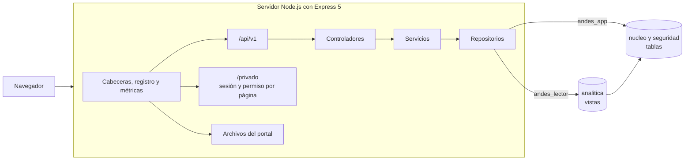
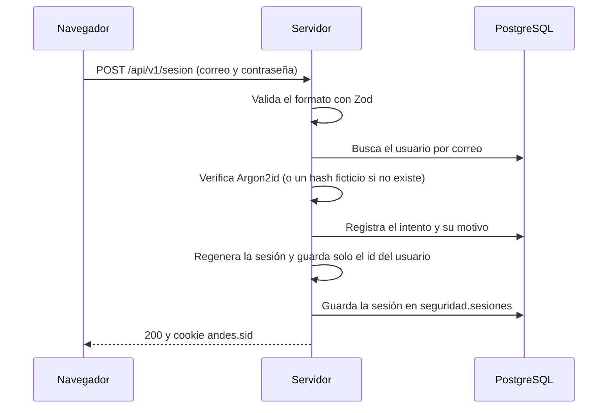
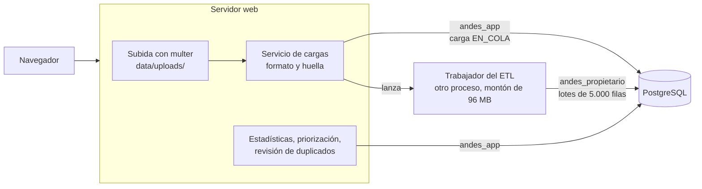

# Arquitectura del backend

Documento de las fases 3 y 4. Explica cómo está construido el servidor, cómo viaja una solicitud, cómo se protegen la sesión y los datos, y qué se comprobó. La base de datos está en [DATABASE.md](DATABASE.md), el contrato de cada ruta en [API.md](API.md), el proceso de carga en [ETL.md](ETL.md) y los algoritmos en [ALGORITHMS.md](ALGORITHMS.md). Las secciones 1 a 14 describen la fase 3; la 15, lo que agregó la fase 4.

## 1. Qué entrega la fase 3

| Entregable | Estado |
|---|---|
| PostgreSQL 18 en Docker, con tres esquemas y tres cuentas de privilegio mínimo | Construido |
| Migraciones versionadas y semillas con las cifras oficiales de la fase 2 | Construidas |
| API REST pública de solo lectura, que el portal consume en lugar de los archivos JSON | Construida |
| Autenticación con sesiones guardadas en el servidor y contraseñas Argon2id | Construida |
| Cuatro roles y siete permisos, verificados en cada ruta y en cada página privada | Construidos |
| API privada de administración e ingeniería | Construida |
| Páginas privadas reales: administración, calidad de datos y panel de ingeniería | Construidas |
| Auditoría encadenada con hash y registro de accesos | Construidos |
| Pruebas unitarias y de integración contra una base de datos real | 502 pruebas aprobadas |

Criterio de salida de la fase: los endpoints están probados y los privados rechazan las solicitudes sin sesión. Las secciones 13 y 14 detallan la verificación y lo que queda pendiente.

## 2. Vista general

El servidor es un monolito modular, como propuso la decisión D1. Una sola aplicación entrega el portal, las páginas privadas y la API.

## 3. Capas y carpetas

| Carpeta | Responsabilidad | No hace |
|---|---|---|
| `backend/src/config/` | Lee y valida el entorno, crea los grupos de conexiones y el registro | No conoce rutas ni reglas de negocio |
| `backend/src/routes/` | Declara cada ruta con su validación y su permiso | No consulta la base de datos |
| `backend/src/controllers/` | Traduce la solicitud validada en una llamada al servicio y su resultado en JSON | No decide permisos ni arma consultas |
| `backend/src/services/` | Reglas de negocio y forma de las respuestas | No conoce Express |
| `backend/src/repositories/` | SQL explícito y parametrizado | No transforma los datos para la interfaz |
| `backend/src/models/` | Esquemas Zod de cada entrada y dimensiones de la agregación | |
| `backend/src/middlewares/` | Sesión, autorización, validación, seguridad, métricas, límites y errores | |
| `backend/src/algorithms/` | Los siete algoritmos y sus estructuras de datos | No depende de nada del servidor |
| `backend/src/utils/` | Errores HTTP y anillo de capacidad fija | |
| `etl/` | Definiciones YAML, lectores, validación, carga por lotes, duplicados, agregados, cola y trabajador | No atiende solicitudes HTTP |

Las dependencias van en un solo sentido: rutas, controladores, servicios y repositorios. `crearAplicacion` recibe la configuración, las conexiones, el registro, las métricas y los límites, y arma todo lo demás. Por eso las pruebas pueden crear una aplicación con una base de datos de prueba o con límites distintos sin modificar el código.

## 4. Recorrido de una solicitud

| Orden | Paso | Para qué |
|---|---|---|
| 1 | Helmet | Cabeceras de seguridad y política de contenido |
| 2 | pino-http | Una línea de registro en JSON por solicitud |
| 3 | Métricas en `/api` | Duración y estado por patrón de ruta |
| 4 | Límite de solicitudes | 300 por minuto y por dirección IP en toda la API |
| 5 | Verificación del origen | Rechaza los métodos que escriben si vienen de otro sitio |
| 6 | Lectura del cuerpo JSON | Hasta 20 kB |
| 7 | Rutas de sesión, administración e ingeniería | `Cache-Control: no-store`, sesión, carga del usuario y, en las dos últimas, sesión obligatoria |
| 8 | Rutas públicas | `Cache-Control: no-cache` con ETag, de modo que el navegador revalida y recibe 304 si nada cambió |
| 9 | Ruta inexistente | 404 en formato de problema |
| 10 | Manejador de errores | Convierte cualquier error en `application/problem+json` |

Las páginas privadas siguen otro camino: sesión, carga del usuario, protección de páginas y, solo si todo pasa, el archivo HTML.

## 5. Cuentas de base de datos

| Cuenta | Usa | Puede |
|---|---|---|
| `andes_propietario` | Migraciones, semillas, el comando `usuarios:crear` y el trabajador del ETL | Todo sobre los objetos del proyecto |
| `andes_app` | API privada y sesiones | Leer las tablas, editar solo los campos descriptivos de una fuente, guardar sesiones, insertar accesos, registrar auditoría por medio de una función, encolar cargas, decidir sobre duplicados y sumar sus agregados |
| `andes_lector` | API pública | Leer las vistas de `analitica`. Nada más. |

La API pública no puede devolver una tabla de `nucleo` ni un usuario aunque una consulta tuviera un defecto, porque su cuenta no tiene permiso. Las pruebas de `tests/integration/privilegios.test.js` lo comprueban sentencia por sentencia. [DATABASE.md](DATABASE.md) lista cada permiso.

## 6. Autenticación y sesiones

- **Sin pistas para quien adivina.** Un correo inexistente, una contraseña incorrecta y una cuenta desactivada reciben la misma respuesta 401. Si el correo no existe, el servidor verifica igual un hash ficticio, para que el tiempo de respuesta no revele qué cuentas existen. El motivo real queda solo en el registro de accesos.
- **Sesión nueva en cada ingreso.** La sesión se regenera al iniciar, lo que impide fijar de antemano un identificador ajeno.
- **Permisos siempre frescos.** Cada solicitud privada vuelve a leer el usuario, su rol y sus permisos. Si una cuenta se desactiva, su sesión se destruye en la siguiente solicitud.
- **Cookie protegida.** `andes.sid` es `HttpOnly` y `SameSite=Strict`, y `Secure` en producción. Dura 8 horas y se renueva con el uso.
- **Sesiones en PostgreSQL.** Sobreviven a un reinicio del servidor y se pueden revocar borrando su fila. Las vencidas se eliminan cada 15 minutos.
- **Cierre de sesión real.** `DELETE /api/v1/sesion` registra el cierre, destruye la sesión en la base de datos y borra la cookie. Una copia de la cookie deja de servir en ese momento.

## 7. Autorización

Los permisos se declaran en `config/roles.yml` y las semillas los copian a la base de datos.

| Permiso | Analista | Administrador de datos | Ingeniero | Superadministrador |
|---|---|---|---|---|
| `datos:consultar` | Sí | Sí | Sí | Sí |
| `datos:importar` | No | Sí | No | Sí |
| `datos:editar` | No | Sí | No | Sí |
| `priorizacion:usar` | Sí | Sí | No | Sí |
| `sistema:ver` | No | No | Sí | Sí |
| `auditoria:ver` | No | No | Sí | Sí |
| `usuarios:administrar` | No | No | No | Sí |

- **Negar por defecto en la API.** Todo lo que está bajo `/api/v1/admin` y `/api/v1/ingenieria` exige sesión antes de buscar la ruta. Una persona sin sesión recibe 401 incluso en rutas que no existen, así no puede averiguar cuáles existen. Después, cada ruta declara su permiso.
- **Negar por defecto en las páginas.** Solo hay tres páginas privadas declaradas, cada una con su permiso. Cualquier otra dirección bajo `/privado` responde 404. Antes de buscar la página, la dirección se decodifica, se pasa a minúsculas y se le quitan las barras finales y la extensión `.html`. Así `/privado/ADMINISTRACION` o `/privado/administraci%6Fn` no esquivan la protección en un sistema de archivos que no distingue mayúsculas.
- **Recursos libres acotados.** Sin sesión solo se entregan la página de acceso y los archivos `.css` y `.js` del entorno privado, que no contienen datos. El patrón no admite segmentos `..`.
- **Redirección segura.** Sin sesión, una página privada redirige con 303 a `/privado/?siguiente=…`. Después del ingreso, la interfaz solo vuelve a una de las tres páginas declaradas que el rol pueda ver. Cualquier otro valor de `siguiente`, como un dominio externo, lleva a la primera página permitida.
- **La interfaz no es la defensa.** Los menús ocultan lo que el rol no puede usar, pero quien decide es el servidor.

## 8. Protecciones HTTP

| Riesgo | Control |
|---|---|
| Inyección de código en el navegador | Política de contenido con `default-src 'self'`. Los estilos admiten `'unsafe-inline'` porque ECharts y Leaflet generan estilos en línea al dibujar. |
| Falsificación de solicitudes | Cookie `SameSite=Strict` y verificación del origen en todo método que escribe: si llega `Origin`, su anfitrión debe ser el del servidor; si no llega, se rechaza `Sec-Fetch-Site: cross-site`. |
| Fuerza bruta | 10 intentos fallidos de ingreso cada 15 minutos por dirección IP. Los ingresos correctos no cuentan. |
| Abuso de la API | 300 solicitudes por minuto por dirección IP. |
| Cuerpos enormes | Límite de 20 kB y respuesta 413. |
| Inyección SQL | Toda consulta es parametrizada. Los nombres de columna que se editan salen de una lista fija en el repositorio. |
| Fuga de detalles internos | Un error inesperado responde con un mensaje genérico. El detalle queda en el registro del servidor. |
| Tecnología expuesta | Sin cabecera `X-Powered-By`. |
| Conexión sin cifrar | En producción: cookie `Secure`, HSTS de un año y `upgrade-insecure-requests`. |

## 9. Validación y errores

Cada ruta declara un esquema Zod para sus parámetros, su consulta y su cuerpo. Los esquemas rechazan los campos que no esperan, de modo que nadie puede enviar `origen` o `rol` aunque la base de datos los tenga. Los mensajes están en español, y los de longitud se escribieron a mano para que se entiendan sin conocer la biblioteca.

Todos los errores siguen el formato `application/problem+json` del RFC 9457 y llevan un código estable en el miembro `codigo`. La lista completa está en [API.md](API.md#6-errores).

## 10. Métricas y registro

**Registro.** pino escribe una línea JSON por evento, con la ruta, el estado y la duración de cada solicitud. Las pruebas lo silencian.

**Métricas por ruta.** Se guardan en memoria y alimentan el panel de ingeniería.

| Dato | Cómo se calcula | Costo |
|---|---|---|
| Solicitudes y errores por ruta | Contadores en un `Map`. Solo los estados 500 o mayores cuentan como error. | O(1) por solicitud |
| Promedio por ruta | Suma de duraciones dividida entre el número de solicitudes | O(1) por solicitud |
| Percentil 95 | Método del rango más cercano sobre las últimas 500 duraciones de cada ruta, guardadas en un anillo de capacidad fija | O(m log m) al consultar, con m ≤ 500 |
| Diez rutas más frecuentes | Montículo mínimo de tamaño diez | O(n log k) con n rutas y k = 10 |
| Errores recientes | Anillo con los últimos 20 | O(1) por error |

**Patrones de ruta, no direcciones.** Las métricas agrupan por la ruta declarada, como `GET /api/v1/eventos/:evento/territorio`, y nunca por la dirección que escribió el cliente. Una solicitud que no llega a ninguna ruta se agrupa por el punto de montaje más profundo que alcanzó, como `GET /api/v1/admin/*`. Así nadie puede hacer crecer la memoria del servidor inventando direcciones.

Express restaura `req.baseUrl` cuando un error sale de un enrutador, de modo que al terminar la respuesta ya no se sabe bajo qué prefijo coincidió la ruta. Por eso `seguirEnrutamiento`, en `middlewares/metricas.js`, observa las asignaciones a `req.baseUrl` y `req.route` en el momento en que Express las hace y guarda el patrón completo.

**Retardo del ciclo de eventos.** Se mide con `monitorEventLoopDelay` de Node.js, que toma una muestra cada 20 ms. Su histograma registra el intervalo completo entre muestras, así que el servidor resta esos 20 ms para informar solo el retraso. Antes de la primera muestra informa «Sin dato».

**Límites conocidos.** Las métricas viven en la memoria de un proceso: se reinician con el servidor y no se comparten entre varias instancias.

## 11. Configuración

El servidor valida el entorno con Zod al arrancar. Si falta una variable o tiene un formato inválido, se detiene con un mensaje que nombra la variable sin mostrar su valor. La configuración resultante queda congelada. Las variables están en el [README](../README.md#configuración).

## 12. Decisiones de la fase 3

| Decisión | Razón |
|---|---|
| Sesiones en PostgreSQL | Se revocan al instante y sobreviven a un reinicio, como pedía la decisión D4 de la propuesta. |
| Tres cuentas de base de datos | Un defecto en la API pública no puede alcanzar datos que su cuenta no ve. |
| Migraciones en archivos `.up.sql` y `.down.sql` separados | El formato de un solo archivo de node-pg-migrate exige marcadores con forma de comentario, que la regla del proyecto prohíbe. |
| La API pública conserva la forma de los archivos de la fase 2 | El portal pasó a la API sin cambiar su lógica. La procedencia sigue en cada cifra: cada punto de una serie cita su fuente y su fecha de corte. Ver [API.md](API.md#8-diferencias-con-la-propuesta). |
| Paginación por clave en lugar de `OFFSET` | Cada página cuesta lo mismo sin importar cuán lejos esté, y no repite ni salta filas si llegan datos nuevos. |
| Métricas por patrón de ruta | La propuesta hablaba de ruta y parámetros. Contar parámetros deja crecer la memoria sin límite. |
| Límite de intentos por dirección IP, no por cuenta | Bloquear una cuenta tras varios fallos permite que cualquiera la bloquee a propósito. El límite por cuenta queda por decidir en la fase 6. |

## 13. Verificación realizada

**Pruebas automáticas** del 18 de noviembre de 2026: 502 pruebas en 23 archivos, todas aprobadas.

| Grupo | Archivos | Pruebas | Qué cubre |
|---|---|---|---|
| Unitarias | 15 | 321 | Algoritmos, métricas, configuración, validación, errores, protección de páginas, cliente de la API, navegación privada, formato, datos y ETL |
| Integración | 8 | 181 | API pública comparada con las semillas, sesión, matriz de rol por ruta, administración, ingeniería, privilegios de la base de datos, alta de usuarios y servidor |

Las pruebas de integración crean una base de datos `andes_pruebas` desde cero en cada ejecución, con las migraciones y semillas reales.

**Las pruebas detectan fallos reales.** Se introdujeron a propósito dos defectos de seguridad y se confirmó que las pruebas fallan: quitar la decodificación de la dirección en la protección de páginas y desactivar la verificación del origen. Los archivos se restauraron después.

**Verificación en el navegador**, el 18 de noviembre de 2026, en el navegador integrado basado en Chromium:

| Comprobación | Resultado |
|---|---|
| Las diez páginas públicas en ambos modos, con los datos servidos por la API | Sin errores de JavaScript ni respuestas 4xx o 5xx. Las recargas reciben 304. |
| Página privada sin sesión | Redirige al acceso con la página pedida |
| Contraseña incorrecta | Mensaje genérico, sin revelar si el correo existe |
| Ingreso del ingeniero | Llega a la página pedida y ve las tres secciones |
| Ingreso del analista | Ve solo administración y calidad, las fuentes en modo de lectura y la página 403 en ingeniería |
| Ingreso del administrador de datos | Ve el formulario de fuentes. Un cambio de prueba y su reversión quedaron en el historial, y la cadena de auditoría siguió íntegra. |
| Cierre de sesión | La cookie anterior responde 401 y la tabla de sesiones quedó vacía |
| Filtros y paginación del explorador | 14 municipios con Risaralda. «Cargar más» pasa de 25 a 50 filas sin repetir y en orden DIVIPOLA. |
| Calidad de datos | 13, 27 y 51 municipios por regla, y 470 sin dato de fallecidos, iguales a la semilla |
| Ancho de 375 y de 1.366 píxeles | Sin desplazamiento horizontal de la página |

Para no escribir la contraseña de los usuarios de demostración en el navegador, las sesiones de esta verificación se abrieron desde la terminal con la clave del archivo `.env` y se cerraron desde la interfaz al terminar.

**Defectos encontrados y corregidos durante la verificación:**

- Las páginas privadas quedaban en blanco debajo de la cabecera por un error al montar el marco (`HierarchyRequestError`).
- El retardo del ciclo de eventos sumaba los 20 ms del intervalo de muestreo, y el percentil 99 mostraba 0 antes de la primera muestra.
- Las tarjetas de estado del panel de ingeniería se estiraban por un `flex-basis` pensado para una fila.
- Las solicitudes rechazadas se agrupaban en las métricas con un prefijo incompleto o como «ruta inexistente».
- `formatearDuracion` mostraba «60 s» con 59,99 segundos y «1 d 0 min» con un día exacto.
- Los formularios privados mostraban solo el mensaje general de un error de validación y no el motivo de cada campo.
- `usuarios:crear` registraba «CREAR» en la auditoría también cuando el correo ya existía y el usuario solo se actualizaba.

## 14. Lo que esta fase no cubre

- La importación de archivos, el esquema `staging`, los errores por fila, la detección de duplicados y la edición de registros llegan con el ETL de la fase 4.
- Los usuarios se crean con `npm run usuarios:crear`. No hay pantalla de administración de usuarios.
- No hay comprobación periódica de las API externas en el panel de ingeniería.
- El contrato OpenAPI en YAML que menciona la propuesta y los registros de decisión en `docs/adr/` quedan para la fase 6.
- Detrás de un proxy inverso habría que configurar `trust proxy` en Express. Sin eso, el límite por dirección IP vería la dirección del proxy.
- No se probó en Firefox ni en Safari, y no hubo pruebas de carga.

## 15. Fase 4: procesamiento de datos

### 15.1 Qué entrega

| Entregable | Estado |
|---|---|
| ETL de CSV, JSON y JSON Lines con definiciones YAML, validación por campo, reglas de negocio y filas rechazadas con su motivo | Construido. Ver [ETL.md](ETL.md). |
| Los siete algoritmos con sus pruebas y su medición | Construidos. Ver [ALGORITHMS.md](ALGORITHMS.md). |
| Generador de registros simulados con defectos conocidos y manifiesto | Construido |
| Importación desde el entorno privado, con cola y trabajador en otro proceso | Construida |
| Revisión de filas rechazadas y de duplicados en la página de calidad | Construida |
| Consultas estadísticas de población y aseguramiento, priorización y búsqueda de municipios | Construidas |
| Carga de un millón de filas | 14.576 filas por segundo y 259,6 MB, con conteos exactos |
| Pruebas | 903 pruebas aprobadas |

### 15.2 Procesos

El servidor web nunca procesa un archivo. Guarda el archivo, comprueba su extensión y su huella, inserta la carga en cola y lanza el trabajador si no hay uno activo. El trabajador corre con la cuenta dueña del esquema, la única que puede escribir registros. Si se cae, el servidor sigue atendiendo, y la carga se reanuda la próxima vez que el trabajador arranque.

### 15.3 Capas nuevas

| Archivo | Responsabilidad |
|---|---|
| `middlewares/archivos.js` | multer con almacenamiento en disco, nombres UUID, un solo archivo, límite de tamaño y filtro de extensión. Borra el archivo si cualquier paso posterior de la ruta falla. |
| `services/cargas.js` | Valida el conjunto y el formato, calcula la huella, rechaza los archivos repetidos, encola y lanza el trabajador. Lee las filas rechazadas con el contenido oculto y en el orden de la definición. |
| `services/duplicados.js` y `repositories/duplicados.js` | Cola de revisión con grupos calculados con conjuntos disjuntos, y la decisión en una transacción con bloqueo de fila, auditoría y suma de agregados |
| `services/estadisticas.js` y `repositories/estadisticas.js` | Población, aseguramiento y priorización a partir de `analitica.agregados` y del reporte oficial |
| `services/trabajador.js` | Lanza `etl/cli.js trabajar` como proceso hijo y lo vuelve a lanzar si llegó otra carga mientras trabajaba |
| `config/priorizacion.js` | Lee y valida `config/priorizacion.yml` con Zod |
| `models/dimensiones.js` | Las dimensiones de agregación de personas y viviendas y las consultas que las alimentan, compartidas por el ETL y la API |

### 15.4 Decisiones de la fase 4

| Decisión | Razón |
|---|---|
| El ETL corre en un proceso aparte, con la cuenta dueña | Un archivo grande no bloquea el servidor web, y la cuenta de la API no puede escribir registros aunque tenga un defecto. |
| Cola en la tabla de cargas, con `FOR UPDATE SKIP LOCKED` | No hace falta un servicio de colas. La misma tabla guarda la procedencia de cada carga. |
| Los duplicados probables nunca se fusionan solos | Una fusión equivocada borra a una persona de las estadísticas. La decisión es humana y queda auditada. |
| Los registros en revisión no cuentan en las estadísticas | Contarlos inflaría la afectación, que es justo el error que la detección quiere evitar. |
| Agregados incrementales y un recálculo completo que debe dar lo mismo | Cada carga suma lo suyo sin releer las anteriores, y `reagregar` permite comprobarlo o reparar la tabla. |
| Las estadísticas privadas no suprimen celdas pequeñas | Son internas. La supresión de celdas con menos de diez registros se aplica al publicarlas en el portal, en la fase 5. |
| La priorización usa los pesos del YAML | La pantalla para ajustarlos es el laboratorio de la fase 5. La ruta ya devuelve el desglose que esa pantalla necesita. |

### 15.5 Verificación

**Pruebas automáticas** del 19 de noviembre de 2026: 903 pruebas en 42 archivos, todas aprobadas, con el formato y la revisión de estilo sin hallazgos.

| Grupo | Archivos | Pruebas |
|---|---|---|
| Unitarias | 32 | 635 |
| Integración | 10 | 268 |

Las pruebas de integración del ETL y de las cargas crean sus propias bases de datos, `andes_pruebas_etl` y `andes_pruebas_cargas`, para no alterar los conteos que verifican las demás.

**Verificación en el navegador**, el 19 de noviembre de 2026, con el servidor de desarrollo y su trabajador:

| Comprobación | Resultado |
|---|---|
| Importar el archivo de prueba con un error de cada tipo | Carga terminada: 15 filas leídas, 7 válidas, 8 rechazadas, 1 duplicado exacto y 2 registros en revisión |
| Volver a subir el mismo archivo con otro nombre | «Este archivo ya se cargó en la ejecución 12» |
| Seguir una carga de 60.000 filas | El mensaje avanzó de 0 a 55.000 filas confirmadas, con el botón desactivado, hasta terminar |
| Enlace de la tabla de cargas a las filas rechazadas | Abre la página de calidad en la carga elegida, a la altura de la sección |
| Filas rechazadas | Cada fila con sus motivos y su contenido, con el documento oculto (`•••002`, `•••ABC`) |
| «Es el mismo» y «Son distintos» | La celda muestra el resultado y el resumen de pares pendientes baja en uno |
| Filtro de pares por estado | El par fusionado aparece con su fecha |
| Analista | Sin formulario de importación y sin cola de duplicados, con el aviso de su rol |
| Ancho de 375 píxeles | Sin desplazamiento horizontal de la página. Las tablas anchas se desplazan dentro de su región. |

**Defectos encontrados y corregidos durante la verificación y las pruebas:**

- Las filas rechazadas se guardaban con el documento original, y los mensajes de error de formato lo repetían.
- Si la validación del cuerpo de una subida fallaba, el archivo ya guardado se quedaba en disco.
- El límite de 1 MB de los lectores de JSON solo se comprobaba entre fragmentos de lectura: un objeto que terminaba dentro del último fragmento pasaba.
- Un CSV que mezclaba finales de línea LF y CRLF dejaba un retorno de carro en el último campo.
- El mensaje de una carga decía «1 duplicados exactos descartados» y no separaba los miles.
- El encabezado fijo tapaba el título de la sección a la que lleva un enlace.
- El contenido de una fila rechazada salía en el orden interno de `jsonb` y no en el del archivo.
- El trie ordenaba los hijos de cada nodo en cada visita; corregirlo y quitar el generador bajó el costo por consulta a menos de la mitad.

### 15.6 Lo que la fase 4 no cubre

- Las pantallas que usan las estadísticas, la priorización y la búsqueda de municipios: modelo en estrella, laboratorio de priorización y Power BI son de la fase 5, que también trajo la supresión de celdas pequeñas (sección 16).
- La edición manual de un registro individual. Hoy un registro solo cambia por una decisión sobre duplicados.
- Deshacer una fusión desde la interfaz. Queda en la auditoría y se puede revertir en la base de datos.
- Los tres hallazgos moderados de `npm audit` en node-pg-migrate, que se revisarán en la fase 6. Ver [ETL.md](ETL.md#14-decisiones-y-diferencias-con-la-propuesta).

## 16. Fase 5: inteligencia de negocios

### 16.1 Qué entrega

- **Indicadores clave.** `config/kpi.yml` define 13 cocientes, validados con Zod al primer uso: 8 con cifras oficiales y 5 con los registros simulados. `GET /api/v1/eventos/:evento/kpi` los calcula con su calificador, sus fuentes y su variación entre cortes, y el panorama nacional los muestra en tarjetas.
- **Visualizaciones conectadas a los datos.** `GET /api/v1/eventos/:evento/registros/poblacion` y `/registros/viviendas` arman, desde los agregados del ETL, lo que antes salía de dos archivos JSON fijos. En modo de demostración, las páginas de población y vivienda leen esas rutas.
- **Comparación.** La página pública `/comparar` pone dos departamentos lado a lado, ordena los departamentos por cada variable y compara los balances nacionales entre cortes.
- **Laboratorio de priorización.** La página privada `/privado/priorizacion`, con el permiso `priorizacion:usar`, ajusta los pesos de los criterios y muestra el aporte de cada uno y el cambio de puesto de cada zona.
- **Modelo en estrella y Power BI.** El esquema `bi` (migración 0008), la cuenta `powerbi_lector`, 40 medidas DAX, la consulta que las crea de una vez y la exportación a CSV. Ver [POWERBI.md](POWERBI.md).

### 16.2 Capas nuevas

| Capa | Archivo | Responsabilidad |
|---|---|---|
| Configuración | `config/kpi.js` | Lee y valida `config/kpi.yml`. Cada lado de un cociente tiene exactamente un ingrediente: `indicador`, `territorial`, `agregado` o `cruce`. |
| Repositorios | `repositories/kpi.js`, `repositories/registros.js` | Consultas con la cuenta pública a las vistas de `analitica` |
| Servicios | `services/kpi.js`, `services/registros.js` | Cálculo de los indicadores clave y armado de las distribuciones de registros |
| Servicios | `services/publicables.js` | Lector de agregados, catálogo de categorías, índice de cruces y tablas protegidas. Es el único lugar que decide qué celda de los registros se publica. |
| Algoritmos | `algorithms/supresion.js` | Supresión complementaria en particiones y en matrices. Ver [ALGORITHMS.md](ALGORITHMS.md#supresión-de-celdas-pequeñas). |
| Analítica | `analytics/powerbi/` | Medidas DAX, su lector y revisor, y la exportación del modelo |

### 16.3 Decisiones de la fase 5

| Decisión | Razón |
|---|---|
| Los indicadores clave se definen en YAML y no en código | Agregar o corregir un cociente no exige programar, y las pruebas comprueban que cada uno tiene su medida DAX con el mismo nombre. |
| Un indicador clave nunca mezcla cifras oficiales con simuladas | El esquema de configuración lo impide. Así el sello de cada tarjeta es verdadero. |
| Los indicadores de severidad son neutrales | Entre balances, la proporción de viviendas destruidas cae porque llegan más reportes de averías, no porque la situación mejore. Llamarlo «mejora» sería engañoso. |
| El portal público no lee el esquema `bi` | El modelo en estrella tiene celdas de una sola persona. El portal lee `agregados_publicables` y `cruces_publicables`, que solo tienen niveles nacional y departamental y ocultan las celdas pequeñas. |
| Supresión complementaria en el servidor | La vista hace la supresión primaria; la complementaria necesita ver la partición o el cruce completo, y eso es más claro en JavaScript que en SQL. |
| Una sola fuente de celdas protegidas | El primer borrador calculaba los indicadores clave con los cruces sin protección complementaria. En la base de desarrollo, «viviendas destruidas que tenían póliza» publicaba 43, una celda que la tabla de registros ocultaba como complemento, y con los márgenes publicados se despejaba una celda de 3 viviendas. Ahora los dos servicios usan las mismas tablas protegidas. |
| Cruce de estado físico y ocupación aparte del cubo | Responde cuántas viviendas propias y arrendadas resultaron afectadas con 36 celdas por territorio en lugar de multiplicar el cubo por seis. |
| Los indicadores de vivienda del modo de demostración salen de los registros | El archivo `simulado/indicadores.json` ya no los trae. Si una cifra queda oculta, la tarjeta dice «Información no disponible» en lugar de caer en un valor de otra muestra. |
| Los pesos personalizados van en la consulta | El cálculo no guarda nada, así que una URL basta para repetirlo, y el laboratorio no necesita permiso de escritura. |

### 16.4 Verificación

- Pruebas: 1.031 en 51 archivos, 716 unitarias y 315 de integración. Las nuevas cubren la supresión con propiedades de fast-check, los indicadores clave, los registros, las medidas DAX, la comparación, los pesos y, en `tests/integration/inteligencia.test.js`, el modelo en estrella, la cuenta de Power BI, la exportación y la regla RNF-06 recorriendo cada número que publica la API.
- Las pruebas encontraron dos errores antes de publicarlos: el lector de medidas no aceptaba nombres de una letra, y la API de priorización mezclaba pesos en escala de 0 a 100 con los configurados en escala de 0 a 1 cuando solo llegaban algunos.
- Revisión en el navegador, en escritorio y a 375 px: las tarjetas de indicadores clave en los dos modos, las páginas de población y vivienda con los registros de la base, la comparación con su cambio de departamento y su URL, y el laboratorio con una sesión de analista, que se cerró al terminar.
- Los indicadores clave oficiales coinciden con un cálculo independiente en SQL y con los valores de referencia de [POWERBI.md](POWERBI.md#8-indicadores-clave-y-valores-de-referencia). Las medidas DAX equivalentes no se pudieron ejecutar sin Power BI.
- `npm run datos:demostracion` cargó 50.000 viviendas en 5,6 s, a 8.937 filas por segundo y con 246,5 MB de memoria máxima.
- Lint, formato y verificación de comentarios sin hallazgos.

### 16.5 Lo que la fase 5 no cubre

- El archivo `.pbix`: Power BI Desktop necesita Windows (decisión B7). Las medidas se validaron contra el modelo con pruebas automáticas, pero no se ejecutaron en Power BI.
- La comprobación automática de que la cuenta de Power BI es de solo lectura al iniciar sesión. Se comprobó a mano (`25006` al crear una tabla temporal); las pruebas verifican sus privilegios con `SET ROLE`.
- El hecho de atención y suministros, porque no hay fuente.
- Una granularidad más gruesa del modelo en estrella para datos reales. Ver [POWERBI.md](POWERBI.md#10-privacidad).

## 17. Fase 6: calidad y documentación

La fase 6 verificó los requisitos no funcionales y corrigió lo que la verificación encontró. El estado de cada requisito está en [VERIFICACION.md](VERIFICACION.md).

| Tema | Qué se hizo | Documento |
|---|---|---|
| Rendimiento | Medición de las 12 rutas públicas con un millón de registros, comparación de planes de consulta y gráficas de todas las mediciones. La medición encontró una vista que costaba 463 ms y la corrigió. | [RENDIMIENTO.md](RENDIMIENTO.md) |
| Seguridad | Revisión de código, encabezados, sesiones, SQL y dependencias. Nueva variable `PROXIES_DE_CONFIANZA`, escape de los textos en las ventanas de información de las gráficas y `npm audit` sin hallazgos. | [SEGURIDAD.md](SEGURIDAD.md) |
| Pruebas | Cobertura con umbrales que hacen fallar la suite, un proyecto de pruebas de interfaz con happy-dom, pruebas de contrato, de encabezados, de límite de solicitudes, de despliegue detrás de un proxy y de la carga del reporte oficial del DANE. | [CONTRIBUTING.md](CONTRIBUTING.md#6-pruebas) |
| Contrato | OpenAPI 3.1 con las 37 rutas, comprobado contra el servidor y contra las respuestas públicas. | [openapi.yml](openapi.yml) |
| Accesibilidad | Contraste de los colores como prueba automática y revisión de las 15 páginas a 360 y 1.920 píxeles: tablas de las gráficas, nombres accesibles, foco y recursos externos. | [VERIFICACION.md](VERIFICACION.md#2-requisitos-no-funcionales) |
| Funcionalidad pendiente | El buscador de municipios del mapa (RF-09), que usaba la API del trie pero no tenía pantalla, y la descarga en CSV (RF-16). | [FRONTEND.md](FRONTEND.md) |

### 17.1 Configuración nueva

| Variable | Por defecto | Para qué |
|---|---|---|
| `PROXIES_DE_CONFIANZA` | 0 | Número de proxies delante del servidor. Con un proxy que termina TLS debe ser 1: sin eso, en producción la cookie `Secure` no se emite y el límite de solicitudes ve a todos los usuarios como una sola IP. |

### 17.2 Lo que la fase 6 no cubre

- La prueba con lectores de pantalla y la ejecución en Windows y Linux.
- El informe `.pbix` (decisión B7).
- Los requisitos funcionales pendientes RF-24, RF-32, RF-33 y RF-39. Ver [VERIFICACION.md](VERIFICACION.md#4-pendientes-y-decisiones-abiertas).
