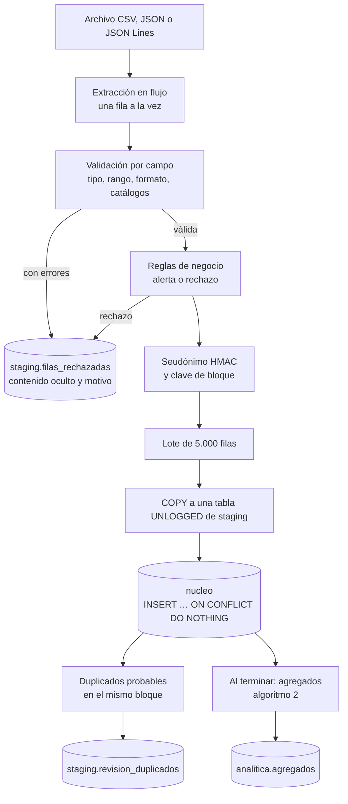
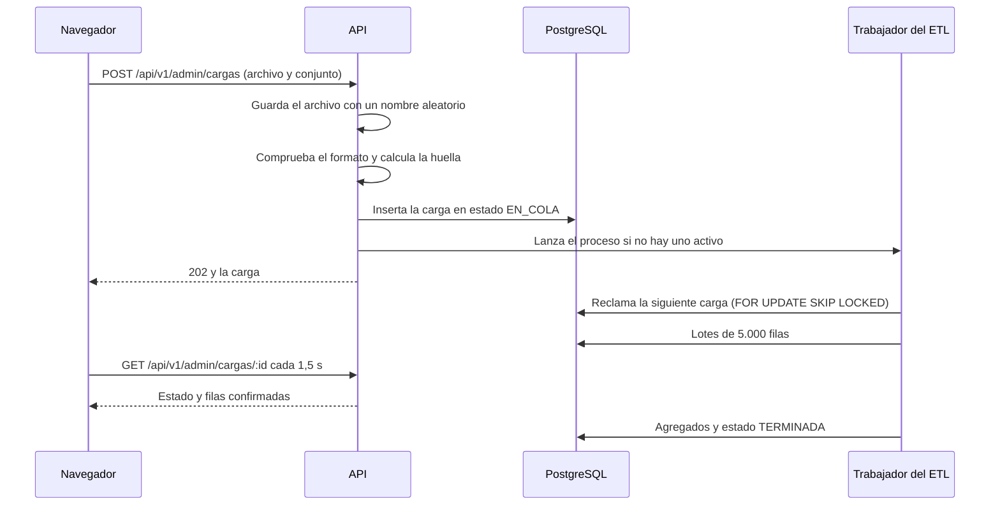

# Proceso de carga (ETL)

El ETL de ANDES lee archivos CSV, JSON y JSON Lines, valida cada fila, separa las que tienen errores, seudonimiza los identificadores, detecta duplicados y actualiza las estadísticas agregadas. Este documento explica cómo funciona, cómo se configura y qué garantías ofrece.

## Contenido

1. [Qué hace y qué no hace](#1-qué-hace-y-qué-no-hace)
2. [Recorrido de un archivo](#2-recorrido-de-un-archivo)
3. [Definiciones de conjuntos en YAML](#3-definiciones-de-conjuntos-en-yaml)
4. [Extracción](#4-extracción)
5. [Validación y limpieza](#5-validación-y-limpieza)
6. [Privacidad: seudónimos y ocultamiento](#6-privacidad-seudónimos-y-ocultamiento)
7. [Carga por lotes](#7-carga-por-lotes)
8. [Duplicados](#8-duplicados)
9. [Agregados](#9-agregados)
10. [Cola de cargas y trabajador](#10-cola-de-cargas-y-trabajador)
11. [Comandos](#11-comandos)
12. [Rendimiento](#12-rendimiento)
13. [Pruebas](#13-pruebas)
14. [Decisiones y diferencias con la propuesta](#14-decisiones-y-diferencias-con-la-propuesta)

## 1. Qué hace y qué no hace

| Hace | No hace |
|---|---|
| Lee archivos de hasta 250 MB sin cargarlos completos en memoria | No descarga datos de internet. Las descargas del DANE están en `etl/tareas/`. |
| Valida cada fila contra la definición YAML del conjunto | No corrige datos de forma silenciosa. Lo que normaliza está documentado y lo que no puede interpretar lo rechaza con su motivo. |
| Guarda aparte las filas rechazadas, con su número y su motivo | No detiene la carga por una fila mala. Solo un error de estructura del archivo completo la detiene. |
| Guarda los documentos como seudónimos HMAC-SHA256 | No guarda el número de documento ni lo muestra en los mensajes de error |
| Descarta los duplicados exactos y deja en revisión los probables | No fusiona registros parecidos por su cuenta |
| Reanuda una carga interrumpida desde la última fila confirmada | No vuelve a cargar un archivo idéntico a uno ya cargado |

## 2. Recorrido de un archivo



Cada lote se confirma en **una sola transacción**: los registros, sus tablas hijas, los pares en revisión, las filas rechazadas y los contadores de la carga. Si algo falla a mitad del lote, no queda nada a medias.

## 3. Definiciones de conjuntos en YAML

Cada conjunto de datos se describe en `etl/definiciones/<id>.yml`. El ETL valida la definición con Zod antes de leer una sola fila y se detiene si tiene errores.

| Definición | Destino | Origen | Formatos |
|---|---|---|---|
| `dane-afectaciones.yml` | Reportes por municipio | OFICIAL | JSON |
| `personas-simuladas.yml` | Personas afectadas | SIMULADO | CSV, JSON y JSON Lines |
| `viviendas-simuladas.yml` | Viviendas afectadas | SIMULADO | CSV, JSON y JSON Lines |

Estructura:

```yaml
id: personas-simuladas
nombre: Personas afectadas, registros simulados
descripcion: ...
fuente: generador-andes
origen: SIMULADO
destino: personas
evento: sismo-2026-08-10
version_esquema: 1
formatos: [csv, json, jsonl]
tamano_lote: 5000
campos:
  - nombre: documento
    tipo: texto
    obligatorio: true
    patron: '^[0-9]{5,12}$'
    seudonimizar: true
  - nombre: edad
    tipo: entero
    obligatorio: true
    minimo: 0
    maximo: 120
reglas:
  - codigo: EMBARAZO_SEXO_MASCULINO
    efecto: alerta
duplicados:
  umbral_duplicado: 0.92
  umbral_revision: 0.8
  pesos:
    nombre: 0.8
    sexo: 0.2
```

| Propiedad de un campo | Significado |
|---|---|
| `nombre` | Nombre del campo dentro de la plataforma |
| `origen` | Nombre de la columna en el archivo, si es distinto. Se compara sin distinguir mayúsculas ni espacios. |
| `tipo` | `texto`, `entero`, `decimal`, `categoria`, `lista`, `fecha` o `municipio` |
| `obligatorio` | Si falta, la fila se rechaza |
| `si_invalido` | `rechazar`, por defecto, o `anular`: el valor inválido de un campo opcional se guarda como vacío y la fila sigue |
| `minimo`, `maximo`, `longitud_maxima`, `patron` | Restricciones del valor |
| `valores` | Lista cerrada de códigos permitidos en las categorías y listas |
| `separador` | Separador de los elementos de una lista en CSV. Por defecto, `\|`. |
| `desde`, `hasta` | Límites de una fecha. Pueden ser una fecha fija o una referencia: `evento` (el día del sismo), `hoy` o `consulta` (la fecha de consulta de la fuente). |
| `seudonimizar` | El valor se reemplaza por su HMAC antes de guardarse |

La definición declara también los **marcadores de ausencia**: los textos que significan «sin dato», como vacío, `N/A`, `NA`, `No registra`, `Sin dato`, `NULL`, `Nulo` y `-`. Un marcador no es un cero: el campo queda vacío.

Cuando la carga empieza, el ETL comprueba que el evento y la fuente existan y que el origen de la definición coincida con el de la fuente. Una definición no puede declarar como oficial un conjunto cuya fuente es simulada.

## 4. Extracción

Los tres lectores son generadores asíncronos que entregan una fila a la vez, así que la memoria no depende del tamaño del archivo.

| Formato | Lector | Detalles |
|---|---|---|
| CSV | `etl/extractores/csv.js`, con csv-parse | Quita la marca de orden de bytes, admite finales de línea LF y CRLF aunque se mezclen, respeta comillas y saltos de línea dentro de un campo y normaliza los encabezados a minúsculas. Un registro no puede superar 64 kB. |
| JSON Lines | `etl/extractores/json.js` | Un objeto por línea. Omite las líneas vacías. Una línea no puede superar 1 MB. |
| Arreglo JSON | `etl/extractores/json.js` | Un separador propio recorre el archivo carácter por carácter, sigue la profundidad de llaves y corchetes, respeta las cadenas y sus escapes, y entrega cada objeto por separado. Un objeto no puede superar 1 MB. |

Hay dos clases de error:

- **Errores de fila**, que no detienen la carga: una fila con columnas de más o de menos (`COLUMNAS`), una línea que no es JSON válido (`JSON_INVALIDO`) o un elemento que no es un objeto (`JSON_NO_OBJETO`).
- **Errores de archivo**, que sí la detienen y la marcan como fallida: encabezados vacíos o repetidos, un archivo vacío, comillas sin cerrar, un arreglo JSON mal formado o un elemento de más de 1 MB.

## 5. Validación y limpieza

`etl/transformadores/campos.js` convierte cada valor según su tipo y acumula todos los errores de la fila, no solo el primero.

### Normalizaciones que se aplican

| Caso | Ejemplo | Resultado |
|---|---|---|
| Espacios alrededor | `" civil "` | `CIVIL` |
| Mayúsculas y tildes en categorías | `Reclusión`, `otra modalidad` | `RECLUSION`, `OTRA_MODALIDAD` |
| Municipio sin el cero inicial | `5001` | `05001` |
| Números escritos como texto | `"34"` en JSON | `34` |
| Marcadores de ausencia | `No registra` | vacío |
| Listas con separador | `discapacidad\| embarazo` | `["DISCAPACIDAD", "EMBARAZO"]` |

### Motivos de rechazo

| Código | Cuándo |
|---|---|
| `OBLIGATORIO` | Falta un campo obligatorio o solo trae un marcador de ausencia |
| `TIPO` | El valor no es un número entero o decimal válido |
| `RANGO` | El número o la fecha están fuera de los límites |
| `FORMATO` | El texto no cumple el patrón, o el código de municipio no tiene cuatro o cinco dígitos |
| `LONGITUD` | El texto supera la longitud máxima |
| `VALOR_NO_PERMITIDO` | La categoría o un elemento de la lista no está en el catálogo |
| `MUNICIPIO_INEXISTENTE` | El código no está en la DIVIPOLA |
| `FECHA_INVALIDA` | La fecha no existe, como el 30 de febrero, o no tiene el formato `AAAA-MM-DD` |
| `COLUMNAS`, `JSON_INVALIDO`, `JSON_NO_OBJETO` | Errores de estructura de la fila |
| `RECLAMACION_SIN_POLIZA`, `VALOR_APROBADO_INCOHERENTE` | Reglas de negocio de las viviendas con efecto de rechazo |

### Reglas de negocio

Las reglas viven en `etl/transformadores/reglas.js` y cada definición decide si una regla produce una **alerta** (la fila se carga y queda marcada) o un **rechazo**.

| Regla | Conjunto | Efecto |
|---|---|---|
| `EMBARAZO_SEXO_MASCULINO` | Personas | Alerta |
| `EMBARAZO_EDAD_IMPROBABLE` | Personas | Alerta |
| `RECLAMACION_SIN_POLIZA` | Viviendas | Rechazo |
| `VALOR_APROBADO_INCOHERENTE` | Viviendas | Rechazo |
| `HIPOTECA_SIN_SEGURO` | Viviendas | Alerta |
| `COSTO_SUPERIOR_AL_AVALUO` | Viviendas | Alerta |
| `EVALUACION_SIN_FECHA` | Viviendas | Alerta |
| `PERSONAS_MENOR_QUE_FAMILIAS` | Reportes oficiales | Alerta |
| `FECHA_REPORTE_INVALIDA` | Reportes oficiales | Alerta |

Después, cada fila válida pasa por la clasificación del algoritmo 1.

## 6. Privacidad: seudónimos y ocultamiento

- **Seudónimos.** Los campos marcados con `seudonimizar` se guardan como `HMAC-SHA256(SEUDONIMO_SECRETO, valor)` en hexadecimal. El mismo documento produce siempre el mismo seudónimo, lo que permite detectar duplicados exactos, pero sin el secreto no se puede recalcular ni revertir. El secreto vive en `.env`, debe tener al menos 32 caracteres y el ETL no carga datos con documentos si falta.
- **Filas rechazadas ocultas antes de guardarse.** El contenido original de una fila rechazada se guarda para que la persona que administra los datos entienda el error, pero el ETL lo oculta antes de escribirlo:
  - el valor de un campo seudonimizado se reemplaza por `•••` y sus tres últimos caracteres;
  - en las columnas que la definición no conoce y en las filas que no se pudieron interpretar, como un CSV con columnas de más o un JSON roto, se oculta toda secuencia de cinco o más dígitos, porque el sistema no puede saber cuál es el documento;
  - los mensajes de error de un campo seudonimizado no repiten su valor: «El valor •••ABC no tiene el formato esperado».
- **Doble barrera.** La API aplica el mismo ocultamiento al leer las filas rechazadas, para cubrir cualquier fila guardada antes de este cambio.
- **Acceso.** Las filas rechazadas y la cola de duplicados viven en el esquema `staging`, que la cuenta del portal público no puede leer. La cola de duplicados muestra nombres y direcciones normalizados, por eso solo la consultan los roles con permiso para editar datos.

## 7. Carga por lotes

Las filas se procesan en lotes de 5.000, configurables en la definición entre 1 y 50.000. Por cada lote:

1. Las filas válidas se copian con `COPY` a una tabla `UNLOGGED` de staging, `staging.personas` o `staging.viviendas`, que no escribe en el registro de transacciones.
2. `INSERT … SELECT … ON CONFLICT DO NOTHING RETURNING id` las pasa al esquema `nucleo`. Las que chocan con la restricción única (evento, seudónimo) son duplicados exactos y no vuelven en `RETURNING`.
3. Las tablas hijas (vulnerabilidades, afectación de la vivienda, aseguramiento, financiación, reclamación e indemnización) se arman en JavaScript con los identificadores devueltos y se insertan con `COPY` o `unnest`.
4. Se buscan los duplicados probables de los registros recién insertados, en su bloque.
5. Las filas rechazadas se copian a `staging.filas_rechazadas`, una fila por fila rechazada con la lista de sus errores.
6. Se actualizan los contadores de la carga y `filas_confirmadas`, el número de la última fila del lote.
7. `COMMIT`.

### Idempotencia y reanudación

- **Huella.** Antes de empezar se calcula el SHA-256 del archivo. Si el mismo conjunto ya tiene una carga terminada con esa huella, el ETL responde `YA_CARGADO` y no lee el archivo. El nombre del archivo no importa: dos copias con nombres distintos son el mismo archivo.
- **Reanudación.** Si una carga se interrumpe, queda `FALLIDA` o `EN_CURSO` con su `filas_confirmadas`. Al volver a ejecutarla con el mismo archivo, el ETL salta las filas ya confirmadas y continúa. Los contadores se acumulan y el resultado es idéntico al de una carga sin interrupción. Una prueba lo verifica interrumpiendo una carga de 1.200 filas después del primer lote de 500.
- **Exclusión.** Cada carga toma un candado consultivo de PostgreSQL (`pg_try_advisory_lock`). Dos procesos no pueden avanzar la misma carga a la vez.

### Procedencia de cada registro

Cada registro guarda su carga (`ejecucion_id`), su número de fila en el archivo, su fecha de captura, su fecha de carga, su fecha de actualización y su origen (`OFICIAL`, `ESTIMADO` o `SIMULADO`). La carga guarda el archivo, su huella, su formato, su tamaño, quién lo subió, el tamaño del lote, la duración, la memoria máxima y los conteos por resultado. La fuente guarda su nivel de confiabilidad.

## 8. Duplicados

| Nivel | Cómo se detecta | Qué pasa con el registro |
|---|---|---|
| Exacto | El mismo seudónimo en el mismo evento | Se descarta y se cuenta como duplicado |
| Clave natural | El mismo nombre o la misma dirección normalizados, en el mismo bloque | Queda `EN_REVISION`, con el motivo `CLAVE_NATURAL` |
| Probable | Similitud entre el umbral de revisión y 1, en el mismo bloque | Queda `EN_REVISION`, con el motivo `SIMILITUD` |

El bloque de una persona es su municipio, su edad y la inicial de su nombre normalizado. El de una vivienda es su municipio y las dos primeras palabras de su dirección normalizada, que suelen ser el tipo de vía y su número. Cada registro guarda su `clave_bloque` con un índice. Así, la búsqueda de candidatos incluye los registros de cargas anteriores sin recorrer la tabla completa. La comparación es la del [algoritmo 3](ALGORITHMS.md#algoritmo-3-detección-de-registros-duplicados).

Para las viviendas, los números de la dirección se comparan de forma exacta y el texto con distancia de edición. Así, «CL 10 # 5-20» y «CL 10 # 5-22» no se confunden: son casas vecinas, no la misma escrita de dos formas.

### Revisión humana

Un registro en revisión **no cuenta en las estadísticas**. En la página de calidad de datos, quien tiene el permiso `datos:editar` ve cada par con los dos registros, su similitud, el detalle por campo y el grupo que forma con otros pares. Hay dos decisiones:

- **«Es el mismo».** El registro queda `FUSIONADO` con el representante del grupo: si el candidato ya estaba fusionado con otro, se sigue la cadena hasta el registro vigente. Los demás pares pendientes del mismo registro se marcan `RESUELTO`. Las estadísticas no cambian.
- **«Son distintos».** El par queda `DISTINTO`. Si el registro no tiene otros pares pendientes, pasa a `VIGENTE` y se suma a las estadísticas en ese momento.

Cada decisión queda en la auditoría encadenada, con el estado anterior, el nuevo, la decisión y el usuario. No se puede decidir dos veces sobre el mismo par (`409 YA_DECIDIDO`) ni sobre un registro cuya carga sigue en curso (`409 CARGA_EN_CURSO`).

## 9. Agregados

Al terminar cada carga, el ETL agrega sus registros vigentes con el [algoritmo 2](ALGORITHMS.md#algoritmo-2-agrupación-y-agregación-de-estadísticas) y suma las celdas a `analitica.agregados`. La tabla guarda, por evento, origen, destino, nivel, territorio, dimensión y categoría, la cantidad y la suma.

| Destino | Dimensiones |
|---|---|
| Personas | `total`, `grupo_edad`, `quinquenio_sexo`, `sexo`, `condicion`, `grupo_condicion`, `tenencia`, `situacion`, `condicion_salud`, `vulnerabilidad`, `vulnerable` y `semana` |
| Viviendas | `total`, `cubo` (estado, aseguramiento, financiación y reclamación), `estado_ocupacion`, `estado_fisico`, `aseguramiento`, `financiacion`, `reclamacion`, `zona`, `estrato`, `ocupacion` y `semana` |

`estado_ocupacion` cruza el estado físico con la ocupación. Llegó en la fase 5 para responder cuántas viviendas propias y arrendadas resultaron afectadas sin agrandar el cubo: son 36 celdas por territorio, contra las 216 que costaría sumar la ocupación al cubo. Tras agregar una dimensión hay que ejecutar `npm run etl -- reagregar` una vez.

La suma incremental y el recálculo completo dan el mismo resultado:

```bash
npm run etl -- reagregar
```

`reagregar` borra y reconstruye los agregados de cada destino a partir de los registros vigentes de las cargas terminadas. Toma el mismo candado consultivo que la suma de una carga y que la decisión sobre un duplicado, y lee con aislamiento `REPEATABLE READ`. Así no cuenta dos veces una carga que termina mientras recalcula. Con las 589.690 personas de la base de desarrollo tardó 5,0 s.

## 10. Cola de cargas y trabajador



- **La API no procesa archivos.** Solo guarda el archivo en `data/uploads/` con un nombre UUID, comprueba la extensión y la huella e inserta la carga en cola. La cuenta de la aplicación puede insertar cargas, pero no escribir registros.
- **El trabajador es un proceso aparte**, `node --max-old-space-size=96 etl/cli.js trabajar`, que se conecta con la cuenta dueña del esquema. Si el proceso se cae, el servidor web sigue atendiendo.
- **Un solo trabajador a la vez**, garantizado con un candado consultivo. Si llega otra carga mientras trabaja, el servidor lo vuelve a lanzar al terminar.
- **Recuperación.** Al empezar, el trabajador devuelve a la cola las cargas `EN_CURSO` que ningún proceso tiene tomadas, y las reanuda.
- **Sin el trabajador.** Si faltan `BD_PROPIETARIO_CLAVE` o `SEUDONIMO_SECRETO`, el servidor no lanza el trabajador, la carga queda en cola y la interfaz lo avisa. `npm run etl -- trabajar` la procesa a mano.
- **Rutas seguras.** El trabajador solo abre archivos dentro de `data/` y `tests/fixtures/`.

## 11. Comandos

| Comando | Qué hace |
|---|---|
| `npm run etl -- conjuntos` | Lista las definiciones disponibles |
| `npm run etl -- cargar --conjunto personas-simuladas --archivo ruta.csv` | Carga un archivo directamente, sin pasar por la cola. Muestra el avance, la duración, el ritmo y la memoria máxima. |
| `npm run etl -- trabajar` | Procesa las cargas en cola |
| `npm run etl -- reagregar [--destino personas\|viviendas]` | Recalcula los agregados desde cero |
| `npm run datos:registros -- --tipo personas --cantidad 100000 --formato csv` | Genera registros simulados con defectos conocidos. Acepta `--tipo viviendas` o `ambos`, `--formato jsonl` o `json`, `--semilla N` y `--sin-defectos`. |
| `npm run medir:etl -- --cantidad 1000000` | Mide el ETL con un millón de filas en una base de datos aislada |

El generador escribe en `data/raw/generador-andes/` el archivo y, al lado, un manifiesto `.manifiesto.json` con lo que el ETL debe encontrar: filas, rechazos por motivo, normalizaciones, duplicados exactos y probables inyectados, filas válidas e insertadas, y la huella del archivo. Los identificadores dependen de la semilla, así que dos archivos con semillas distintas no comparten documentos.

## 12. Rendimiento

La propuesta fijó el criterio de salida de la fase en **cargar un millón de filas con al menos 10.000 filas por segundo y menos de 300 MB de memoria**. `npm run medir:etl` lo comprueba en una base de datos aislada, `andes_medicion`, que crea desde cero, para no tocar la de desarrollo.

| Medida | Resultado | Criterio |
|---|---|---|
| Archivo | `personas-1000000-s20260810.csv`, 111 MB | |
| Duración | 68,6 s | |
| Ritmo | **14.576 filas por segundo** | ≥ 10.000 |
| Memoria máxima del proceso | **259,6 MB** | < 300 MB |
| Conteos | Leídas, válidas, rechazadas, duplicados exactos e insertadas coinciden con el manifiesto | Exactos |

Equipo: Apple M4 con 16 GB, Node.js 24.15.0 y PostgreSQL 18.7 en Docker, el 19 de noviembre de 2026. El resultado completo está en `analytics/benchmarks/resultados/etl-personas-1000000.json`.

La medición se repitió tres veces con el mismo archivo:

| Medición | Ritmo | Memoria máxima |
|---|---|---|
| Antes de agregar el ocultamiento de filas rechazadas, el candado de agregados y la dimensión `vulnerable` | 13.714 filas/s | 229 MB |
| Con esos cambios, primera vez | 14.383 filas/s | 284,4 MB |
| Con esos cambios, segunda vez (la guardada) | 14.576 filas/s | 259,6 MB |

El ritmo es estable. La memoria varía entre mediciones porque es la memoria residente del proceso: además del montón de JavaScript, limitado a 96 MB, incluye los búferes del flujo del archivo y del protocolo de PostgreSQL, que se liberan cuando el recolector de basura decide. Las tres mediciones cumplen el criterio, pero el margen de una de ellas es estrecho. Reducirlo, por ejemplo enviando cada `COPY` en fragmentos más pequeños, queda para la optimización de la fase 6.

De las 4.991 parejas de duplicados probables que el generador inyectó, el ETL dejó 5.530 registros en revisión. La diferencia son homónimos reales del generador: personas distintas con el mismo nombre, la misma edad y el mismo municipio, que una persona debe revisar.

Tres decisiones explican el ritmo:

- **`COPY` a tablas `UNLOGGED`** en lugar de miles de `INSERT` individuales.
- **Tablas hijas armadas en JavaScript** con los identificadores que devuelve `RETURNING`. La primera versión unía el lote con staging por número de fila en una expresión común de tabla. PostgreSQL la resolvía con un ciclo anidado de costo cuadrático en el tamaño del lote: tardaba 7,2 s por cada 100.000 filas, y ahora tarda 2,7 s.
- **Montón de 96 MB.** Node.js libera memoria con pereza. Sin límite, el proceso llegaba a varios cientos de megabytes aunque los datos vivos fueran pocos. Con el límite, el recolector trabaja antes y la memoria máxima queda por debajo de 300 MB.

## 13. Pruebas

| Archivo | Qué prueba |
|---|---|
| `tests/unit/etl/extractores.test.js` | Los tres lectores: marca de orden de bytes, finales de línea mezclados, comillas, filas con columnas de más, JSON roto, objetos partidos entre fragmentos y límites de tamaño |
| `tests/unit/etl/validacion.test.js` | Cada tipo de campo, cada motivo de rechazo, los marcadores de ausencia, `si_invalido` y cada regla de negocio |
| `tests/unit/etl/seudonimos.test.js` | El HMAC, el ocultamiento de valores, de dígitos, de filas y de mensajes, y que ocultar dos veces no cambia nada |
| `tests/unit/etl/definiciones.test.js` | Las tres definiciones del proyecto, los valores por defecto y las definiciones inválidas |
| `tests/unit/generador/registros.test.js` | Que el generador sea determinista, que el manifiesto cuadre y que dos semillas no compartan documentos |
| `tests/integration/etl.test.js` | Un archivo con un error de cada tipo y sus resultados fila por fila, el ocultamiento en la base de datos, JSON Lines, cinco archivos generados contra su manifiesto, la reanudación, los errores que detienen la carga y la igualdad de los agregados con SQL y con el recálculo |
| `tests/integration/cargas.test.js` | La subida de archivos: sesión, permiso, origen, formato, tamaño, conjunto, archivos que no quedan en disco, cola, trabajador, `409` por archivo repetido, filas rechazadas y revisión de duplicados con auditoría |

Las dos pruebas de integración del ETL crean su propia base de datos (`andes_pruebas_etl` y `andes_pruebas_cargas`) para que sus cargas no cambien los conteos que verifican las demás pruebas. Los archivos de prueba con errores conocidos están en `tests/fixtures/etl/`.

## 14. Decisiones y diferencias con la propuesta

| Tema | Propuesta | Implementación y motivo |
|---|---|---|
| Lector de JSON | stream-json | Un separador propio de 130 líneas. El README de stream-json advierte que no está pensado para entradas no confiables, y las cargas llegan de personas usuarias. |
| Cola de revisión | Tabla en `nucleo` | `staging.revision_duplicados`. La cola es de trabajo, no un dato publicado, y así la cuenta pública no puede leerla ni por error. |
| Filas rechazadas | Una fila por error | Una fila por fila rechazada, con la lista de sus errores en `jsonb`. La interfaz muestra la fila completa una vez, con todos sus motivos. |
| Tablas de agregados | Una tabla por estadística | Una tabla genérica, `analitica.agregados`, con la dimensión y la categoría como columnas. Una sola consulta sirve a todas las estadísticas y agregar una dimensión no exige una migración. |
| Nombre de las personas | Solo el seudónimo | Se guarda además el nombre normalizado, sin tildes y en mayúsculas, porque la detección de duplicados probables lo necesita. Solo lo ven los roles con permiso para editar datos, y nunca el portal público. |
| Orden del contenido rechazado | Sin definir | `jsonb` reordena las claves. La API las devuelve en el orden de la definición. |
| Hallazgos de `npm audit` | Sin hallazgos | Tres de severidad moderada en `glob` y `minimatch`, que trae node-pg-migrate 9.0.0. Solo afectan a la herramienta de migraciones, que lee archivos locales del proyecto y no recibe datos de las personas usuarias. La corrección que propone npm es bajar a node-pg-migrate 7.6.1, que rompe la compatibilidad, así que se mantiene la versión actual y se revisará en la fase 6. |
