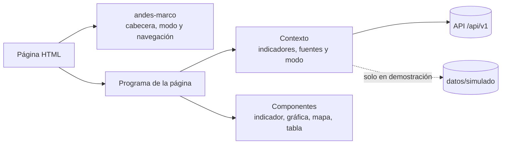

# Interfaz de ANDES

Documento de la fase 2: diseño de interfaz, actualizado en la fase 3. Describe qué se construyó, cómo está organizado, cómo se amplía y qué se comprobó. Desde la fase 3 el portal lee las cifras oficiales de la API y el entorno privado funciona con sesión; la sección 10 describe esa parte.

## 1. Qué entrega la fase 2

| Entregable | Estado |
|---|---|
| Portal público con diez páginas: panorama nacional, población, vivienda, economía, infraestructura, salud, educación, logística, mapa y metodología | Construido y navegable |
| Componentes reutilizables: marco, indicador, sello, gráfica, tabla y mapa | Construidos |
| Dos modos de consulta: datos oficiales y demostración | Construidos |
| Entorno privado: acceso, administración, calidad de datos e ingeniería | Maqueta en la fase 2. Desde la fase 3 exige sesión y muestra datos reales. |
| Datos oficiales compilados y datos simulados reproducibles | Los oficiales se sirven desde la API desde la fase 3. Los simulados siguen siendo archivos JSON. |
| Servidor | Desde la fase 3 entrega también la API y protege el entorno privado |

## 2. Cómo ejecutarla

```bash
npm install
```

```bash
npm run dev
```

El portal queda en `http://localhost:3000` y el entorno privado en `http://localhost:3000/privado/`. `npm install` copia las bibliotecas a `frontend/public/vendor/`, así que el portal funciona sin internet. Desde la fase 3 el portal necesita la base de datos en marcha: el [README](../README.md) explica cómo levantarla, junto con el resto de los comandos y la configuración.

## 3. Organización

| Carpeta | Contenido |
|---|---|
| `frontend/public/*.html` | Una página por módulo. Cada una declara su título, su texto de entrada y el programa que la construye. |
| `frontend/public/css/` | `tokens.css` con las variables de diseño, `base.css` con el marco y la tipografía, y `componentes.css`. |
| `frontend/public/js/nucleo/` | Utilidades sin interfaz: carga de datos, formato, modo, cálculo de indicadores, presentación de indicadores clave (`kpi.js`), comparación de territorios y cortes (`comparacion.js`), clasificación y tablas. |
| `frontend/public/js/componentes/` | Elementos personalizados y piezas de interfaz. |
| `frontend/public/js/graficas/` | Tema y constructores de opciones de Apache ECharts. |
| `frontend/public/js/paginas/` | Un programa por página y los bloques que comparten. |
| `frontend/public/datos/` | Límites del mapa en `geo/` y datos simulados de los módulos sin registros en `simulado/`. Las cifras oficiales y los registros de población y vivienda llegan por la API. Ver [DATA_DICTIONARY.md](DATA_DICTIONARY.md). |
| `frontend/private/` | Entorno privado: páginas, estilos y programas. Ver la sección 10. |
| `backend/` | Servidor y API. Ver [ARCHITECTURE.md](ARCHITECTURE.md). |
| `etl/` | Programas que descargan y normalizan los datos oficiales del DANE. |
| `data/generador/` | Generador de los datos simulados. |

El frontend no usa empaquetador. Los navegadores cargan los módulos ES directamente.

## 4. Cómo se construye una página



1. La página HTML contiene el título, el texto de entrada y un contenedor vacío.
2. El elemento `andes-marco` envuelve ese contenido con la cabecera, el selector de modo, la navegación y el pie.
3. El programa de la página llama a `iniciarPagina`, que carga el contexto y entrega funciones para leer indicadores. `nucleo/datos.js` traduce cada recurso oficial a su ruta de la API, por ejemplo `oficial/territorio` a `/api/v1/eventos/sismo-2026-08-10/territorio`, y cada recurso simulado a su archivo en `datos/simulado/`.
4. El programa arma secciones con `seccion`, `indicadores`, `grafica` y `graficaSimulada`.
5. Si algo falla al cargar, la página muestra un mensaje de error en lugar de quedar en blanco.

## 5. Componentes

| Componente | Archivo | Responsabilidad |
|---|---|---|
| `andes-marco` | `componentes/marco.js` | Cabecera, selector de modo, navegación adaptable, aviso de demostración y pie. |
| `andes-indicador` | `componentes/indicador.js` | Tarjeta con valor, unidad, variación, descripción, fuente, fecha de corte y sello. También el estado «Información no disponible». |
| `andes-kpi` | `componentes/kpi.js` | Tarjeta de un indicador clave: cociente con su calificador, sus dos partes, la variación con su valoración, la descripción y las fuentes de cada parte. También el estado «Información no disponible» con su motivo. |
| `andes-sello` | `componentes/sello.js` | Sello de origen y nivel de confiabilidad. Desde la fase 5 también «Cálculo con cifras oficiales». |
| `andes-grafica` | `componentes/grafica.js` | Gráfica con su pregunta, su procedencia y una tabla alternativa con los mismos datos. Agrega la marca de agua en los datos simulados. |
| `andes-mapa` | `componentes/mapa.js` | Mapa de coropletas con leyenda, clasificación por cuantiles y selección de territorio. |
| Figura | `componentes/figura.js` | Marco común de gráficas, tablas y mapas: cabecera, sello y pie de fuente. |
| Tabla | `nucleo/tabla.js` | Tabla accesible con título, encabezados y desplazamiento propio. |

Los constructores de `graficas/opciones.js` devuelven a la vez la opción de la gráfica y su tabla. Así ninguna gráfica puede publicarse sin su alternativa en texto.

## 6. Variables de diseño

Los colores, la tipografía y las medidas viven en `css/tokens.css`. Ningún otro archivo declara un color.

| Grupo | Variables | Uso |
|---|---|---|
| Identidad | `--azul-oscuro`, `--azul-institucional`, `--grafito`, `--gris-medio`, `--fondo`, `--blanco` | Texto, cabeceras, enlaces y superficies |
| Estados | `--alerta`, `--critico`, `--positivo` y sus fondos | Alertas, errores, avances y el sello de dato simulado |
| Series | `--serie-1` a `--serie-8` | Colores de las series en las gráficas |
| Escala | `--escala-1` a `--escala-6` | Mapas y matrices, de claro a oscuro |
| Daño | `--dano-0` a `--dano-4` y `--dano-pendiente` | Estado físico de las viviendas e infraestructura |

El sello de origen no depende solo del color: el oficial tiene borde continuo, el estimado punteado y el simulado discontinuo, y los tres llevan su texto.

## 7. Modos de datos

| Modo | Qué muestra |
|---|---|
| Datos oficiales | Solo cifras con fuente. Lo que no existe aparece como «Información no disponible». Es el modo por defecto. |
| Demostración | Agrega los datos simulados. Cada tarjeta y gráfica simulada lleva el sello, el borde discontinuo y la marca de agua. Un aviso permanente encabeza la página. Las páginas de población y vivienda leen los registros cargados por el ETL desde `/api/v1/eventos/:evento/registros/`; los demás módulos simulados siguen en archivos. |

Reglas que el código hace cumplir:

- Un valor que la fuente no trae se muestra como «Sin dato», nunca como cero. Un cero que la fuente sí reporta se muestra como «0».
- Un indicador con cifra oficial nunca se reemplaza por una simulada, ni siquiera en el modo de demostración.
- Las cifras simuladas informan el tamaño de su muestra y no reproducen los totales oficiales.
- El modo se guarda en el navegador de cada persona. No viaja en la dirección de la página.
- Una celda de registros que la API oculta llega como `null` y se muestra como «Sin dato» o «Información no disponible». Las gráficas, las tablas y las sumas nunca la convierten en cero.
- Los indicadores de vivienda del modo de demostración vienen de los registros. Si la API oculta uno, la tarjeta no recurre a un valor de archivo.

## 8. Cómo ampliar el portal

**Agregar un indicador.** Se añade su definición en `database/seeds/oficial/indicadores.json`, con su serie por fecha de corte. Cada punto cita una fuente de `fuentes.json`. Después se ejecuta `npm run db:seed` y se incluye su código en la lista de la página que lo muestra.

**Agregar una gráfica oficial.** En el programa de la página se llama a `grafica` con la pregunta, el resultado de un constructor de `graficas/opciones.js` y el origen que devuelve `origenDe`.

**Agregar una gráfica que solo existe en demostración.** Se usa `graficaSimulada`. En el modo oficial muestra por sí sola el aviso de información no disponible.

**Agregar una página.** Se crea el archivo HTML a partir de otro, se crea su programa en `js/paginas/` y se añade a la lista `PAGINAS` de `componentes/marco.js`.

## 9. Accesibilidad

- Enlace para saltar al contenido, puntos de referencia semánticos y foco visible.
- Cada gráfica tiene una tabla alternativa. El mapa tiene además selectores y una tabla con los mismos datos.
- Las gráficas circulares solo se usan con categorías excluyentes. La vulnerabilidad se muestra en barras.
- Se respeta la preferencia de movimiento reducido del sistema.
- El idioma declarado es español de Colombia, y los números, la moneda y las fechas siguen ese formato.
- Los colores de texto tienen un contraste de 4,5:1 o más; `tests/unit/frontend/contraste.test.js` lo comprueba sobre `tokens.css`.
- Los nombres que entran en las ventanas de información de las gráficas se escapan antes de convertirse en HTML.

### 9.1 Mapa: buscador de municipios y descargas (fase 6)

- El mapa tiene un buscador de municipios: un campo `search` con su `datalist`, alimentado por `/api/v1/municipios` (el trie del algoritmo 5) después de dos letras y 200 ms de pausa. Al elegir un municipio, el mapa abre su departamento y su ficha, y la dirección queda como `?departamento=27&municipio=27660`, que también sirve para llegar directo. Si el municipio no tiene reporte, la ficha lo dice. El componente está en `componentes/buscador.js`.
- La página de metodología ofrece en CSV, además de JSON, los indicadores con su serie y la afectación por municipio. El archivo se arma en el navegador con `nucleo/csv.js`: UTF-8 con marca de orden de bytes, separado por comas, fin de línea CRLF y comillas solo donde hacen falta.

## 10. Entorno privado

Las páginas privadas usan los mismos estilos y utilidades del portal, más los programas de `frontend/private/js/`.

| Archivo | Responsabilidad |
|---|---|
| `api.js` | Cliente de la API: `pedir`, `enviarArchivo` para las subidas en `multipart/form-data`, el error `ErrorDeApi`, `describirError`, que muestra el motivo de cada campo cuando la API lo envía, y `conParametros` |
| `navegacion.js` | Las cuatro páginas privadas con su permiso, la sesión actual y el destino seguro después del ingreso |
| `marco-privado.js` | Elemento `andes-marco-privado`: cabecera con el usuario, su rol y el cierre de sesión, y navegación con solo las páginas que el rol puede ver |
| `pagina-privada.js` | Arranque común: espera la sesión, construye la página, lleva al ancla de la dirección cuando la página termina de construirse, muestra los errores y vuelve al acceso si la sesión venció |
| `lista-paginada.js` | Tablas paginadas por clave, con filtros y el botón «Cargar más», que se oculta cuando no quedan filas |
| `etiquetas.js` | Textos en español de los estados de carga y de los pares de duplicados, las alertas, los motivos de rechazo y de duplicado, los campos de comparación, los motivos de acceso y las acciones de auditoría |
| `acceso.js` | Formulario de ingreso. Si ya hay sesión, lleva directamente a la página pedida. |
| `pesos.js` | Funciones puras del laboratorio: formato de los pesos para la API, reparto sobre 100 y texto del cambio de puesto |
| `paginas/` | Un programa por página: administración, calidad, priorización e ingeniería |

Reglas:

- La interfaz oculta lo que el rol no puede usar, como el formulario de fuentes para el analista o el panel de ingeniería en el menú. Quien decide es el servidor: una página o una ruta sin permiso responde 403.
- Después del ingreso, la interfaz solo vuelve a una de las cuatro páginas declaradas. Cualquier otro destino lleva a la primera página permitida.
- Lo que aún no existe se muestra con su motivo, nunca con datos de relleno.

### 10.1 Importación y revisión (fase 4)

| Página | Sección | Qué hace |
|---|---|---|
| Administración | Importar archivos | Formulario con el conjunto y el archivo. Muestra los formatos que acepta el conjunto elegido. Al enviar, sube el archivo, consulta el avance cada 1,5 segundos y muestra las filas confirmadas hasta que la carga termina o falla. El botón queda desactivado mientras tanto. El analista ve un aviso en lugar del formulario. |
| Administración | Cargas ejecutadas | Archivo, filas leídas, válidas, rechazadas, duplicadas y en revisión, duración y estado. El número de rechazadas enlaza a esas filas en la página de calidad. |
| Calidad | Duplicados por revisar | Resumen de pares y registros pendientes. Con el permiso `datos:editar`, la cola por tipo de registro y estado, con los dos registros, su parecido por campo, el grupo y los botones «Es el mismo» y «Son distintos». La celda muestra el resultado de la decisión, y si el registro se fusionó, sus otros pares se marcan como resueltos sin recargar. |
| Calidad | Filas rechazadas | Rechazos por motivo de todas las cargas, y las filas de la carga elegida con sus motivos y su contenido, con los identificadores ocultos. La dirección `?carga=12#filas-rechazadas` abre esa carga en esa sección. |

Reglas de estas secciones:

- Los botones de decisión tienen un nombre accesible con el número del par, como «Es el mismo: par 13», porque cada fila repite los mismos textos.
- Las tablas anchas se desplazan dentro de su región, con foco de teclado, y la página nunca se desplaza a lo ancho.
- Las secciones con ancla dejan espacio para el encabezado fijo, para que el enlace no esconda el título.

### 10.2 Inteligencia de negocios (fase 5)

| Página | Qué hace |
|---|---|
| Panorama nacional | Sección «Indicadores clave» con los ocho cocientes oficiales. En modo de demostración agrega los cinco simulados bajo «Con los registros simulados». |
| Comparar (`/comparar`) | Dos selectores de departamento, con los dos de más personas afectadas por defecto. Una gráfica de participación en el total nacional, una tabla con valor, participación y puesto, el ranking por variable y la tabla de cambios entre el primer y el último corte de cada indicador nacional. La dirección `?departamento=27&departamento=66` reproduce la comparación. |
| Laboratorio de priorización (`/privado/priorizacion`) | El aviso académico fijo, un control deslizante por criterio con su reparto sobre 100, los criterios sin datos desactivados con su motivo, el número de zonas, el regreso a los pesos configurados y la opción de tasas por habitante desactivada con su explicación. Cada cambio espera 300 ms antes de consultar la API y descarta las respuestas viejas. La gráfica apila el aporte de cada criterio; la tabla trae el puntaje, el puesto con los pesos configurados y el cambio, y una segunda tabla lista las zonas que salen del grupo. |

## 11. Verificación realizada

Hecha el 12 de noviembre de 2026 en el navegador integrado, basado en Chromium, y repetida el 17 de noviembre después de corregir el tratamiento de los valores ausentes.

| Comprobación | Resultado |
|---|---|
| Las 16 páginas cargan sin errores de JavaScript en ambos modos | Correcto |
| Ninguna página queda en estado de carga ni de error, ni muestra textos como `null` o `NaN` | Correcto |
| Sin desplazamiento horizontal a 375 y a 1.280 píxeles de ancho | Correcto en las 16 páginas |
| Menú de secciones en celular | Abre, marca la página actual y cierra |
| Mapa: selección de departamento con clic o con la lista, detalle municipal y encuadre | Correcto, comprobado con Valle del Cauca, Chocó, Risaralda y Antioquia |
| Valores ausentes en el mapa y sus tablas | Se muestran como «Sin dato». En Antioquia, 95 de 106 municipios no traen viviendas destruidas. |
| Contraste de 16 combinaciones de texto y fondo | Todas superan 4,5. La menor es 4,64. |
| Pruebas automáticas | 213 pruebas en 8 archivos, todas aprobadas |
| Reglas de código y ausencia de comentarios | Sin hallazgos |

La verificación del portal sobre la API y del entorno privado, hecha el 18 de noviembre de 2026, está en [ARCHITECTURE.md](ARCHITECTURE.md#13-verificación-realizada).

## 12. Lo que no se cubre

- No se probó en Firefox ni en Safari.
- No se hicieron pruebas con lector de pantalla ni con personas usuarias.
- El entorno privado no tiene pruebas automáticas de interfaz. Sus funciones se prueban por separado y la interfaz se verificó en el navegador.
- El mapa no usa mapa base. Dibuja los límites oficiales sobre un fondo liso para funcionar sin internet.
