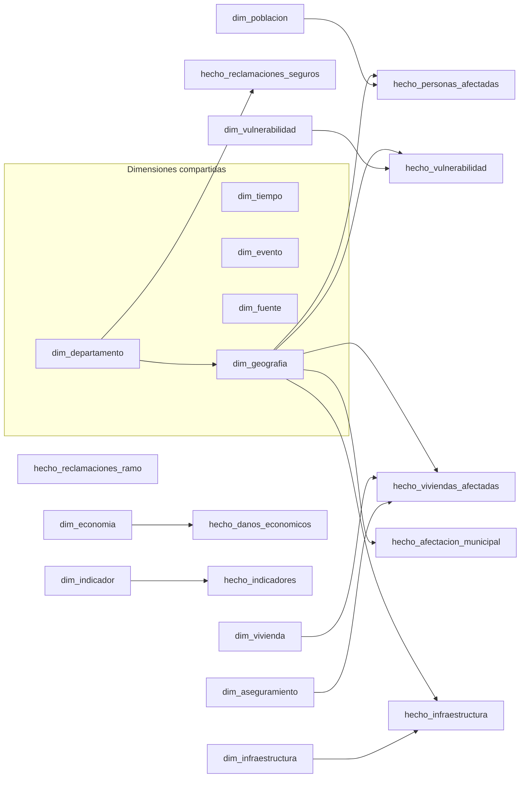

# Power BI

ANDES funciona sin Power BI. El portal público, el área privada y la API calculan sus propias cifras. Power BI es un consumidor opcional que lee un modelo en estrella preparado para él en el esquema `bi` de PostgreSQL. Este documento explica qué información se comparte, cómo conectarse, cómo armar el modelo y qué medidas DAX usar.

## Contenido

1. [Qué se comparte y qué no](#1-qué-se-comparte-y-qué-no)
2. [Modelo en estrella](#2-modelo-en-estrella)
3. [Cuenta de solo lectura](#3-cuenta-de-solo-lectura)
4. [Conexión directa con PostgreSQL](#4-conexión-directa-con-postgresql)
5. [Alternativa sin conexión: archivos CSV](#5-alternativa-sin-conexión-archivos-csv)
6. [Relaciones](#6-relaciones)
7. [Medidas DAX](#7-medidas-dax)
8. [Indicadores clave y valores de referencia](#8-indicadores-clave-y-valores-de-referencia)
9. [Páginas sugeridas para el informe](#9-páginas-sugeridas-para-el-informe)
10. [Privacidad](#10-privacidad)
11. [Limitaciones y decisiones pendientes](#11-limitaciones-y-decisiones-pendientes)
12. [Pruebas](#12-pruebas)

## 1. Qué se comparte y qué no

| Se comparte | No se comparte |
|---|---|
| Las 21 vistas del esquema `bi`: 12 dimensiones y 9 tablas de hechos | Los esquemas `nucleo`, `staging`, `analitica` y `seguridad` |
| Conteos y sumas agrupados por semana, municipio y perfil | Registros individuales, identificadores internos y seudónimos |
| Grupos de edad, sexo, condición, tenencia, situación y vulnerabilidad | Nombres, documentos, direcciones, teléfonos y edades exactas |
| Cifras oficiales con su fuente, fecha de corte y calificador | Filas rechazadas por el ETL y su contenido |
| Catálogos de fuentes, indicadores, territorios e infraestructura | Usuarios, sesiones, permisos y bitácora de auditoría |

La cuenta `powerbi_lector` solo puede leer el esquema `bi`. Las vistas se ejecutan con los permisos de su dueño, así que la cuenta lee los resultados agregados sin tener acceso a las tablas de origen. Las pruebas de integración comprueban, con `SET ROLE powerbi_lector`, que la cuenta lee el esquema `bi` y que cualquier consulta a otro esquema, o el intento de crear una tabla, termina con el error `42501`. Que una sesión iniciada con la cuenta sea de solo lectura (error `25006` al crear una tabla temporal) se comprobó a mano con la cuenta real, porque las pruebas no pueden cambiar su clave.

El servidor de PostgreSQL de desarrollo solo escucha en `127.0.0.1:5433`. Nada del modelo sale del equipo a menos que alguien copie los archivos exportados o abra un túnel.

## 2. Modelo en estrella

El modelo está en `database/migrations/0008_modelo_en_estrella.up.sql`. Son vistas comunes, no materializadas: Power BI las lee en modo de importación y cada actualización del informe vuelve a calcularlas con los datos vigentes. La vista más pesada tarda cerca de 1,8 s con 600.000 personas.



`dim_tiempo`, `dim_evento` y `dim_fuente` se relacionan con todas las tablas de hechos. El diagrama no dibuja esas flechas para que se pueda leer.

### Dimensiones

| Vista | Dimensión de la propuesta | Clave | Filas en desarrollo | Contenido |
|---|---|---|---:|---|
| `dim_tiempo` | Tiempo | `fecha` | 102 | Un día por fila desde el sismo hasta la fecha de la consulta, con mes, semana y días desde el sismo |
| `dim_evento` | | `codigo_evento` | 1 | Evento sísmico |
| `dim_geografia` | Geografía | `codigo_municipio` | 1.122 | Municipios DIVIPOLA con su departamento y si tienen reporte oficial |
| `dim_departamento` | Geografía | `codigo_departamento` | 33 | Departamentos |
| `dim_poblacion` | Población | `perfil_clave` | 3.840 | Todas las combinaciones de grupo de edad, sexo, condición, tenencia, situación, condición de salud y vulnerabilidad |
| `dim_vulnerabilidad` | Población | `vulnerabilidad` | 8 | Condiciones de vulnerabilidad, incluidas las que se derivan de la edad |
| `dim_vivienda` | Vivienda | `vivienda_clave` | 2.016 | Combinaciones de estado físico, ocupación, financiación, zona y estrato |
| `dim_aseguramiento` | Aseguramiento | `aseguramiento_clave` | 7 | Combinaciones válidas de condición de aseguramiento y estado de la reclamación |
| `dim_infraestructura` | Infraestructura | `tipo_infraestructura` | 10 | Variables del reporte del DANE, con su categoría y si es infraestructura crítica |
| `dim_economia` | Economía | `concepto_clave` | 12 | Costos, recursos y destinos del fondo publicados por las entidades |
| `dim_indicador` | | `indicador` | 65 | Catálogo de indicadores nacionales |
| `dim_fuente` | | `fuente_id` | 19 | Entidad, documento, fecha de publicación, nivel de confiabilidad y enlace |

`dim_poblacion`, `dim_vivienda` y `dim_aseguramiento` son dimensiones de combinaciones: agrupan atributos de baja cardinalidad en una sola tabla para que las tablas de hechos tengan una clave en lugar de seis. Las claves son de texto, por ejemplo `DE_18_A_59|M|CIVIL|PROPIETARIO|AFECTADA|ILESA|NO` o `ASEGURADA|EN_ESTUDIO`. Cada atributo trae su nombre para mostrar y su orden. Las marcas de sí o no usan los textos `Sí` y `No`, salvo `con_vulnerabilidad`, que usa `SI` y `NO` porque forma parte de la clave.

### Tablas de hechos

| Vista | Hecho de la propuesta | Granularidad | Origen |
|---|---|---|---|
| `hecho_personas_afectadas` | Personas afectadas | Semana de registro, municipio, perfil de población y fuente | SIMULADO |
| `hecho_vulnerabilidad` | Personas afectadas | Semana, municipio y condición de vulnerabilidad. Una persona cuenta una vez por cada condición. | SIMULADO |
| `hecho_viviendas_afectadas` | Viviendas afectadas | Semana, municipio, perfil de vivienda y aseguramiento, con seis valores en pesos | SIMULADO |
| `hecho_afectacion_municipal` | Personas y viviendas afectadas | Un reporte oficial por municipio | OFICIAL |
| `hecho_infraestructura` | Infraestructura | Municipio y tipo de infraestructura | OFICIAL |
| `hecho_danos_economicos` | Daños económicos | Concepto económico, con su fecha y su calificador | OFICIAL |
| `hecho_reclamaciones_seguros` | Daños económicos | Departamento, según Fasecolda | OFICIAL |
| `hecho_reclamaciones_ramo` | Daños económicos | Ramo de seguros, según Fasecolda | OFICIAL |
| `hecho_indicadores` | | Indicador nacional y fecha de corte, con `numero_corte` para comparar cortes | OFICIAL |

Todas las tablas de hechos traen `origen_dato`. Ninguna mezcla cifras oficiales con simuladas, así que un filtro por origen nunca deja una suma a medias. Las sumas de `hecho_personas_afectadas` y `hecho_viviendas_afectadas` coinciden con los registros vigentes de la base: las uniones que alimentan la vista de viviendas son de uno a uno por restricciones `UNIQUE`.

La propuesta incluía un hecho de atención y suministros. No se creó porque no hay ninguna fuente, oficial ni simulada, con entregas de ayudas o suministros. Ver la [sección 11](#11-limitaciones-y-decisiones-pendientes).

## 3. Cuenta de solo lectura

La migración 0008 crea el rol `powerbi_lector` sin permiso para iniciar sesión, porque la clave no puede estar en una migración. Para activarlo:

1. Agregue `BD_POWERBI_CLAVE` al archivo `.env` con al menos 16 caracteres. `.env.example` trae el nombre de la variable.
2. Ejecute:

   ```bash
   npm run bi:cuenta
   ```

El comando, con la cuenta dueña de la base:

- habilita el inicio de sesión con la clave del `.env`;
- limita la cuenta a 5 conexiones simultáneas;
- deja `default_transaction_read_only = on`, de modo que toda transacción de la cuenta es de solo lectura;
- se conecta como `powerbi_lector` para comprobar que la cuenta lee las 21 vistas.

Para cambiar la clave, cámbiela en `.env` y vuelva a ejecutar el comando.

## 4. Conexión directa con PostgreSQL

Power BI Desktop solo existe para Windows. Si trabaja en un Mac, lea primero la [sección 11](#11-limitaciones-y-decisiones-pendientes).

1. En Power BI Desktop, abra **Obtener datos → Base de datos → Base de datos PostgreSQL**. El conector viene incluido; no hace falta instalar Npgsql.
2. Escriba **Servidor** `localhost:5433` y **Base de datos** `andes`. Elija el modo **Importar**.
3. En las credenciales, use la pestaña **Base de datos**: usuario `powerbi_lector` y la clave de `BD_POWERBI_CLAVE`.
4. Power BI intenta primero una conexión cifrada. El contenedor de desarrollo no tiene SSL, así que la conexión cifrada falla y Power BI ofrece seguir sin cifrado; también se puede desmarcar **Cifrar conexiones** en **Configuración de origen de datos**. Hágalo solo si el servidor es `localhost` o un túnel SSH. Para un servidor remoto, active SSL antes.
5. En el **Navegador**, marque las 21 vistas del esquema `bi` y elija **Transformar datos**. Si aparecen objetos de otros esquemas, ignórelos: la cuenta no puede leerlos.
6. Si las consultas aparecen con el esquema delante (por ejemplo `bi dim_tiempo` o `bi.dim_tiempo`), cámbieles el nombre por el de la vista (`dim_tiempo`). Las medidas DAX usan esos nombres.
7. Revise que `codigo_municipio`, `codigo_departamento`, `estrato` y todas las claves sean de tipo **Texto**. Los códigos DIVIPOLA empiezan por cero.
8. Elija **Cerrar y aplicar**.

Antes de cargar, en **Archivo → Opciones y configuración → Opciones → Archivo actual → Carga de datos**, desactive **Detectar automáticamente nuevas relaciones** y **Fecha y hora automáticas**. El modelo trae su propia tabla de fechas y sus relaciones se crean a mano (sección 6). Después de cargar, marque `dim_tiempo` como tabla de fechas con la columna `fecha`.

Para traer datos nuevos basta con **Actualizar**. Las vistas leen siempre los registros vigentes.

## 5. Alternativa sin conexión: archivos CSV

Cuando Power BI está en otro equipo, la forma más simple y segura es exportar el modelo a archivos:

```bash
npm run bi:exportar
```

El comando se conecta como `powerbi_lector`, de modo que exporta exactamente lo que vería Power BI, y escribe en `analytics/powerbi/datos/`:

| Archivo | Contenido |
|---|---|
| `dim_*.csv` y `hecho_*.csv` | Una vista por archivo, ordenada por todas sus columnas para que dos exportaciones de los mismos datos sean idénticas |
| `manifiesto.json` | Fecha de generación y, por archivo, filas, columnas, bytes y huella SHA-256 |
| `medidas.dax` | Copia de las medidas |
| `consulta-de-medidas.dax` | Consulta para crear todas las medidas de una vez (sección 7) |

Con `--salida` se elige otra carpeta: `npm run bi:exportar -- --salida /ruta/de/salida`. La carpeta está en `.gitignore`. Con los datos de desarrollo son 21 archivos y unos 26 MB, y la exportación tarda unos 4,5 s.

Los archivos son CSV en UTF-8 con marca de orden de bytes, separados por comas, con encabezado, punto decimal y fechas `AAAA-MM-DD`. Para importarlos:

1. Copie la carpeta al equipo con Windows. Si quiere confirmar que llegó completa, compare la huella de cada archivo con el manifiesto: `Get-FileHash -Algorithm SHA256 dim_tiempo.csv` en PowerShell.
2. En **Archivo → Opciones y configuración → Opciones → Archivo actual → Configuración regional**, elija **Inglés (Estados Unidos)** como configuración regional de importación. Con la configuración de Colombia, Power BI leería el punto como separador de miles y `1234.5` se convertiría en `12345`.
3. Importe cada archivo con **Obtener datos → Texto o CSV**, con origen **65001: Unicode (UTF-8)** y delimitador **Coma**.
4. Ajuste los tipos como en el paso 7 de la sección 4. La detección automática convertiría `05001` en `5001`.

Para no repetir el paso 3 veintiún veces, puede crear un parámetro `CarpetaDeDatos` y una consulta en blanco por vista con este código de Power Query:

```powerquery
let
    Origen = Csv.Document(
        File.Contents(CarpetaDeDatos & "dim_tiempo.csv"),
        [Delimiter = ",", Encoding = 65001, QuoteStyle = QuoteStyle.Csv]
    ),
    ConEncabezados = Table.PromoteHeaders(Origen, [PromoteAllScalars = true])
in
    ConEncabezados
```

Con el parámetro, apuntar el informe a una exportación nueva es cambiar una sola ruta.

## 6. Relaciones

Todas son de varios a uno, con dirección de filtro simple, desde la tabla de hechos hacia la dimensión.

| Desde | Hacia |
|---|---|
| Columna `codigo_evento` de cada tabla de hechos | `dim_evento[codigo_evento]` |
| Columna `fecha` de cada tabla de hechos | `dim_tiempo[fecha]` |
| Columna `fuente_id` de cada tabla de hechos | `dim_fuente[fuente_id]` |
| `codigo_municipio` de `hecho_personas_afectadas`, `hecho_vulnerabilidad`, `hecho_viviendas_afectadas`, `hecho_afectacion_municipal` y `hecho_infraestructura` | `dim_geografia[codigo_municipio]` |
| `dim_geografia[codigo_departamento]` | `dim_departamento[codigo_departamento]` |
| `hecho_reclamaciones_seguros[codigo_departamento]` | `dim_departamento[codigo_departamento]` |
| `hecho_personas_afectadas[perfil_clave]` | `dim_poblacion[perfil_clave]` |
| `hecho_vulnerabilidad[vulnerabilidad]` | `dim_vulnerabilidad[vulnerabilidad]` |
| `hecho_viviendas_afectadas[vivienda_clave]` | `dim_vivienda[vivienda_clave]` |
| `hecho_viviendas_afectadas[aseguramiento_clave]` | `dim_aseguramiento[aseguramiento_clave]` |
| `hecho_infraestructura[tipo_infraestructura]` | `dim_infraestructura[tipo_infraestructura]` |
| `hecho_danos_economicos[concepto_clave]` | `dim_economia[concepto_clave]` |
| `hecho_indicadores[indicador]` | `dim_indicador[indicador]` |

No hay rutas ambiguas: `dim_departamento` llega a los hechos municipales solo a través de `dim_geografia`, y a `hecho_reclamaciones_seguros` solo de forma directa. `hecho_reclamaciones_ramo` no tiene dimensión propia: el ramo es un atributo de la misma tabla.

Ninguna clave de un hecho queda sin pareja en su dimensión. 78 reportes municipales oficiales no traen fecha y quedan relacionados con la fila en blanco de `dim_tiempo`. Así aparecen cuando no hay filtro de fechas y desaparecen cuando lo hay, que es lo correcto porque no se sabe a qué fecha corresponden.

## 7. Medidas DAX

Las 40 medidas están en [`analytics/powerbi/medidas.dax`](../analytics/powerbi/medidas.dax), una por bloque, en la forma `Nombre de la medida =` seguida de la expresión.

### Cómo crearlas

1. Cree una tabla vacía para guardarlas: **Inicio → Especificar datos**, nombre `Medidas`, **Cargar**.
2. Abra la **Vista de consultas DAX**, pegue el contenido de `consulta-de-medidas.dax` y ejecútela. La consulta define las 40 medidas sobre la tabla `Medidas` y devuelve una fila con el valor de cada una.
3. Elija **Actualizar modelo con cambios**. Power BI agrega las 40 medidas al modelo.
4. Oculte la columna vacía de `Medidas` y dé formato a cada medida según la tabla siguiente.

Si prefiere no usar la vista de consultas, cree cada medida con **Nueva medida** y pegue su bloque de `medidas.dax`.

`npm run bi:exportar` genera `consulta-de-medidas.dax` a partir de `medidas.dax` y se niega a hacerlo si el archivo de medidas tiene un nombre repetido, una medida que usa otra que no existe, una dependencia circular o un paréntesis sin cerrar.

### Medidas de registros (simulados)

| Medida | Calcula | Formato |
|---|---|---|
| Personas Registradas | Personas en los registros vigentes | Número entero |
| Personas Registradas Publicables | Lo mismo, en blanco si la celda tiene menos de 10 personas | Número entero |
| Participación de Personas | Personas del contexto sobre el total de la selección de población | Porcentaje |
| Personas con Vulnerabilidad | Personas con al menos una condición de vulnerabilidad, incluidas menores de 18 años y personas de 60 o más | Número entero |
| Personas Registradas con Alguna Vulnerabilidad | La anterior sobre las personas registradas | Porcentaje |
| Condiciones de Vulnerabilidad | Pares de persona y condición. Una persona con dos condiciones cuenta dos veces. | Número entero |
| Viviendas Registradas | Viviendas en los registros vigentes | Número entero |
| Viviendas Registradas Publicables | Lo mismo, en blanco si la celda tiene menos de 10 viviendas | Número entero |
| Viviendas Aseguradas, Viviendas no Aseguradas, Viviendas con Póliza por Verificar | Viviendas según su condición de aseguramiento | Número entero |
| Viviendas Registradas con Seguro | Aseguradas sobre registradas: la cobertura mínima | Porcentaje |
| Cobertura Máxima de Aseguramiento | Aseguradas más pólizas por verificar, sobre registradas | Porcentaje |
| Viviendas Destruidas que tenían Póliza | Destruidas y aseguradas sobre destruidas | Porcentaje |
| Reclamaciones Aprobadas entre las Resueltas | Aprobadas o pagadas sobre aprobadas, pagadas o rechazadas | Porcentaje |
| Viviendas Hipotecadas o en Leasing sin Seguro | No aseguradas entre las que tienen una financiación que exige seguro | Porcentaje |
| Daño sin Seguro COP | Costo estimado del daño de las viviendas no aseguradas | Moneda, pesos |
| Pagado sobre Aprobado | Indemnizaciones pagadas sobre valor aprobado | Porcentaje |

### Medidas de reportes oficiales

| Medida | Calcula | Formato |
|---|---|---|
| Personas Afectadas Reportadas | Personas afectadas según los reportes municipales | Número entero |
| Viviendas Destruidas Reportadas | Viviendas destruidas según los reportes municipales | Número entero |
| Participación Territorial | Personas afectadas del territorio sobre el total de los reportes | Porcentaje |
| Personas Afectadas en los Diez Municipios con más Reportes | Indicador de concentración territorial, independiente de los filtros de territorio | Porcentaje |
| Estructuras Afectadas | Estructuras de los diez tipos de infraestructura | Número entero |
| Infraestructura Crítica entre la Infraestructura Afectada | Centros de salud, centros educativos y acueductos sobre todas las estructuras | Porcentaje |
| Valor Económico COP | Valor de un concepto económico. Queda en blanco si hay varios conceptos, porque sumar un costo con un recurso no tiene sentido. | Moneda, pesos |
| Calificador del Valor Económico | «más de» o «cerca de», cuando la fuente lo indica | Texto |
| Siniestros Reportados | Siniestros por departamento, según Fasecolda | Número entero |
| Pagos sobre Valor Estimado de Siniestros | Pagos sobre valor estimado, por departamento | Porcentaje |

### Medidas de series de indicadores

Se usan con `dim_indicador[indicador_nombre]` en filas. Con varios indicadores a la vez quedan en blanco, porque no se pueden comparar valores con unidades distintas.

| Medida | Calcula |
|---|---|
| Último Corte | Número del corte más reciente dentro del filtro de fechas |
| Valor del Último Corte | Valor del indicador en ese corte |
| Fecha del Último Corte | Fecha de publicación de ese corte |
| Calificador del Último Corte | «más de» o «cerca de», cuando la fuente lo indica |
| Variación frente al Corte Anterior | Cambio relativo frente al corte previo del mismo indicador |
| Valor Vigente del Indicador | Último valor publicado. Las medidas de indicadores clave la usan como ingrediente. |

Con un filtro de fechas, estas medidas responden «cuánto valía el indicador en esa fecha»: el último corte es el más reciente dentro del rango.

## 8. Indicadores clave y valores de referencia

`config/kpi.yml` define los 13 indicadores clave del portal y cada uno tiene una medida DAX con el mismo nombre. Los 5 simulados están en la sección 7: Viviendas Registradas con Seguro, Viviendas Destruidas que tenían Póliza, Reclamaciones Aprobadas entre las Resueltas, Viviendas Hipotecadas o en Leasing sin Seguro y Personas Registradas con Alguna Vulnerabilidad. Los 8 oficiales son los de la tabla siguiente.

Valores calculados el 19 de noviembre de 2026 con los datos oficiales cargados, para comprobar que el informe y el portal dicen lo mismo:

| Indicador clave | Cálculo | Valor |
|---|---|---:|
| Viviendas destruidas por cada 100 afectadas | 36.478 sobre 244.367, balance de la UNGRD del 10 de octubre | 14,9 % |
| Avance de la reconstrucción de vivienda | más de 4.700 sobre 36.478 | más de 12,9 % |
| Indemnizaciones pagadas frente al valor de los siniestros | 95.076 millones sobre 3,7 billones, Fasecolda | 2,6 % |
| Parte del plan de recuperación sin financiar | 50,08 billones sobre 58,29 billones, Plan de Acción Específico | 85,9 % |
| Desembolso de los recursos públicos movilizados | 624.656 millones sobre cerca de 1 billón | cerca de 62,5 % |
| Fallecidos por cada 100 mil personas afectadas | 335 sobre 489.862 | 68,4 |
| Personas afectadas en los diez municipios con más reportes | 60.895 sobre 128.818 personas en los reportes municipales | 47,3 % |
| Infraestructura crítica entre la infraestructura afectada | 4.213 sobre 15.402 estructuras | 27,4 % |

Son cocientes calculados por ANDES a partir de cifras publicadas, no cifras publicadas por las entidades. Dos de ellos heredan un calificador de sus ingredientes. Las medidas DAX devuelven el número; para mostrar el calificador en el informe, ponga **Calificador del Último Corte** en la información sobre herramientas de la tarjeta. El portal combina los calificadores por su cuenta: «más de» en el numerador da «más de», «más de» en el denominador da «menos de», «cerca de» en cualquiera de los dos da «cerca de» y «más de» en los dos también da «cerca de».

Los reportes municipales no traen el número de personas afectadas en 239 de 498 municipios. Esos municipios no cuentan en la concentración territorial: en DAX una suma ignora los valores en blanco, y el portal muestra «Sin dato» en lugar de cero.

## 9. Páginas sugeridas para el informe

| Página | Contenido | Origen |
|---|---|---|
| Resumen | Tarjetas de los ocho indicadores clave oficiales con su fecha de corte y su fuente | OFICIAL |
| Territorio | Mapa de personas afectadas por municipio, participación territorial y ranking de departamentos | OFICIAL |
| Infraestructura | Estructuras afectadas por categoría y tipo, con la proporción de infraestructura crítica | OFICIAL |
| Economía y seguros | Costos, recursos y destinos del fondo con su calificador, y siniestros por departamento y ramo | OFICIAL |
| Evolución | Valor de cada indicador por corte, con su variación | OFICIAL |
| Población registrada | Pirámide por edad y sexo, condiciones de vulnerabilidad y semanas de registro | SIMULADO |
| Vivienda y aseguramiento | Estado físico, cobertura mínima y máxima, reclamaciones y brecha de aseguramiento | SIMULADO |

Toda página con datos simulados debe decir SIMULADO en el título, como lo hace el portal. Ponga un filtro de página en `origen_dato` para que no se mezclen orígenes por error.

## 10. Privacidad

El modelo en estrella está pensado para análisis interno, no para publicación. Las vistas agrupan los registros, pero con una granularidad fina:

| Tabla de hechos | Celdas | Celdas con menos de 10 | Celdas con 1 |
|---|---:|---:|---:|
| `hecho_personas_afectadas` | 191.946 | 179.628 | 100.355 |
| `hecho_viviendas_afectadas` | 1.952 | 1.952 | 1.942 |

Con datos simulados no hay riesgo. Con datos reales, una celda de una persona en un municipio pequeño, con grupo de edad, sexo y condición de salud, podría identificarla. Una celda de una vivienda revelaría su avalúo exacto. Por eso:

- La cuenta `powerbi_lector` es privada, de solo lectura y solo accesible desde el equipo del servidor.
- El informe no debe publicarse con **Publicar en la web** ni compartirse fuera de los roles autorizados del área privada.
- Las medidas «Publicables» dejan en blanco las celdas con menos de 10 personas o viviendas. Úselas en cualquier visual que vaya a mostrarse fuera del equipo de análisis. Solo hacen supresión primaria: un total visible menos sus partes visibles podría revelar una celda oculta.
- El portal público no lee el esquema `bi`. Sus cifras salen de `analitica.agregados_publicables` y `analitica.cruces_publicables`, que solo tienen niveles nacional y departamental y anulan las celdas con menos de 10, y el servidor agrega la supresión complementaria. Ver [ALGORITHMS.md](ALGORITHMS.md#supresión-de-celdas-pequeñas).

Antes de cargar datos reales conviene engrosar la granularidad del modelo, por ejemplo con meses en lugar de semanas o con departamentos en lugar de municipios pequeños. Ese ajuste queda para la fase 6.

## 11. Limitaciones y decisiones pendientes

- **Power BI Desktop necesita Windows (decisión B7).** No hay versión para Mac, y el servicio web de Power BI no se conecta a un PostgreSQL local sin una puerta de enlace, que también es de Windows. El archivo `.pbix` del requisito RF-38 se construirá cuando se decida dónde. Las opciones, de la más simple a la más compleja:
  1. Exportar los CSV y abrirlos en cualquier equipo con Windows (sección 5). No expone la base de datos.
  2. Conectar un equipo con Windows por un túnel SSH hacia el Mac: `ssh -L 5433:127.0.0.1:5433 usuario@equipo-del-servidor`, y en Power BI usar `localhost:5433`. La base sigue escuchando solo en el equipo local.
  3. Instalar el proyecto completo con Docker en el equipo con Windows.

  Abrir el puerto de PostgreSQL a la red local no es recomendable: exigiría SSL, reglas de `pg_hba.conf` y del cortafuegos.
- **Sin hecho de atención y suministros.** No hay fuente de entregas de ayudas ni de suministros. Cuando exista, el hecho tendría la granularidad de fecha de entrega, municipio, tipo de ayuda y entidad que entrega.
- **Un solo evento.** La base tiene un evento y las medidas suponen uno en contexto. Si se cargan más, el informe necesita un segmentador de `dim_evento`.
- **Calificadores.** Las medidas de indicadores clave devuelven el número sin su calificador (sección 8).
- **Modo de importación.** DirectQuery funcionaría, pero cada visual recalcularía las vistas. Con importación el costo se paga una vez por actualización.
- **Fechas.** `dim_tiempo` llega hasta el día de la consulta o la exportación. Un informe abierto días después muestra hasta la fecha de su última actualización.

## 12. Pruebas

| Archivo | Qué comprueba |
|---|---|
| `tests/unit/analitica/medidas.test.js` | El lector de `medidas.dax`: bloques, columnas, medidas usadas, filtros de texto, nombres repetidos, medidas inexistentes, dependencias circulares y paréntesis sin cerrar. Que las 40 medidas reales pasan la revisión, que cada indicador clave tiene una medida con su nombre y que la consulta generada define todas las medidas. |
| `tests/integration/inteligencia.test.js` | En una base de datos propia con 3.000 personas y 2.500 viviendas cargadas por el ETL: las 21 vistas, que los hechos suman los registros vigentes, que ninguna clave de un hecho queda sin pareja en su dimensión, los privilegios de `powerbi_lector`, que cada columna y cada valor de texto que usan las medidas existe en el modelo, y la exportación: marca de orden de bytes, encabezado, filas y huella de cada archivo frente al manifiesto. |

Las medidas no se ejecutaron en Power BI, que necesita Windows. Las pruebas garantizan que nombran objetos y valores que existen; los valores de referencia de la sección 8 sirven para comprobar el informe cuando se construya.
