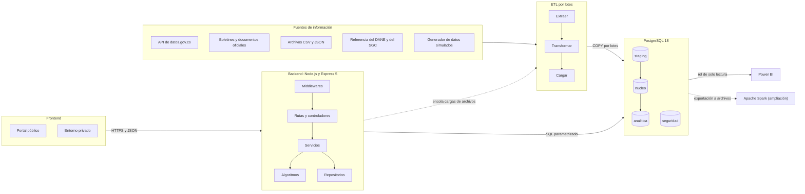
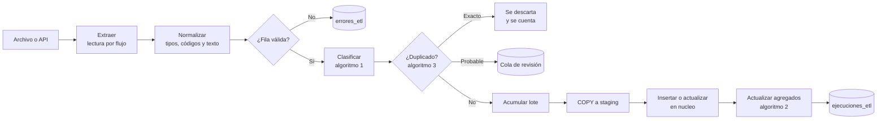
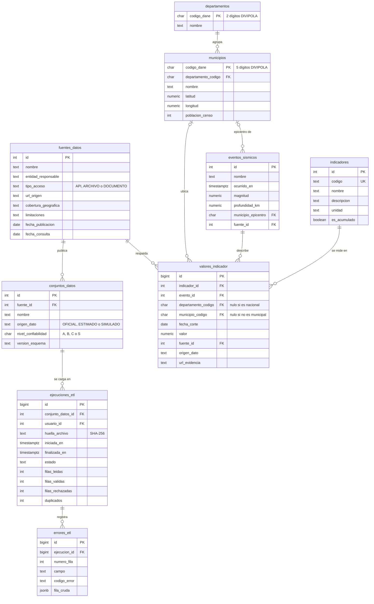
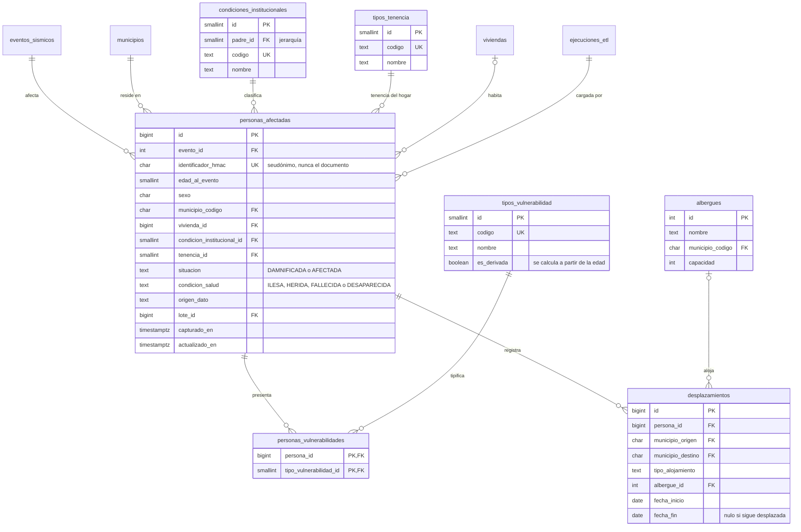
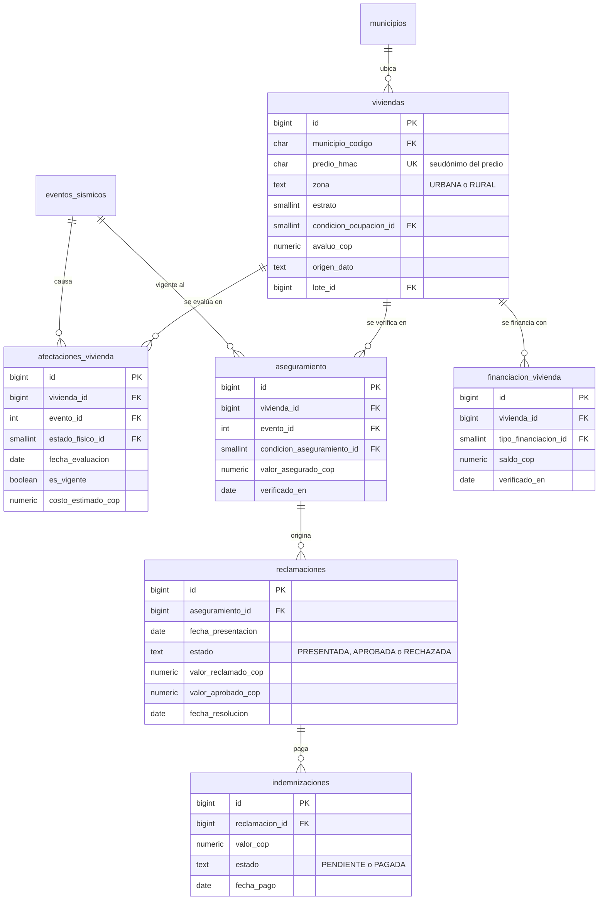
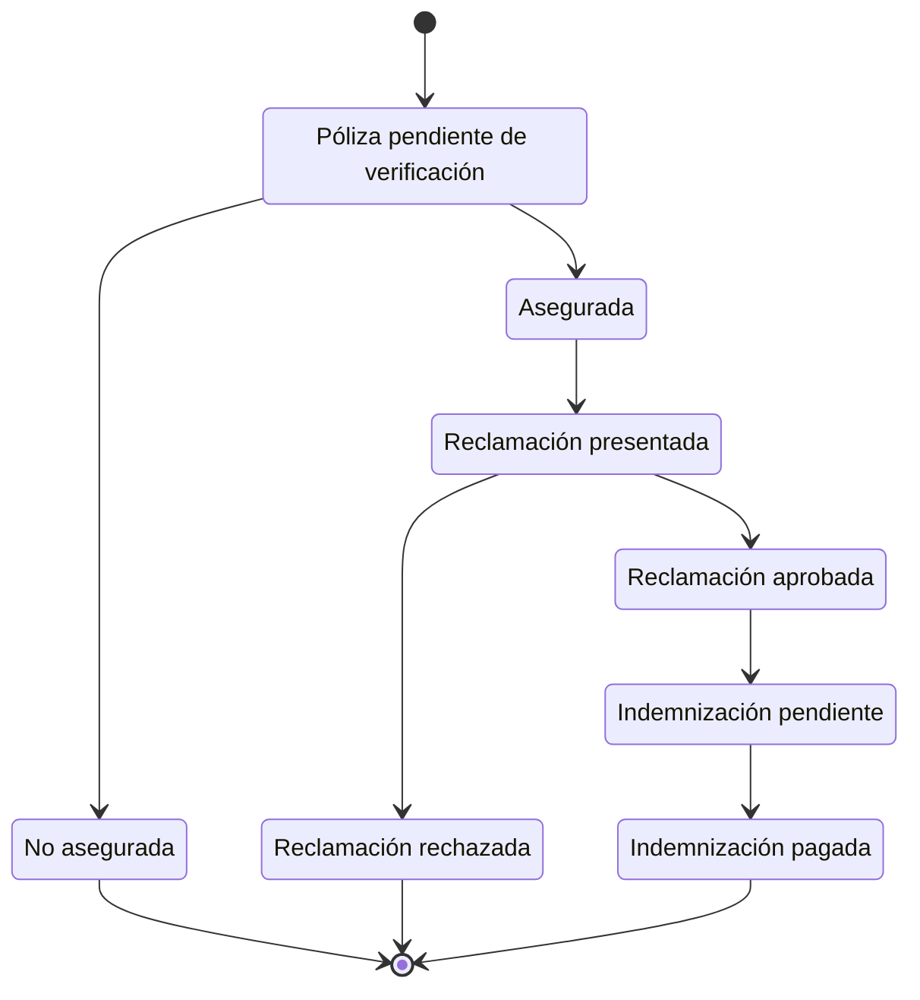
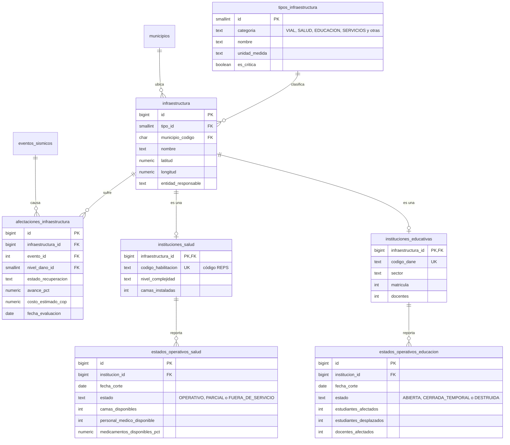
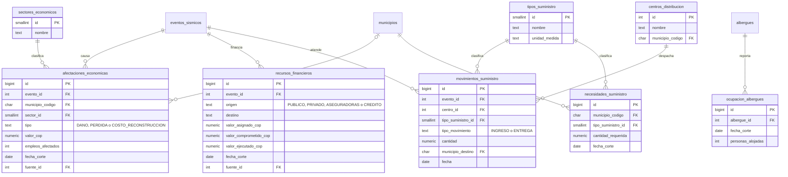
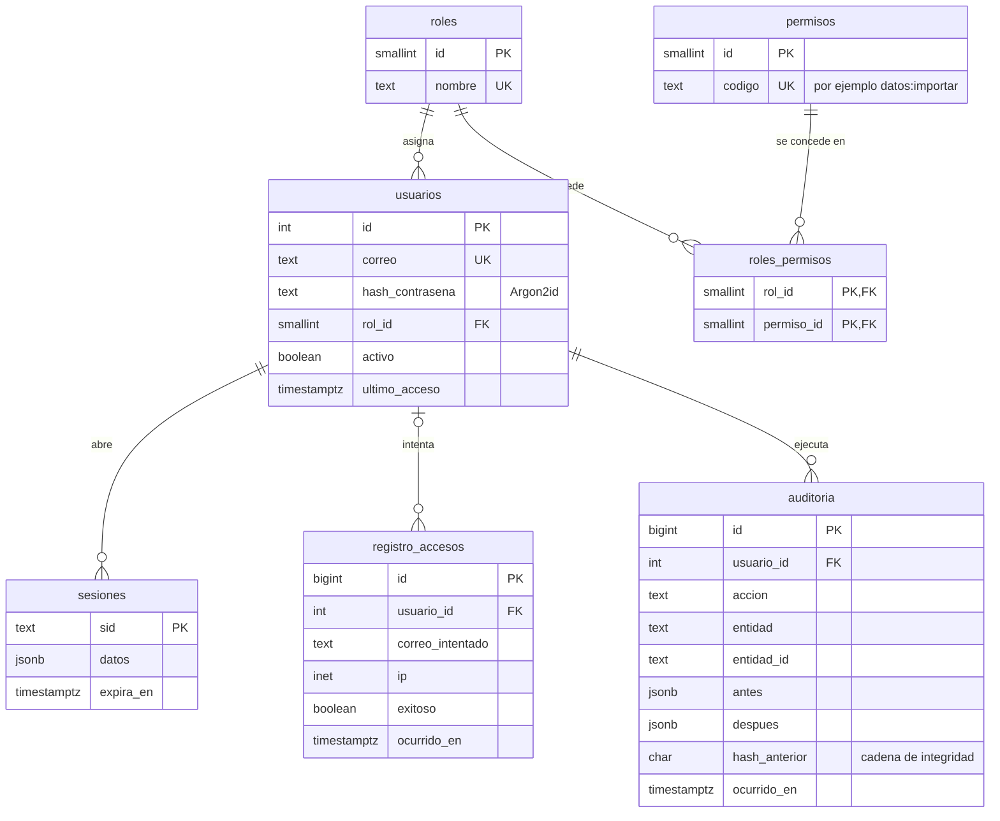
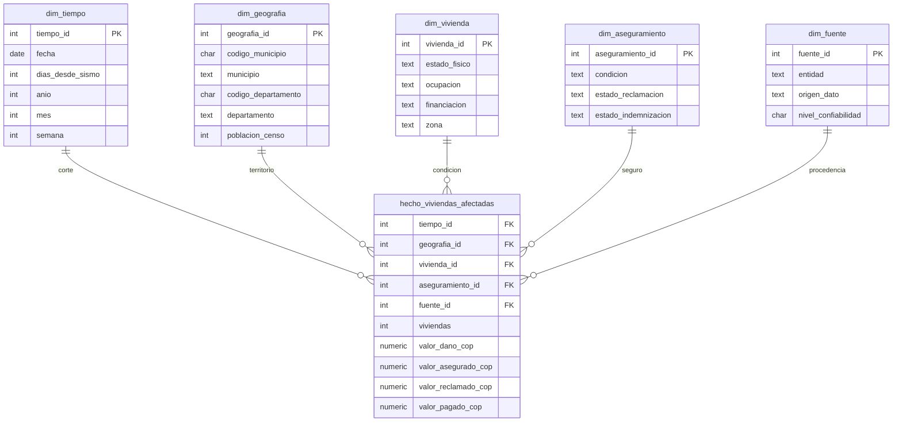

# ANDES — Analítica Nacional de Datos para Emergencias Sísmicas

**Propuesta técnica preliminar.** Plataforma de Big Data e Inteligencia de Negocios para la gestión de información posterremoto en Colombia.

| | |
|---|---|
| Asignatura | Análisis de Algoritmos |
| Fase | 1 de 6: planeación y arquitectura |
| Versión | 0.2, del 12 de noviembre de 2026 |
| Estado | Aprobada el 11 de noviembre de 2026. Las seis fases están construidas; la verificación de cada requisito está en [VERIFICACION.md](VERIFICACION.md). El informe de Power BI espera la decisión B7. |

> **Regla de veracidad.** Este documento no contiene cifras inventadas. Cada cifra del terremoto indica la entidad que la reporta y su fecha de corte. El detalle de cómo se verificó cada una está en [FUENTES_VERIFICADAS.md](FUENTES_VERIFICADAS.md). Las metas de rendimiento son objetivos por validar, no mediciones.

**Cambios frente a la versión 0.1.** La primera versión afirmaba que no existían datos estructurados del sismo por municipio. Era incorrecto: un servicio geográfico del DANE los publica, con reportes hasta el 22 de agosto de 2026. Se corrigieron el componente P3 del problema, la tabla de módulos (13.5), las fuentes (17.2 y 17.4), el riesgo R1 y las limitaciones. El anexo B registra qué decisiones quedaron resueltas con la aprobación.

**Diferencias con lo construido.** Este documento se conserva como el diseño aprobado. Lo que las fases 3 y 4 hicieron de otra manera, y por qué, está en [DATABASE.md](DATABASE.md#11-diferencias-con-el-modelo-de-la-propuesta), [API.md](API.md#8-diferencias-con-la-propuesta), [ARCHITECTURE.md](ARCHITECTURE.md#12-decisiones-de-la-fase-3), [ETL.md](ETL.md#14-decisiones-y-diferencias-con-la-propuesta) y [ALGORITHMS.md](ALGORITHMS.md). Las mediciones de la sección 16 ya están hechas: los resultados están en ALGORITHMS.md y ETL.md.

## Contenido

1. [Nombre profesional de la plataforma](#1-nombre-profesional-de-la-plataforma)
2. [Descripción del proyecto](#2-descripción-del-proyecto)
3. [Problema que busca resolver](#3-problema-que-busca-resolver)
4. [Objetivo general](#4-objetivo-general)
5. [Objetivos específicos](#5-objetivos-específicos)
6. [Alcance funcional](#6-alcance-funcional)
7. [Requerimientos funcionales](#7-requerimientos-funcionales)
8. [Requerimientos no funcionales](#8-requerimientos-no-funcionales)
9. [Arquitectura tecnológica propuesta](#9-arquitectura-tecnológica-propuesta)
10. [Diagrama de arquitectura](#10-diagrama-de-arquitectura)
11. [Diagrama preliminar de base de datos](#11-diagrama-preliminar-de-base-de-datos)
12. [Estructura de carpetas](#12-estructura-de-carpetas)
13. [Descripción de los módulos públicos](#13-descripción-de-los-módulos-públicos)
14. [Descripción de los módulos privados](#14-descripción-de-los-módulos-privados)
15. [Algoritmos que se implementarán](#15-algoritmos-que-se-implementarán)
16. [Complejidad algorítmica esperada](#16-complejidad-algorítmica-esperada)
17. [Fuentes de datos que se deben consultar](#17-fuentes-de-datos-que-se-deben-consultar)
18. [Propuesta de integración con Power BI](#18-propuesta-de-integración-con-power-bi)
19. [Plan de desarrollo por fases](#19-plan-de-desarrollo-por-fases)
20. [Riesgos y limitaciones técnicas](#20-riesgos-y-limitaciones-técnicas)

Anexos: [A. Entorno de trabajo en Visual Studio Code](#anexo-a-entorno-de-trabajo-en-visual-studio-code) · [B. Decisiones que requieren aprobación](#anexo-b-decisiones-que-requieren-aprobación)

---

## 1. Nombre profesional de la plataforma

**ANDES — Analítica Nacional de Datos para Emergencias Sísmicas**

Lema: *datos trazables para entender y atender un terremoto.*

| Criterio | Cómo lo cumple el nombre |
|---|---|
| Describe la función | Cada palabra de la sigla nombra una parte del sistema: analítica, alcance nacional, datos, emergencias sísmicas. |
| Se recuerda y se pronuncia | Es una palabra corriente en español. |
| Tiene sentido geográfico | El sismo del 10 de agosto de 2026 afectó sobre todo a departamentos del occidente andino y del Pacífico: Chocó, Risaralda, Caldas, Quindío y Valle del Cauca. |
| No suplanta a una entidad | No usa el nombre ni la sigla de la UNGRD ni de otro organismo. Es un proyecto académico y debe verse como tal. |

Identificador técnico para el repositorio y el paquete: `andes-posterremoto`.

Alternativas si el nombre no convence: *SismoData Colombia* y *Observatorio de Datos Posterremoto (ODP)*.

## 2. Descripción del proyecto

ANDES es una plataforma web que reúne en un solo lugar la información sobre las consecuencias del sismo del 10 de agosto de 2026 en Colombia, la depura y la presenta con su fuente y su fecha de corte. Tiene dos entornos:

- **Portal público.** Cualquier ciudadano consulta, sin iniciar sesión, indicadores agregados y anónimos sobre población, vivienda, economía, infraestructura, salud, educación, logística y territorio.
- **Entorno privado.** Administradores e ingenieros cargan archivos, validan y corrigen registros, revisan duplicados, auditan cambios y vigilan el estado interno del sistema.

El proyecto demuestra cómo se conectan cinco disciplinas en un mismo producto:

| Disciplina | Qué aporta en ANDES |
|---|---|
| Desarrollo web | Portal público y entorno privado con HTML, CSS y JavaScript sobre una API REST en Node.js y Express. |
| Bases de datos | Modelo relacional normalizado en PostgreSQL, con índices, restricciones y vistas analíticas. |
| Big Data | Ingesta por lotes con memoria acotada, integración de fuentes heterogéneas, histórico por fecha de corte y trazabilidad de cada registro. |
| Análisis de algoritmos | Siete algoritmos propios con estructuras de datos justificadas, complejidad analizada y verificada con mediciones. |
| Inteligencia de negocios | Indicadores, modelo en estrella y conexión con Power BI. |

El principio que ordena todo el diseño es que **ninguna cifra se muestra sin su procedencia**. Un dato es oficial, estimado o simulado, y el sistema lo dice en la base de datos, en la API y en la pantalla.

## 3. Problema que busca resolver

El 10 de agosto de 2026, a las 07:34 hora local, ocurrió un sismo de magnitud 7,4 con epicentro en San José del Palmar (Chocó). El Gobierno declaró la situación de desastre de carácter nacional mediante el Decreto 1171 del 11 de agosto de 2026.

Tres meses después, una pregunta simple recibe respuestas distintas según la entidad y la fecha:

| Pregunta | Respuesta | Quién la da y cuándo |
|---|---|---|
| ¿Cuántas personas fallecieron? | 294, y luego 289 | UNGRD, 15/08/2026. La cifra bajó al depurar registros repetidos. |
| ¿Cuántas viviendas quedaron destruidas? | 36.478 | UNGRD, corte del 10/10/2026 |
| | Más de 51.700 | Ministerio de Vivienda, 23/10/2026 |
| | 51.778 | Plan de Acción Específico, citado el 08/11/2026 |
| ¿Cuántos municipios resultaron afectados? | 500, en 16 departamentos | UNGRD, corte del 10/10/2026 |
| | 451, en 31 departamentos | Fasecolda, corte del 07/09/2026 (municipios con reclamaciones de seguros) |
| ¿A qué profundidad ocurrió el sismo? | 103 km | Servicio Geológico Colombiano |
| | 116,1 km | USGS |
| ¿Cuánto cuesta la reconstrucción? | $54 billones | Ministerio de Vivienda, 23/10/2026 |
| | $58,29 billones | Plan de Acción Específico, citado el 08/11/2026 |

Estas diferencias no son errores. Cada entidad mide un universo distinto, con un método distinto y en una fecha distinta. El problema es que quien consulta no tiene cómo saberlo, porque las cifras circulan separadas de su fuente, de su definición y de su fecha.

El problema tiene cinco componentes, verificados entre el 9 y el 11 de noviembre de 2026:

| # | Componente | Evidencia |
|---|---|---|
| P1 | **Información dispersa y en formatos distintos.** | Los balances de la UNGRD se difunden en boletines, los de Fasecolda en PDF, los costos de reconstrucción en declaraciones públicas y los catálogos de salud y educación en la API de datos.gov.co. |
| P2 | **Cifras que cambian y se corrigen.** | La UNGRD explicó que coteja los reportes iniciales, muchos de ellos verbales, con Fiscalía, Medicina Legal y organismos de socorro «para evitar que una misma víctima sea contabilizada más de una vez» (Semana, 15/08/2026). |
| P3 | **Datos estructurados escasos, desactualizados y sin documentar.** | El tablero «Evaluación Situacional de Daños» de la UNGRD dejó de estar disponible hacia el 12 de agosto. El conjunto abierto «Emergencias UNGRD V2» solo contiene registros de 2025. Un servicio geográfico del DANE sí trae la afectación por municipio, pero no declara metadatos ni fecha de corte, y sus reportes llegan hasta el 22 de agosto. |
| P4 | **Datos personales que no se pueden publicar.** | El Registro Único de Damnificados contiene información de personas y hogares, protegida por la Ley 1581 de 2012. La estadística pública tiene que ser agregada y anónima. |
| P5 | **Cruces que ninguna fuente publica.** | No se encontró información pública que cruce el estado de una vivienda con su seguro y su financiación, ni la población afectada por edad y condición de vulnerabilidad. |

En términos de ingeniería, el problema es construir un sistema que **consolide** fuentes heterogéneas, **depure** registros repetidos e inconsistentes, **conserve** la procedencia y la historia de cada cifra y **publique** solo agregados anónimos, con un costo computacional conocido y justificado.

## 4. Objetivo general

Desarrollar una plataforma web de análisis de datos que centralice, depure y visualice la información sobre las consecuencias humanas, habitacionales, económicas, sociales y estructurales del sismo del 10 de agosto de 2026 en Colombia, mediante desarrollo web, bases de datos relacionales, procesamiento de grandes volúmenes de información, algoritmos de complejidad analizada e inteligencia de negocios, de modo que un ciudadano entienda la situación y un ingeniero pueda mantener y optimizar el sistema.

## 5. Objetivos específicos

| # | Objetivo | Cómo se comprueba |
|---|---|---|
| OE1 | Diseñar un modelo relacional normalizado que trate el estado físico, la ocupación, el aseguramiento y la financiación de una vivienda como variables independientes. | Scripts SQL, diagrama entidad-relación y consultas que cruzan las cuatro variables. |
| OE2 | Construir un proceso ETL que cargue archivos CSV y JSON por lotes, valide cada registro y conserve su procedencia. | Carga de un archivo de un millón de filas con memoria acotada y reporte de filas rechazadas. |
| OE3 | Implementar siete algoritmos propios y documentar su complejidad temporal y espacial. | Pruebas unitarias y mediciones que confirman el orden de crecimiento previsto. |
| OE4 | Publicar un portal ciudadano con nueve módulos temáticos y un mapa interactivo. | Cada indicador muestra valor, unidad, descripción, fuente, fecha de corte y origen del dato. |
| OE5 | Construir un entorno privado con autenticación, roles, auditoría y panel de ingeniería. | Los endpoints privados rechazan solicitudes sin sesión o sin permiso suficiente. |
| OE6 | Garantizar que el portal público solo exponga información agregada y anónima. | Ningún endpoint público devuelve registros individuales ni celdas con menos de diez personas. |
| OE7 | Preparar un modelo analítico en estrella y conectarlo con Power BI. | Vistas analíticas, medidas DAX y un informe que se actualiza desde la base de datos. |
| OE8 | Documentar el proyecto en Markdown y gestionarlo con Git, sin comentarios en el código fuente. | Documentación en `docs/`, historial de commits descriptivo y regla automática que rechaza comentarios. |

## 6. Alcance funcional

### 6.1 Qué incluye la versión preliminar

| Entorno | Incluye |
|---|---|
| Portal público | Dashboard nacional; módulos de población, vivienda, economía, infraestructura, salud, educación y logística; mapa interactivo por departamento y municipio; filtros y búsqueda; página de metodología, fuentes y glosario. |
| Entorno privado | Inicio de sesión y roles; importación de CSV y JSON; validación y registro de errores; revisión de duplicados; consulta y edición de registros con historial; gestión de fuentes; auditoría; panel de ingeniería; laboratorio de priorización. |
| Datos | ETL por lotes; extractor para la API de datos.gov.co; serie histórica de indicadores por fecha de corte; generador de datos de demostración marcados como simulados. |
| Analítica | Siete algoritmos con pruebas y mediciones; vistas en estrella; medidas DAX; informe de Power BI. |

### 6.2 Política de datos

Todo dato que entra al sistema pertenece a una de tres clases:

| Origen | Significado | Nivel de confiabilidad |
|---|---|---|
| `OFICIAL` | Lo publica una entidad, con enlace y fecha de corte. | **A** si se leyó en la fuente primaria. **B** si se leyó en un tercero que cita a la entidad. |
| `ESTIMADO` | Cálculo o proyección que no proviene de una entidad oficial. | **C** |
| `SIMULADO` | Lo genera el proyecto para demostrar el funcionamiento. | **S** |

El portal público tiene dos modos de consulta:

- **Datos oficiales**, que es el modo por defecto. Solo usa registros de origen `OFICIAL`. Cuando no existe una cifra oficial, el indicador muestra el texto «Información no disponible». Nunca muestra un cero ni un espacio vacío.
- **Demostración.** Agrega los registros `SIMULADO` para que se puedan ver funcionando los cruces que ninguna fuente publica. Cada gráfica y cada tarjeta lleva un sello visible que lo advierte.

Los registros simulados no intentan reproducir los totales oficiales. Sirven para ejercitar los algoritmos y la interfaz a una escala realista, y nunca se suman con datos oficiales en un mismo indicador.

### 6.3 Qué queda por fuera

- Integración en línea con sistemas internos de las entidades, como el Registro Único de Damnificados. No son públicos.
- Datos personales reales. La versión académica solo maneja agregados oficiales y registros simulados.
- Decisiones oficiales de asignación de ayudas. El modelo de priorización es un apoyo analítico.
- Predicción de sismos o evaluación de amenaza sísmica.
- Despliegue productivo en la nube, alta disponibilidad y aplicación móvil nativa.
- Un clúster de Apache Spark. Queda documentado como ampliación.

### 6.4 Orden de construcción

Con prioridad **alta** se construye primero el recorrido completo de un dato, desde el archivo hasta la pantalla: ETL, modelo de datos, los siete algoritmos, dashboard nacional, población, vivienda, mapa, autenticación y panel de administración básico. Los módulos de prioridad **media** (economía, infraestructura, salud, educación, logística, panel de ingeniería completo) reutilizan los mismos componentes, así que su costo marginal es menor. La prioridad **baja** se aborda solo si el calendario lo permite.

## 7. Requerimientos funcionales

### Portal público

| ID | Requerimiento | Prioridad |
|---|---|---|
| RF-01 | Mostrar el dashboard nacional con los doce indicadores generales: personas afectadas, desplazadas, fallecidas y heridas; viviendas afectadas, destruidas, aseguradas y no aseguradas; infraestructura afectada; pérdidas económicas; presupuesto de recuperación y avance de recuperación. | Alta |
| RF-02 | Presentar cada indicador con valor, unidad, descripción, fuente, fecha de corte, variación frente al corte anterior y sello de origen del dato. | Alta |
| RF-03 | Mostrar «Información no disponible» cuando no exista una cifra oficial. | Alta |
| RF-04 | Permitir cambiar entre el modo de datos oficiales y el modo de demostración. | Alta |
| RF-05 | Segmentar la población por condición institucional, tenencia, situación, grupo de edad y vulnerabilidad, con clasificaciones excluyentes cuando se presentan como porcentajes. | Alta |
| RF-06 | Clasificar las viviendas por estado físico, ocupación y tenencia, aseguramiento y financiación, como cuatro variables independientes que se pueden cruzar. | Alta |
| RF-07 | Responder las nueve preguntas de vivienda del enunciado con una consulta directa cada una. | Alta |
| RF-08 | Mostrar el mapa de Colombia con departamentos y municipios, y abrir la ficha de un territorio al seleccionarlo. | Alta |
| RF-09 | Filtrar por departamento, municipio, categoría y periodo, y buscar municipios con autocompletado. | Alta |
| RF-10 | Adaptar la interfaz a computadores, tabletas y celulares. | Alta |
| RF-11 | Mostrar daños, pérdidas, costos de reconstrucción y recursos asignados, comprometidos y ejecutados, y compararlos. | Media |
| RF-12 | Mostrar la infraestructura afectada por tipo, nivel de daño, ubicación y estado de recuperación. | Media |
| RF-13 | Mostrar los indicadores de salud: heridos, fallecidos, hospitalizados, capacidad y operación hospitalaria. | Media |
| RF-14 | Mostrar los indicadores de educación: sedes afectadas y cerradas, estudiantes y docentes afectados. | Media |
| RF-15 | Mostrar demanda, inventario y distribución de suministros, y la ocupación de albergues. | Media |
| RF-16 | Publicar la página de metodología, fuentes y glosario, y permitir la descarga de los agregados en CSV y JSON. | Media |

### Datos y ETL

| ID | Requerimiento | Prioridad |
|---|---|---|
| RF-17 | Importar archivos CSV y JSON, incluido JSON por líneas, procesándolos por lotes. | Alta |
| RF-18 | Definir cada conjunto de datos en un archivo YAML: columnas, tipos, valores permitidos, clave natural y tratamiento de valores nulos. | Alta |
| RF-19 | Validar y normalizar cada registro, y guardar las filas rechazadas con el motivo. | Alta |
| RF-20 | Detectar duplicados exactos y probables, y enviar los probables a una cola de revisión. | Alta |
| RF-21 | Registrar en cada dato su fuente, lote de carga, fecha de captura, fecha de actualización y nivel de confiabilidad. | Alta |
| RF-22 | Guardar la serie histórica de cada indicador por fecha de corte. | Alta |
| RF-23 | Impedir que volver a importar el mismo archivo duplique información. | Alta |
| RF-24 | Extraer datos de la API de datos.gov.co con paginación. | Media |

### Entorno privado

| ID | Requerimiento | Prioridad |
|---|---|---|
| RF-25 | Autenticar usuarios y autorizar cada operación según su rol. | Alta |
| RF-26 | Consultar los registros almacenados con filtros y paginación. | Alta |
| RF-27 | Gestionar conjuntos de datos y fuentes de información, con sus fechas de actualización. | Alta |
| RF-28 | Mostrar el reporte de calidad de datos: valores nulos, inconsistencias y duplicados. | Alta |
| RF-29 | Mostrar el panel de ingeniería: estado del servidor y de la base de datos, registros procesados y almacenados, tiempos de respuesta y de procesamiento, errores, procesos ETL, consultas más frecuentes y uso de recursos. | Alta |
| RF-30 | Registrar la auditoría de operaciones y el registro de accesos. | Alta |
| RF-31 | Calcular la priorización de zonas con ponderaciones configurables y mostrar el aporte de cada criterio al puntaje. | Alta |
| RF-32 | Editar registros y conservar el historial de modificaciones. | Media |
| RF-33 | Administrar usuarios y roles. | Media |

### Algoritmos e inteligencia de negocios

| ID | Requerimiento | Prioridad |
|---|---|---|
| RF-34 | Implementar los siete algoritmos como módulos sin entrada ni salida de datos, cada uno con sus pruebas. | Alta |
| RF-35 | Publicar las vistas analíticas en estrella y un rol de base de datos de solo lectura para Power BI. | Alta |
| RF-36 | Medir el tiempo de cada algoritmo con tamaños crecientes y contrastarlo con su complejidad teórica. | Media |
| RF-37 | Exportar el modelo en estrella a archivos CSV. | Media |
| RF-38 | Entregar un informe de Power BI con los indicadores y las medidas DAX. | Media |
| RF-39 | Repetir una agregación con Apache Spark como prueba de concepto. | Baja |

## 8. Requerimientos no funcionales

| ID | Categoría | Requerimiento | Criterio de verificación |
|---|---|---|---|
| RNF-01 | Rendimiento | Las consultas agregadas del portal público responden con rapidez. | Percentil 95 de 300 ms o menos con un millón de registros, medido en el panel de ingeniería. |
| RNF-02 | Rendimiento | El ETL procesa archivos grandes sin cargarlos completos en memoria. | 10.000 registros por segundo o más y menos de 300 MB de memoria con un archivo de un millón de filas. |
| RNF-03 | Escalabilidad | Ningún algoritmo que recorra todos los registros supera O(n log n). La única excepción es la comparación de duplicados probables, que se acota con bloques. | Análisis documentado y mediciones con tamaños crecientes. |
| RNF-04 | Seguridad | Las contraseñas se guardan con Argon2id y todas las consultas SQL son parametrizadas. | Revisión de código y pruebas de inyección en los endpoints. |
| RNF-05 | Seguridad | El entorno privado no es accesible sin sesión válida y rol suficiente. | Pruebas de endpoints sin sesión y con rol insuficiente. |
| RNF-06 | Privacidad | El portal público no expone datos personales ni celdas con menos de diez personas. | Prueba automática sobre todas las respuestas públicas. |
| RNF-07 | Veracidad | Todo indicador publicado tiene fuente, fecha de corte y origen. | Restricciones `NOT NULL` en la base de datos y prueba sobre la API. |
| RNF-08 | Resiliencia | Un error en un lote del ETL no deja datos a medias ni detiene el servidor. | Cada lote se confirma en una transacción y la carga se puede reanudar. |
| RNF-09 | Usabilidad | Un ciudadano entiende la situación nacional sin capacitación. | Lenguaje claro, glosario y máximo tres clics hasta cualquier indicador. |
| RNF-10 | Accesibilidad | La interfaz cumple el nivel AA de WCAG 2.1. | Contraste de 4,5:1 o más, navegación con teclado y tabla de datos alternativa para cada gráfica. |
| RNF-11 | Adaptabilidad | La interfaz funciona entre 360 y 1.920 píxeles de ancho. | Revisión en celular, tableta y escritorio. |
| RNF-12 | Mantenibilidad | El código separa presentación, lógica de negocio y acceso a datos, y no contiene comentarios. | ESLint sin errores, incluida una regla propia que rechaza comentarios. |
| RNF-13 | Calidad | Los algoritmos tienen pruebas con casos normales, extremos y datos incorrectos. | Cobertura de 90 % o más en `algorithms/` y de 70 % o más en el resto. |
| RNF-14 | Portabilidad | El proyecto se ejecuta en macOS, Windows y Linux. | Node.js 24 o superior y PostgreSQL en Docker Compose. |
| RNF-15 | Documentación | Arquitectura, base de datos, algoritmos, API y decisiones se documentan en Markdown. | Archivos en `docs/` y contrato de la API en YAML. |
| RNF-16 | Observabilidad | Cada solicitud deja un registro estructurado con su duración. | Registros en JSON y métricas visibles en el panel de ingeniería. |
| RNF-17 | Interoperabilidad | Los datos se intercambian en JSON y CSV, y el modelo analítico se conecta con Power BI. | Conexión comprobada desde Power BI Desktop. |
| RNF-18 | Localización | Números, moneda y fechas siguen el formato de Colombia. | Formato `es-CO`, pesos colombianos y zona horaria `America/Bogota`. |
| RNF-19 | Autonomía | La demostración funciona sin conexión a internet. | Bibliotecas, fuentes tipográficas y geometrías servidas desde el propio proyecto. |

## 9. Arquitectura tecnológica propuesta

### 9.1 Estilo de arquitectura

ANDES es un **monolito modular en capas**, acompañado de un proceso ETL por lotes y de una capa analítica dentro de la misma base de datos. Un solo equipo lo desarrolla y se despliega como una sola unidad, de modo que una arquitectura de microservicios agregaría redes, despliegues y fallos parciales sin resolver ninguna necesidad del proyecto.

| Capa | Responsabilidad | Regla que la gobierna |
|---|---|---|
| Presentación | Páginas del portal público y del entorno privado | No contiene reglas de negocio. Solo consume la API. |
| Rutas y controladores | Traducir cada solicitud HTTP en una llamada a un servicio | Validan la entrada y no consultan la base de datos. |
| Servicios | Reglas de negocio | Combinan repositorios y algoritmos. |
| Algoritmos | Cálculo | Funciones puras: reciben datos y devuelven datos, sin entrada ni salida. |
| Repositorios | Acceso a datos | Es el único lugar con SQL, y siempre parametrizado. |
| ETL | Ingesta por lotes | Se ejecuta en un proceso aparte para no bloquear la atención de solicitudes. |

Que los algoritmos sean funciones puras tiene dos consecuencias prácticas. Se prueban sin base de datos ni servidor, y su costo se mide sin que la red o el disco contaminen el resultado.

### 9.2 Tecnologías y versiones verificadas

Las versiones se consultaron el 9 de noviembre de 2026 en npm, nodejs.org y postgresql.org. Todas las bibliotecas declaran compatibilidad con Node.js 24.

| Capa | Tecnología | Versión | Para qué se usa | Alternativa descartada |
|---|---|---|---|---|
| Ejecución | Node.js | 24 LTS | Servidor, ETL y pruebas | Node 26 LTS también es válida. |
| API | Express | 5.3.0 | API REST y entrega de archivos estáticos | Express 4 no propaga los errores de funciones asíncronas. |
| Base de datos | PostgreSQL | 18 | Almacén relacional y analítico | MySQL carece de vistas materializadas, índices parciales y `GROUPING SETS`. |
| Acceso a datos | pg | 8.23.1 | Consultas parametrizadas | Un ORM oculta el SQL que la asignatura pide analizar. |
| Migraciones | node-pg-migrate | 9.0.0 | Versionar el esquema con archivos SQL | |
| Carga masiva | pg-copy-streams | 7.0.0 | `COPY` por lotes | `INSERT` fila por fila hace un viaje de red por registro. |
| Validación | zod | 4.6.7 | Validar las entradas de la API | |
| Sesiones | express-session y connect-pg-simple | 1.19.0 y 10.0.0 | Sesiones guardadas en PostgreSQL | Un token JWT no se puede revocar sin una lista de bloqueo. |
| Contraseñas | argon2 | 0.45.2 | Hash Argon2id | bcrypt 6.0.0 queda como respaldo. |
| Protección HTTP | helmet y express-rate-limit | 8.3.0 y 8.7.3 | Cabeceras seguras y límite de intentos | |
| Archivos | multer, csv-parse y stream-json | 2.5.0, 7.0.3 y 3.8.0 | Recibir y leer CSV y JSON como flujo | Leer el archivo completo consume memoria proporcional a su tamaño. |
| Configuración | yaml | 2.9.1 | Leer definiciones YAML | Las variables de entorno se cargan con `node --env-file`, sin dependencia adicional. |
| Registros | pino | 10.4.0 | Registros estructurados en JSON | |
| Interfaz | Bootstrap | 5.3.8 | Rejilla adaptable y formularios | Tailwind requiere un paso de compilación. |
| Gráficas | Apache ECharts | 6.1.0 | Barras, circulares, pirámides, embudos y series | Chart.js necesita complementos para embudos, mapas y diagramas de árbol. |
| Mapa | Leaflet | 1.9.4 | Mapa interactivo con capas | |
| Geometrías | mapshaper y topojson-client | 0.7.101 y 3.1.0 | Simplificar y leer los límites del DANE | |
| Pruebas | Vitest, Supertest y fast-check | 5.1.0, 7.3.2 y 4.10.2 | Unitarias, de endpoints y basadas en propiedades | Jest requiere configuración adicional para módulos ES. |
| Calidad | ESLint y Prettier | 10.14.0 y 3.9.10 | Reglas y formato | |
| Inteligencia de negocios | Power BI Desktop | Versión mensual vigente | Informe analítico | |
| Entorno local | Docker Compose | Docker 29.4.1 | PostgreSQL sin instalación manual | |

El frontend no usa empaquetador. Los navegadores actuales cargan módulos ES de forma nativa, y los elementos repetidos de la interfaz se construyen como componentes web estándar. Las bibliotecas se copian al proyecto en lugar de cargarse desde una red de distribución, para que la demostración funcione sin internet.

### 9.3 Big Data a escala proporcional

Estos son los tamaños reales de los conjuntos que el sistema debe manejar, consultados el 9 de noviembre de 2026:

| Conjunto | Tamaño | Fuente |
|---|---|---|
| Personas en el Registro Único de Damnificados | 489.862, cifra preliminar al 10/10/2026 | UNGRD |
| Viviendas destruidas o averiadas | 244.367 al 10/10/2026 | UNGRD |
| Reclamaciones de seguros | 68.270 al 07/09/2026 | Fasecolda |
| Contratos públicos de SECOP II | 5.687.362 filas | datos.gov.co |
| Establecimientos educativos | 606.206 filas | datos.gov.co |
| Sedes de prestadores de salud | 76.821 filas | datos.gov.co |
| Emergencias reportadas a la UNGRD en 2025 | 6.506 filas y 61 columnas | datos.gov.co |
| Municipios en el servicio de afectaciones | 1.122, de los cuales 498 tienen reporte | DANE y UNGRD |

El volumen por entidad está entre cien mil y diez millones de filas. Un solo servidor de PostgreSQL con buenos índices lo maneja sin dificultad, así que **Apache Spark no se incluye en el alcance inicial**: resolvería un problema que el proyecto no tiene. Se justificaría si el volumen superara la capacidad de un servidor, del orden de cientos de millones de filas, o si se necesitara procesar flujos continuos en varios nodos. La ruta de ampliación queda preparada, porque la capa analítica se puede exportar a archivos y las mismas agregaciones se pueden expresar en Spark SQL (RF-39).

Lo que sí se aplica desde el principio son las prácticas de Big Data que el volumen real exige:

| Concepto | Cómo se aplica en ANDES |
|---|---|
| ETL | Tres etapas independientes: extraer, transformar y cargar. |
| Procesamiento por lotes | Lotes de 5.000 filas, tamaño configurable. La memoria depende del lote y no del archivo. |
| Limpieza y transformación | Reglas declaradas en YAML por cada conjunto de datos. |
| Integración de fuentes | Un adaptador por formato (CSV, JSON, API) con una interfaz común. |
| Agregaciones | Tablas de agregados que se actualizan al terminar cada carga. |
| Indexación | Índices B-tree compuestos, índices parciales e índices BRIN por fecha. |
| Paginación | Por clave, no por desplazamiento, para que la página mil cueste lo mismo que la primera. |
| Almacenamiento histórico | Cada cifra se guarda por fecha de corte. Nada se sobrescribe. |
| Análisis de tendencias | El algoritmo 6 trabaja sobre la serie histórica. |

Las cuatro dimensiones clásicas de Big Data tienen una respuesta concreta:

| Dimensión | Situación real | Respuesta del diseño |
|---|---|---|
| Volumen | Hasta millones de filas por conjunto | Lectura por flujo, `COPY` por lotes, índices y particiones. |
| Variedad | API, PDF, boletines, CSV, JSON | Adaptadores de extracción y definición declarativa de cada conjunto. |
| Velocidad | Balances diarios durante la emergencia | Cargas incrementales e idempotentes. |
| Veracidad | Cifras que difieren entre entidades y se corrigen | Origen, nivel de confiabilidad, detección de duplicados e histórico. |

### 9.4 Capas de datos

La base de datos se organiza en cuatro esquemas:

| Esquema | Contenido | Quién lo usa |
|---|---|---|
| `staging` | El dato tal como llega, las filas rechazadas y la cola de revisión de duplicados | ETL |
| `nucleo` | El modelo relacional normalizado | API y entorno privado |
| `analitica` | El modelo en estrella y las tablas de agregados | Portal público y Power BI |
| `seguridad` | Usuarios, roles, sesiones, accesos y auditoría | Autenticación y administración |

El portal público solo lee del esquema `analitica`. Aunque una consulta tuviera un defecto, no podría devolver un registro individual, porque la cuenta de base de datos que usa no tiene permiso sobre `nucleo`.

### 9.5 Formatos

| Formato | Uso en el proyecto |
|---|---|
| Markdown | Documentación en `docs/` y registro de decisiones de arquitectura. |
| YAML | Definición de conjuntos de datos, catálogo de indicadores, ponderaciones de priorización, roles, contrato OpenAPI y Docker Compose. |
| JSON | Respuestas de la API y archivos de intercambio. |
| SQL | Migraciones, vistas analíticas y consultas de agregación. |

### 9.6 Convenciones de la API

- Prefijo `/api/v1`. Las rutas públicas son de solo lectura. Las privadas viven bajo `/api/v1/admin` e `/api/v1/ingenieria`.
- Toda respuesta separa el dato de su procedencia.
- Los errores usan el formato `application/problem+json` (RFC 9457) y se construyen en un único manejador.
- Los listados se paginan con un cursor.

Ejemplo de respuesta de un indicador, con una cifra oficial real:

```json
{
  "datos": {
    "indicador": "viviendas_destruidas",
    "valor": 36478,
    "unidad": "viviendas",
    "fechaCorte": "2026-10-10",
    "variacion": {
      "absoluta": 21773,
      "corteAnterior": "2026-08-15"
    }
  },
  "meta": {
    "origen": "OFICIAL",
    "confiabilidad": "B",
    "entidad": "UNGRD",
    "urlEvidencia": "https://www.lafm.com.co/sociedad/terremoto-colombia-dos-menses-ultimo-balance-ungrd-octubre-10-413627",
    "consultadoEn": "2026-11-09"
  }
}
```

### 9.7 Decisiones de arquitectura

Cada decisión se registrará como un archivo en `docs/adr/` cuando la propuesta se apruebe.

| # | Decisión | Razón principal |
|---|---|---|
| D1 | Monolito modular en capas | Un equipo y un despliegue. Menos complejidad accidental. |
| D2 | PostgreSQL como única base de datos | Cubre lo transaccional y lo analítico con SQL estándar. |
| D3 | SQL explícito, sin ORM | La asignatura evalúa consultas, índices y planes de ejecución. |
| D4 | Sesiones en servidor en lugar de JWT | Se revocan al instante y el navegador nunca ve un token legible. |
| D5 | Algoritmos como funciones puras | Se prueban y se miden aislados. |
| D6 | ETL en un proceso aparte | Node.js atiende las solicitudes en un solo hilo. Un cálculo largo lo bloquearía. |
| D7 | Frontend sin empaquetador | Menos herramientas que mantener. HTML, CSS y JavaScript como pide el enunciado. |
| D8 | Bibliotecas y geometrías servidas desde el proyecto | La demostración funciona sin internet. |
| D9 | Spark fuera del alcance inicial | El volumen real no lo requiere. Queda documentada la ruta de ampliación. |

## 10. Diagrama de arquitectura



Recorrido de un dato, de la fuente a la pantalla:

1. Un administrador sube un archivo desde el entorno privado, o el ETL consulta una API.
2. El backend registra la carga y la encola. El ETL la procesa en un proceso aparte.
3. El ETL lee el archivo como flujo, normaliza y valida cada fila, clasifica los registros y detecta duplicados.
4. Las filas válidas entran a `staging` con `COPY` y pasan a `nucleo` con una operación de inserción o actualización.
5. Al terminar la carga se actualizan las tablas de agregados en `analitica`.
6. El portal público pide un indicador. El servicio lee el agregado, le aplica la regla de anonimato y lo devuelve con su procedencia.
7. Power BI lee las mismas vistas con una cuenta de solo lectura.

El proceso ETL en detalle:



## 11. Diagrama preliminar de base de datos

El modelo se presenta por áreas para que cada diagrama sea legible. Las entidades que aparecen sin atributos en un diagrama están definidas en otro.

### 11.1 Territorio, evento, indicadores y trazabilidad



### 11.2 Población



### 11.3 Vivienda, aseguramiento y financiación



El enunciado enumera ocho condiciones de aseguramiento en una sola lista. En realidad pertenecen a tres entidades distintas: la póliza, la reclamación y la indemnización. Una vivienda con una reclamación aprobada también es una vivienda asegurada, así que contarlas en la misma distribución duplicaría casos. El modelo las separa y las trata como etapas de un mismo ciclo:



### 11.4 Infraestructura, salud y educación



### 11.5 Economía y logística



### 11.6 Seguridad y auditoría



### 11.7 Decisiones del modelo

| Decisión | Justificación |
|---|---|
| Claves naturales DIVIPOLA en departamentos y municipios | Son códigos oficiales y estables. Los dos primeros dígitos del municipio son el departamento, de modo que el nivel superior se obtiene sin consultar otra tabla. Se guardan como texto para no perder el cero inicial. |
| Cuatro variables independientes para la vivienda | Estado físico en `afectaciones_vivienda`, ocupación en `viviendas`, aseguramiento en `aseguramiento` y financiación en `financiacion_vivienda`. Ninguna depende de otra, así que una vivienda hipotecada puede estar asegurada o no. |
| Reclamaciones e indemnizaciones como entidades propias | Evita contar dos veces una vivienda y permite seguir el ciclo completo. |
| Vulnerabilidades en una relación de muchos a muchos | Una persona puede tener varias. Discapacidad y necesidades especiales son tipos distintos. Las que dependen de la edad se calculan y no se almacenan. |
| Condición institucional jerárquica | «Población carcelaria» es un subconjunto de «personas privadas de la libertad»: quienes están en un establecimiento de reclusión. Tratarlas como categorías hermanas duplicaría casos. |
| Evaluaciones y estados con fecha | El estado de una vivienda, un hospital o un colegio cambia. Guardar cada evaluación permite reconstruir la evolución. |
| Procedencia en cada registro | `lote_id` conduce a la carga, al conjunto y a la fuente. `origen_dato` se repite en la fila a propósito, para que un registro simulado nunca pueda perder su marca. |
| Sin identificadores personales | El documento se reemplaza por un HMAC con clave secreta. Un hash simple de una cédula se revierte probando los números posibles. |
| Supertipo y subtipos en infraestructura | Hospitales y colegios comparten ubicación y afectación, y agregan atributos propios. |

Correspondencia con las tablas sugeridas en el enunciado:

| Tabla sugerida | En el modelo |
|---|---|
| `departamentos`, `municipios`, `personas_afectadas`, `viviendas`, `afectaciones_vivienda`, `financiacion_vivienda`, `infraestructura`, `instituciones_salud`, `instituciones_educativas`, `desplazamientos`, `afectaciones_economicas`, `usuarios`, `roles`, `auditoria` | Se conservan. |
| `grupos_poblacionales` | Se divide en `condiciones_institucionales`, `tipos_tenencia` y `tipos_vulnerabilidad`, porque son dimensiones independientes. |
| `aseguramiento` | Se conserva y se complementa con `reclamaciones` e `indemnizaciones`. |
| `suministros` | Se divide en `tipos_suministro`, `movimientos_suministro` y `necesidades_suministro`, para distinguir inventario, entrega y demanda. |
| `fuentes_datos` | Se conserva y se complementa con `conjuntos_datos`. |
| `actualizaciones` | Pasa a ser `ejecuciones_etl`, con `errores_etl`. |

Índices previstos:

| Índice | Tabla | Consulta que acelera |
|---|---|---|
| B-tree `(evento_id, municipio_codigo)` | `personas_afectadas`, `afectaciones_vivienda` | Agregación y filtro por territorio. |
| Único `(evento_id, identificador_hmac)` | `personas_afectadas` | Detección de duplicados exactos al cargar. |
| Parcial `WHERE es_vigente` | `afectaciones_vivienda` | Estado actual de cada vivienda sin recorrer el historial. |
| B-tree `(indicador_id, evento_id, fecha_corte)` | `valores_indicador` | Serie histórica de un indicador. |
| BRIN `(capturado_en)` | Tablas que solo crecen | Filtros por periodo con un índice muy pequeño. |
| GIN con trigramas sobre `nombre` | `municipios` | Búsqueda de municipios sin distinguir tildes ni mayúsculas. |

Las tablas con más filas se podrán particionar por evento cuando el sistema registre más de un sismo.

## 12. Estructura de carpetas

```text
andes-posterremoto/
├── .vscode/                    extensiones recomendadas, tareas y depuración
├── backend/
│   ├── src/
│   │   ├── config/             lectura de variables de entorno y de YAML
│   │   ├── routes/             rutas por recurso
│   │   ├── controllers/        traducción entre HTTP y servicios
│   │   ├── services/           reglas de negocio
│   │   ├── repositories/       consultas SQL parametrizadas
│   │   ├── algorithms/         los siete algoritmos, sin entrada ni salida
│   │   │   └── estructuras/    montículo, trie, conjuntos disjuntos y caché
│   │   ├── middlewares/        sesión, roles, validación, errores y métricas
│   │   ├── models/             esquemas de validación y objetos de dominio
│   │   ├── utils/
│   │   └── app.js
│   └── server.js
├── frontend/
│   ├── public/                 portal ciudadano
│   │   ├── index.html
│   │   ├── css/                variables de diseño, base y componentes
│   │   ├── js/                 cliente de la API, componentes, gráficas y páginas
│   │   ├── assets/             geometrías, tipografías e iconos
│   │   └── vendor/             bibliotecas copiadas desde node_modules
│   └── private/                entorno privado, servido solo con sesión válida
├── database/
│   ├── migrations/             cambios de esquema versionados en SQL
│   ├── seeds/                  catálogos y datos de prueba
│   ├── views/                  vistas analíticas en estrella
│   ├── queries/                consultas de agregación
│   └── schema.sql              esquema completo generado
├── etl/
│   ├── extractores/            CSV, JSON y API
│   ├── transformadores/        normalización, validación y clasificación
│   ├── cargadores/             COPY por lotes e inserción o actualización
│   ├── definiciones/           un archivo YAML por conjunto de datos
│   ├── tareas/                 una tarea por fuente: descarga, transforma y publica
│   └── cli.js
├── data/
│   ├── raw/                    archivos tal como se obtienen de la fuente
│   ├── processed/              archivos ya normalizados
│   ├── examples/               muestras pequeñas para pruebas
│   └── generador/              generador de registros simulados
├── analytics/
│   ├── powerbi/                informe, medidas DAX y guía de conexión
│   ├── benchmarks/             mediciones de complejidad
│   └── spark/                  prueba de concepto opcional
├── config/                     indicadores, priorización, roles y contrato OpenAPI
├── scripts/                    copia de bibliotecas y verificación de comentarios
├── tests/
│   ├── unit/
│   ├── integration/
│   └── fixtures/
├── docs/
│   ├── PROPUESTA_TECNICA.md
│   ├── FUENTES_VERIFICADAS.md
│   ├── ARCHITECTURE.md
│   ├── DATABASE.md
│   ├── ALGORITHMS.md
│   ├── API.md
│   ├── DATA_DICTIONARY.md
│   ├── SECURITY.md
│   ├── POWER_BI.md
│   ├── CONTRIBUTING.md
│   └── adr/                    un archivo por decisión de arquitectura
├── .env.example
├── .gitignore
├── .editorconfig
├── eslint.config.js
├── docker-compose.yml
├── package.json
├── CHANGELOG.md
└── README.md
```

Cambios frente a la estructura del enunciado:

| Cambio | Motivo |
|---|---|
| `frontend/private/` en lugar de `frontend/views/` | El servidor entrega el entorno privado solo a quien tiene sesión. Así ni siquiera sus páginas son visibles para un ciudadano. |
| `algorithms/estructuras/` | Las estructuras de datos propias se reutilizan entre algoritmos y se prueban por separado. |
| `database/views/` y `database/queries/` | El modelo en estrella y las consultas de agregación quedan versionados como SQL. |
| `tests/` en la raíz | Separa pruebas unitarias, de integración y datos de prueba. |
| `data/generador/` y `analytics/benchmarks/` | El generador de datos simulados y las mediciones de complejidad son parte del proyecto, no archivos sueltos. |
| `docs/adr/`, `FUENTES_VERIFICADAS.md`, `SECURITY.md` y `POWER_BI.md` | Documentan decisiones, veracidad, seguridad e inteligencia de negocios en Markdown, sin comentarios en el código. |
| `frontend/public/vendor/` | Bibliotecas locales para funcionar sin internet. |

Convención de nombres: las carpetas técnicas van en inglés, como en la estructura del enunciado. Todo lo que pertenece al dominio (tablas, campos, funciones de negocio) va en español.

## 13. Descripción de los módulos públicos

### 13.1 Principios de la interfaz

1. **Primero la respuesta.** La página principal contesta en una sola pantalla qué pasó y cómo va la recuperación.
2. **Cada cifra con su fuente y su fecha.** No hay números sueltos.
3. **Jerarquía.** Cuatro indicadores principales en tamaño grande y ocho secundarios en una cuadrícula compacta.
4. **Una gráfica por pregunta.** El título de la gráfica es la pregunta que responde, y cada gráfica tiene una tabla alternativa con los mismos datos.
5. **El color informa.** El naranja y el rojo se reservan para alertas, y el verde para mejoras.
6. **Sin adornos.** No hay animaciones decorativas ni tarjetas que no respondan una pregunta.

### 13.2 Identidad visual

| Variable | Color | Uso | Contraste sobre blanco |
|---|---|---|---|
| `--azul-oscuro` | `#0B2545` | Cabecera, navegación y títulos | 15,39 |
| `--azul-institucional` | `#1F5FA8` | Enlaces, acciones y serie principal de las gráficas | 6,44 |
| `--grafito` | `#2B2F36` | Texto | 13,44 |
| `--gris-medio` | `#5B6472` | Texto secundario y ejes | 5,98 |
| `--alerta` | `#C2410C` | Alertas y sello de dato simulado | 5,18 |
| `--critico` | `#B42318` | Daño grave y errores | 6,57 |
| `--positivo` | `#1E7B4A` | Mejoras y avance | 5,27 |
| `--fondo` | `#F4F6F9` | Fondo de la página | |
| `--blanco` | `#FFFFFF` | Tarjetas y paneles | |

Los contrastes se calcularon con la fórmula de WCAG 2.1. Todos los colores de texto superan el mínimo de 4,5 que exige el nivel AA. La tipografía es Inter, servida desde el proyecto, con cifras de ancho fijo para que los números se alineen en tablas y tarjetas.

El sello de origen no depende solo del color. `OFICIAL` usa borde continuo, `ESTIMADO` borde punteado y `SIMULADO` borde discontinuo con el texto completo, de modo que también se distingue en una impresión en blanco y negro.

### 13.3 Anatomía de un indicador

El enunciado pide seis elementos por indicador. Así se ubican en la tarjeta, con una cifra oficial real:

```text
┌────────────────────────────────────────────────┐
│ Viviendas destruidas         OFICIAL · nivel B │
│                                                │
│ 36.478 viviendas                               │
│ +21.773 frente al corte del 15/08/2026         │
│                                                │
│ Fuente: UNGRD · Corte: 10/10/2026              │
└────────────────────────────────────────────────┘
```

| Elemento exigido | Dónde aparece |
|---|---|
| Valor numérico y unidad de medida | Línea principal |
| Descripción | Título, con una explicación ampliada al seleccionarlo |
| Fuente de información | Pie de la tarjeta, con enlace a la evidencia |
| Fecha de actualización | Pie de la tarjeta |
| Variación respecto a un periodo anterior | Segunda línea, solo si existe un corte anterior comparable |

### 13.4 Página principal

```text
┌──────────────────────────────────────────────────────────────────────────┐
│ ANDES   Sismo del 10/08/2026   Modo: datos oficiales   Corte: 10/10/2026 │
├────────────┬─────────────────────────────────────────────────────────────┤
│ Inicio     │ Personas       Viviendas       Pérdidas        Avance de    │
│ Población  │ afectadas      destruidas      estimadas       recuperación │
│ Vivienda   │ Cuatro indicadores principales, en tamaño grande            │
│ Economía   ├──────────────────────────────┬──────────────────────────────┤
│ Infraestr. │ Mapa por departamento        │ Evolución por fecha de corte │
│ Salud      │ Clic para ver el detalle     │ Serie temporal               │
│ Educación  ├──────────────────────────────┴──────────────────────────────┤
│ Logística  │ Ocho indicadores secundarios en cuadrícula compacta         │
│ Mapa       ├─────────────────────────────────────────────────────────────┤
│ Fuentes    │ Fuentes, fechas de actualización y metodología              │
└────────────┴─────────────────────────────────────────────────────────────┘
```

En celulares la navegación lateral pasa a un menú desplegable y los bloques se apilan en una sola columna.

### 13.5 Módulos

La última columna indica qué información oficial se encontró entre el 9 y el 11 de noviembre de 2026. Lo que no aparece ahí se muestra como «Información no disponible» en el modo de datos oficiales. El desglose por municipio proviene del servicio de afectaciones del DANE, cuyos reportes llegan hasta el 22 de agosto de 2026.

| Módulo | Pregunta que responde | Visualizaciones | Dato oficial disponible hoy |
|---|---|---|---|
| Dashboard nacional | ¿Qué pasó y cómo va la recuperación? | Doce tarjetas de indicador, mapa resumen y serie por fecha de corte | Fallecidos, heridos, desaparecidos, damnificados y viviendas destruidas y averiadas (UNGRD). Reclamaciones y pagos de seguros (Fasecolda). Costo de reconstrucción (Ministerio de Vivienda). Sin cifra oficial: total de viviendas aseguradas y no aseguradas, y porcentaje de avance. |
| Población | ¿Quiénes son las personas afectadas? | Barras por condición y por vulnerabilidad, pirámide por edad y sexo, evolución de personas desplazadas | Totales del Registro Único de Damnificados (UNGRD). Familias y personas por municipio (DANE y UNGRD). Los desgloses por edad, condición y vulnerabilidad no son públicos. |
| Vivienda | ¿Cuántas viviendas se afectaron y cuántas tenían seguro? | Barras por estado físico, matriz de estado por aseguramiento, embudo de reclamaciones y departamentos con más viviendas sin seguro | Totales de viviendas destruidas y averiadas (UNGRD) y su desglose por municipio (DANE y UNGRD). Reclamaciones por departamento y por ramo (Fasecolda). Los cruces por vivienda no son públicos. |
| Economía | ¿Cuánto cuesta y con qué recursos se cuenta? | Barras comparadas de daño, recurso asignado y recurso ejecutado | Costo de reconstrucción (Ministerio de Vivienda y Plan de Acción Específico). Recursos del Fondo Milagro (Presidencia). Contratos en SECOP II. Pagos de aseguradoras (Fasecolda). |
| Infraestructura | ¿Qué se dañó y qué se ha recuperado? | Barras por tipo y nivel de daño, mapa de puntos y avance | Centros de salud, educativos y comunitarios, vías, puentes, acueductos y aeropuertos afectados, por municipio (DANE y UNGRD). El nivel de daño y la recuperación no son públicos. |
| Salud | ¿Cómo está la atención en salud? | Tarjetas, hospitales operativos y serie de personas atendidas | Heridos y fallecidos (UNGRD) y su desglose por municipio, con los centros de salud afectados (DANE y UNGRD). El estado de operación de los hospitales no es público. |
| Educación | ¿Cuántos estudiantes siguen sin clases? | Barras por estado de las sedes y serie de sedes reabiertas | Balance preliminar del Ministerio de Educación del 16/08/2026. Centros educativos afectados por municipio (DANE y UNGRD). |
| Logística | ¿Qué se ha entregado y qué falta? | Barras de demanda, inventario y entrega, y ocupación de albergues | Sin dato estructurado de 2026. El reporte anual de la UNGRD trae estas columnas y se integrará cuando se publique. |
| Mapa | ¿Dónde se concentra la afectación? | Mapa por departamento y municipio con ficha territorial | Límites del DANE. Afectación por departamento y municipio (DANE y UNGRD). |
| Metodología y fuentes | ¿De dónde sale cada cifra? | Tabla de fuentes, glosario, definición de cada indicador y descargas | |

Los catálogos oficiales sirven de referencia en todos los módulos: el censo de 2018 del DANE para la población expuesta, el registro REPS para las sedes de salud, el directorio del Ministerio de Educación para los establecimientos y la población intramural del INPEC por municipio.

### 13.6 Clasificaciones de población

El enunciado pide evitar categorías duplicadas y rangos confusos. Cada dimensión se define así:

| Dimensión | Categorías | ¿Excluyentes? | Presentación |
|---|---|---|---|
| Condición institucional | Civil · Militar · Privada de la libertad en establecimiento de reclusión · Privada de la libertad en otra modalidad | Sí | Barras o circular. «Población carcelaria» es la tercera categoría. «Personas privadas de la libertad» es la suma de la tercera y la cuarta. |
| Tenencia del hogar | Propietario · Arrendatario · Ocupante con permiso · Otra · Sin dato | Sí | Barras o circular |
| Situación | Damnificada · Afectada | Sí | Barras |
| Desplazamiento | Desplazada · No desplazada, en cada fecha | Sí | Serie temporal |
| Grupo de edad | 0 a 9 · 10 a 17 · 18 a 59 · 60 o más | Sí | Barras o circular |
| Edad y sexo | Grupos de cinco años | Sí | Pirámide poblacional |
| Vulnerabilidad | Discapacidad · Necesidades especiales · Movilidad reducida · Adulto mayor · Embarazo · Población infantil · Vulnerabilidad socioeconómica · Comunidad de atención prioritaria | No | Barras independientes |

Los cinco rangos de edad del enunciado se solapan entre sí. Por eso se define una partición base de cuatro grupos y los demás se obtienen sumando:

| Rango del enunciado | Cómo se obtiene |
|---|---|
| Niños menores de 10 años | 0 a 9 |
| Personas de 10 años en adelante | 10 a 17, más 18 a 59, más 60 o más |
| Menores de edad | 0 a 9, más 10 a 17 |
| Adultos de 18 años en adelante | 18 a 59, más 60 o más |
| Adultos mayores | 60 o más |

### 13.7 Reglas de visualización

- Una gráfica circular solo se usa cuando las categorías son excluyentes y suman el total. La vulnerabilidad nunca se muestra así, porque una persona puede tener varias condiciones.
- Las series temporales ubican cada corte en su fecha real. Los balances no llegan a intervalos regulares.
- Los mapas usan una escala de un solo tono, de claro a oscuro, y siempre incluyen la leyenda con las unidades.
- En pesos colombianos, un billón es un millón de millones. La interfaz escribe la unidad completa para evitar la confusión con el *billion* anglosajón.

## 14. Descripción de los módulos privados

El entorno privado se entrega únicamente a usuarios con sesión válida. Ni sus páginas ni sus endpoints responden a un visitante anónimo.

### 14.1 Roles y permisos

| Permiso | Analista | Administrador de datos | Ingeniero | Superadministrador |
|---|---|---|---|---|
| Consultar registros y reportes de calidad | Sí | Sí | Sí | Sí |
| Usar el laboratorio de priorización | Sí | Sí | No | Sí |
| Importar archivos y gestionar fuentes | No | Sí | No | Sí |
| Editar registros y resolver duplicados | No | Sí | No | Sí |
| Ver el panel de ingeniería y los procesos ETL | No | No | Sí | Sí |
| Consultar auditoría y registro de accesos | No | No | Sí | Sí |
| Administrar usuarios y roles | No | No | No | Sí |

El ciudadano no tiene cuenta. La autorización niega por defecto: una ruta privada sin permiso declarado no responde a nadie.

### 14.2 Panel de administración

| Función pedida | Pantalla | Qué hace |
|---|---|---|
| Consultar registros almacenados | Explorador de registros | Filtros por territorio, categoría y periodo, con paginación por clave. |
| Gestionar conjuntos de datos | Conjuntos de datos | Muestra la definición, la versión del esquema y la última carga de cada conjunto. |
| Importar archivos CSV y JSON | Asistente de importación | Cuatro pasos: subir el archivo, revisar una vista previa validada, confirmar y seguir el avance. |
| Validar información | Reporte de validación | Resultados por regla y por campo. |
| Actualizar registros | Editor | Exige un motivo y guarda el valor anterior y el nuevo. |
| Detectar duplicados | Cola de revisión | Muestra cada par con su puntaje de similitud y los campos comparados. Una persona decide si se fusionan. |
| Consultar errores de procesamiento | Errores por carga | Fila original, campo y código de error. |
| Gestionar fuentes de información | Catálogo de fuentes | Entidad, enlace, cobertura, variables, limitaciones y fechas. |
| Revisar fechas de actualización | Estado de las fuentes | Antigüedad de la última carga de cada fuente. |
| Consultar historial de modificaciones | Historial | Cambios por registro, con usuario y fecha. |

### 14.3 Mantenimiento y calidad de datos

Las reglas de limpieza parten de problemas observados en un conjunto oficial real, «Emergencias UNGRD V2»:

| Problema | Ejemplo observado | Regla |
|---|---|---|
| Valor monetario guardado como texto | `"$    - 0"` | Se convierte a número. Si no es posible, el campo queda nulo y se registra una advertencia. |
| Marcador de ausencia | `"No Registra"` | Se convierte a nulo. |
| Código DIVIPOLA en una columna numérica | Los códigos que empiezan por cero lo pierden | Se completa a cinco dígitos y se valida contra el catálogo del DANE. |
| Coordenadas sin dato | `"0"` | Se trata como ausente, no como latitud cero. |
| Etiquetas de columna con erratas | `VIVIVIENDAS AVERIADAS` | Las columnas se identifican por su nombre técnico, no por la etiqueta. |

Reglas generales:

| Tarea | Cómo se resuelve |
|---|---|
| Valores nulos | Un nulo no es un cero. Cada campo declara en YAML si es obligatorio, si admite la categoría «Sin dato» o si la fila se rechaza. Nunca se rellena un valor sin dejar registro. |
| Inconsistencias | Reglas entre campos. Ejemplo: una vivienda hipotecada marcada como no asegurada se conserva, pero se señala para verificación, porque el artículo 101 del Estatuto Orgánico del Sistema Financiero exige seguro de incendio y terremoto para los inmuebles hipotecados. |
| Cifras acumuladas que bajan | No se tratan como error. Se registran como revisión a la baja, igual que ocurrió con la cifra de fallecidos a mediados de agosto de 2026. |
| Normalización | Texto sin tildes ni mayúsculas para comparar, fechas en ISO 8601, direcciones con abreviaturas unificadas. |
| Trazabilidad | Cada registro conserva su lote, y cada lote su archivo, su fuente y su usuario. |
| Recuperación ante errores | Cada lote se confirma en una transacción. Si la carga se interrumpe, se reanuda desde el último lote confirmado. La huella SHA-256 del archivo impide cargarlo dos veces. |

### 14.4 Panel de ingeniería

| Indicador | Cómo se obtiene |
|---|---|
| Estado del servidor | Tiempo en ejecución, versión y retardo del ciclo de eventos de Node.js. |
| Conexión con la base de datos | Consulta de comprobación con su tiempo de respuesta y estado del grupo de conexiones. |
| Registros procesados y almacenados | Tabla `ejecuciones_etl` y estadísticas de tablas de PostgreSQL. |
| Tiempo promedio de respuesta | Un middleware mide cada solicitud y guarda promedio y percentil 95 por ruta. |
| Tiempo de procesamiento de archivos | Duración de cada ejecución del ETL. |
| Errores detectados | Tabla `errores_etl` y registros de error del servidor. |
| Procesos ETL ejecutados | Historial con estado, filas leídas, válidas, rechazadas y duplicadas. |
| Última actualización de cada fuente | Fecha de la última ejecución correcta por conjunto de datos. |
| Estado de las API | Comprobación periódica de los endpoints propios y de las API externas. |
| Consultas más frecuentes | Contador por ruta y parámetros, con un montículo que conserva las más frecuentes. |
| Uso de recursos | Memoria del proceso y carga del sistema operativo. |

### 14.5 Seguridad

| Control | Implementación |
|---|---|
| Autenticación | Sesión guardada en el servidor. La cookie es `HttpOnly` y `SameSite=Strict`, y `Secure` en producción. |
| Contraseñas | Hash Argon2id. Nunca se guardan ni se registran en texto. |
| Intentos repetidos | Límite por dirección IP y por cuenta. |
| Autorización | Un middleware verifica el permiso de cada ruta. |
| Inyección SQL | Consultas parametrizadas. Los nombres de columna para ordenar y filtrar se comparan contra una lista permitida. |
| Validación de entradas | Un esquema por ruta. Límite de tamaño y tipo para los archivos. |
| Secretos | Variables de entorno. El archivo `.env` no se versiona. |
| Datos personales | Seudónimos HMAC, edad en lugar de fecha de nacimiento, y solo agregados en el portal público, con un mínimo de diez personas por celda. |
| Falsificación de solicitudes | Cookie `SameSite` y verificación del origen. |
| Exportaciones CSV | Se neutralizan las celdas que una hoja de cálculo interpretaría como fórmula. |
| Cuentas de base de datos | Una por función: migración, aplicación y lectura analítica. |
| Registro de accesos y auditoría | Tablas en las que solo se inserta. Cada fila de auditoría guarda el hash de la anterior, de modo que una alteración se detecta. |

### 14.6 Laboratorio de priorización

Es la pantalla del algoritmo 4. El analista ajusta el peso de cada criterio y ve de inmediato cómo cambia el orden de las zonas. Cada zona muestra su puntaje descompuesto por criterio, de modo que siempre se puede explicar por qué está en esa posición.

La pantalla mantiene visible este aviso: *modelo analítico de carácter académico; no constituye una decisión oficial de asignación de ayudas.* Por la misma razón el resultado no se publica en el portal ciudadano.

## 15. Algoritmos que se implementarán

Los siete algoritmos se escriben como funciones puras en `backend/src/algorithms/`. Esta sección presenta el diseño. La implementación en JavaScript, las pruebas y la ficha completa de diez puntos por algoritmo se entregan en la fase 4, en `docs/ALGORITHMS.md`.

### Algoritmo 1. Clasificación de registros poblacionales

| | |
|---|---|
| Problema | Ubicar a cada persona en un grupo de edad, una condición institucional, una tenencia y un conjunto de vulnerabilidades, de forma consistente. |
| Entradas | *n* registros con edad, código de condición, código de tenencia y vulnerabilidades declaradas. Cortes de edad configurables. |
| Salidas | Por registro: grupo de edad, condición, tenencia y máscara de vulnerabilidades. Conteo de registros que no se pudieron clasificar. |
| Estructuras | Arreglo de acceso directo de 121 posiciones, `Map` para los catálogos y un entero como máscara de bits. |

La tabla `grupoPorEdad` se calcula una vez y convierte la clasificación por edad en una lectura de arreglo. Cada vulnerabilidad ocupa un bit, lo que refleja que son variables independientes: una persona puede tener necesidades especiales sin tener discapacidad. Las que dependen de la edad se activan aquí y no se almacenan.

```text
PREPARAR grupoPorEdad[0..120] a partir de los cortes [10, 18, 60]
PARA CADA persona EN registros:
    grupo     ← grupoPorEdad[minimo(persona.edad, 120)]
    condicion ← catalogoCondiciones.obtener(persona.codigoCondicion)
    mascara   ← 0
    PARA CADA v EN persona.vulnerabilidadesDeclaradas:
        mascara ← mascara O_BIT bitDe[v]
    SI persona.edad ≥ 60: mascara ← mascara O_BIT BIT_ADULTO_MAYOR
    SI persona.edad < 18: mascara ← mascara O_BIT BIT_POBLACION_INFANTIL
    EMITIR (persona.id, grupo, condicion, persona.tenencia, mascara)
```

Alternativas: una cadena de condiciones cuesta O(k) por registro y una búsqueda binaria sobre los cortes cuesta O(log k). La tabla directa cuesta O(1) y además sirve sin cambios para los grupos de cinco años de la pirámide poblacional.

### Algoritmo 2. Agrupación y agregación de estadísticas

| | |
|---|---|
| Problema | Calcular cantidades, sumas, promedios y porcentajes por municipio, por departamento y para el país, por cada categoría. |
| Entradas | Flujo de *n* registros clasificados y la lista de dimensiones. |
| Salidas | Celdas con clave, cantidad, suma, promedio y porcentaje en cada nivel territorial. |
| Estructuras | `Map` con clave compuesta. Variante con arreglo tipado cuando los catálogos son pequeños y conocidos. |

Los registros se recorren una sola vez, al nivel más fino. Los niveles superiores se obtienen combinando celdas, sin volver a leer los registros. El departamento sale de los dos primeros dígitos del código del municipio. Se guardan la suma y la cantidad, porque se pueden combinar entre niveles y entre lotes. Un promedio ya calculado no se puede combinar.

```text
celdas ← Mapa vacío
PARA CADA registro EN flujo:
    clave ← (registro.municipio, registro.categoria)
    celda ← celdas.obtener(clave) o {cantidad: 0, suma: 0}
    celda.cantidad ← celda.cantidad + 1
    celda.suma     ← celda.suma + registro.valor
    celdas.guardar(clave, celda)
PARA CADA (clave, celda) EN celdas:
    departamento ← primerosDosDigitos(clave.municipio)
    combinar(porDepartamento[departamento, clave.categoria], celda)
    combinar(nacional[clave.categoria], celda)
PARA CADA celda EN celdas, porDepartamento y nacional:
    celda.promedio   ← celda.suma / celda.cantidad
    celda.porcentaje ← celda.cantidad / totalDelTerritorio(celda)
```

Alternativas: ordenar y recorrer cuesta O(n log n). Recorrer los registros una vez por cada nivel cuesta O(3n). La pasada única con combinación cuesta O(n + g), donde *g* es el número de grupos. PostgreSQL toma la misma decisión entre `HashAggregate` y `GroupAggregate`, y se puede observar con `EXPLAIN`.

### Algoritmo 3. Detección de registros duplicados

| | |
|---|---|
| Problema | Una misma persona, vivienda o reporte puede llegar varias veces, desde fuentes distintas o escrito de forma distinta. Es el problema que obligó a corregir la cifra oficial de fallecidos. |
| Entradas | *n* registros con identificador, cuando existe, y campos de comparación. Dos umbrales de similitud. |
| Salidas | Grupos de duplicados confirmados, cola de pares por revisar y registros únicos. |
| Estructuras | `Set` de claves vistas, `Map` de bloques, dos filas para la distancia de edición y conjuntos disjuntos. |

Trabaja en tres niveles, del más barato al más costoso:

1. **Exacto por identificador.** El seudónimo del documento se busca en un `Set`.
2. **Exacto por clave natural.** Nombre sin tildes ni mayúsculas, edad y municipio. Para las viviendas, la dirección con abreviaturas unificadas.
3. **Probable.** Los registros se reparten en bloques por municipio, edad e inicial, y solo se comparan los que comparten bloque. La similitud combina la distancia de edición del nombre con la coincidencia de los demás campos. Los pares confirmados se unen con conjuntos disjuntos, para que si A coincide con B y B con C, los tres formen un grupo.

```text
vistos ← Conjunto vacío ; bloques ← Mapa vacío ; grupos ← ConjuntosDisjuntos(n)
PARA CADA registro i:
    SI registro.identificador EN vistos:
        grupos.unir(i, posicionDe[registro.identificador])
    SI NO:
        vistos.agregar(registro.identificador)
        bloques[claveDeBloque(registro)].agregar(i)
PARA CADA bloque EN bloques:
    PARA CADA par (i, j) DEL bloque:
        s ← similitud(registro[i], registro[j])
        SI s ≥ UMBRAL_DUPLICADO: grupos.unir(i, j)
        SI NO, SI s ≥ UMBRAL_REVISION: colaRevision.encolar(i, j, s)
DEVOLVER grupos.componentes(), colaRevision
```

Un duplicado probable nunca se elimina de forma automática. Queda en espera hasta que una persona decide.

Alternativas: comparar todos los registros entre sí cuesta O(n²). Con las 489.862 personas del registro oficial serían 1,2 × 10¹¹ comparaciones. Con bloques de veinte registros en promedio son 4,65 × 10⁶, unas 25.800 veces menos. Ordenar por una clave y comparar dentro de una ventana deslizante cuesta O(n log n + n·w) y es la segunda opción.

### Algoritmo 4. Priorización de atención

| | |
|---|---|
| Problema | Ordenar las zonas según su urgencia relativa, combinando criterios que tienen unidades distintas, de forma que el resultado se pueda explicar. |
| Entradas | *m* zonas con *c* criterios: personas afectadas, personas vulnerables, viviendas destruidas, infraestructura crítica afectada, disponibilidad de suministros y capacidad de respuesta. Un peso por criterio, leído de YAML. El tamaño *k* de la lista. |
| Salidas | Las *k* zonas con mayor puntaje, el puntaje entre 0 y 1 y el aporte de cada criterio. |
| Estructuras | Matriz de *m* por *c* y un montículo binario mínimo de tamaño *k*, que actúa como cola de prioridad. |

Cada criterio se lleva a la escala de 0 a 1 con su mínimo y su máximo. Si todas las zonas tienen el mismo valor en un criterio, ese criterio aporta cero. Los criterios en los que más es mejor, como los suministros disponibles, se invierten. El puntaje es la suma ponderada, y el montículo conserva las *k* mejores zonas sin ordenar las demás. Los empates se resuelven por código DIVIPOLA, para que el resultado sea siempre el mismo.

```text
PARA CADA criterio c: (min[c], max[c]) ← extremos de x[·][c]
PARA CADA zona z:
    puntaje[z] ← 0
    PARA CADA criterio c:
        u ← (x[z][c] − min[c]) / (max[c] − min[c])
        SI c.masEsMejor: u ← 1 − u
        aporte[z][c] ← peso[c] · u
        puntaje[z]   ← puntaje[z] + aporte[z][c]
monticulo ← MonticuloMinimo de capacidad k
PARA CADA zona z:
    SI monticulo.tamaño < k: monticulo.insertar(z)
    SI NO, SI puntaje[z] > monticulo.minimo().puntaje: monticulo.reemplazarMinimo(z)
DEVOLVER monticulo ordenado de mayor a menor, con aporte[z] como explicación
```

Alternativas: ordenar todas las zonas cuesta O(m log m). La selección rápida cuesta O(m) en promedio, pero no deja ordenadas las *k* elegidas. El montículo cuesta O(m log k) y además permite mantener la lista cuando llega un reporte nuevo. Como modelo se prefiere la suma ponderada frente a métodos como TOPSIS o AHP, porque cualquier persona puede reconstruir el puntaje con una calculadora.

Limitación conocida: la normalización por mínimo y máximo es sensible a valores extremos. El laboratorio permite usar tasas por cada mil habitantes en lugar de valores absolutos.

### Algoritmo 5. Búsqueda y filtrado

| | |
|---|---|
| Problema | Responder filtros combinados por departamento, municipio, categoría y periodo, y autocompletar nombres de municipios, sin recorrer todos los datos en cada consulta. |
| Entradas | Tabla de agregados en memoria, filtros y prefijo escrito por el usuario. |
| Salidas | Filas que cumplen los filtros y lista de sugerencias. |
| Estructuras | `Map` por código, índice invertido, arreglo de periodos ordenado y un trie con los nombres normalizados. |

El índice invertido guarda, para cada valor de cada atributo, las posiciones de las filas que lo contienen. Un filtro combinado es la intersección de varias listas, empezando por la más corta. El periodo se resuelve con dos búsquedas binarias sobre el arreglo ordenado. El trie justifica el uso de un árbol: la consulta se repite con cada tecla y su costo depende de la longitud del prefijo, no del tamaño del catálogo.

```text
CONSTRUIR indice[atributo][valor] ← posiciones ordenadas de las filas

FILTRAR(filtros):
    listas    ← las listas indice[a][v] de cada filtro, de la más corta a la más larga
    resultado ← listas[0]
    PARA CADA lista EN el resto de listas:
        resultado ← intersectar(resultado, lista)
    (desde, hasta) ← busquedaBinaria(periodosOrdenados, filtros.periodo)
    DEVOLVER filas de resultado con periodo entre desde y hasta

AUTOCOMPLETAR(prefijo):
    nodo ← raiz
    PARA CADA letra EN normalizar(prefijo):
        nodo ← nodo.hijos[letra] ; SI no existe: DEVOLVER vacío
    DEVOLVER los primeros r nombres del subárbol de nodo
```

En la base de datos se aplican las mismas ideas con índices B-tree y paginación por clave. Alternativas: un recorrido lineal cuesta O(n·f) por consulta. Para autocompletar, un arreglo ordenado con búsqueda binaria cuesta O(log N + r) y es una opción válida y más simple. Se medirá frente al trie.

### Algoritmo 6. Análisis de tendencias

| | |
|---|---|
| Problema | Saber si un indicador mejora, se estanca o empeora entre cortes, cuando los cortes no llegan a intervalos regulares y algunas cifras se corrigen. |
| Entradas | Serie ordenada de fecha y valor, si el indicador es acumulado, tamaño de la ventana y umbral. |
| Salidas | Variación absoluta y porcentual por corte, ritmo diario, media móvil, pendiente, clasificación de la tendencia y cortes marcados como revisión o anomalía. |
| Estructuras | Arreglos, arreglo de sumas prefijas y cola circular para la ventana. |

```text
PARA i DESDE 1 HASTA n − 1:
    dias         ← fecha[i] − fecha[i − 1]
    delta[i]     ← valor[i] − valor[i − 1]
    ritmo[i]     ← delta[i] / dias
    variacion[i] ← delta[i] / valor[i − 1]
    SI esAcumulado Y delta[i] < 0: marcar i como "revisión a la baja"
prefijo[0] ← 0
PARA i DESDE 0 HASTA n − 1: prefijo[i + 1] ← prefijo[i] + valor[i]
suma ← valor[0] + valor[1] + … + valor[w − 1]
PARA i DESDE w HASTA n − 1:
    suma     ← suma + valor[i] − valor[i − w]
    media[i] ← suma / w
pendiente ← (n·Σxy − Σx·Σy) / (n·Σx² − (Σx)²), con x en días desde el sismo
tendencia ← clasificar(pendiente, umbral)
```

La variación porcentual queda como no disponible cuando el valor anterior es cero. Las sumas prefijas permiten responder el total de cualquier intervalo de fechas con una resta. La media móvil no se recalcula: se resta el valor que sale de la ventana y se suma el que entra.

Alternativa: recalcular cada ventana cuesta O(n·w). La ventana deslizante cuesta O(n). Las funciones de ventana de SQL (`LAG` y `AVG ... OVER`) producen los mismos resultados, y las pruebas compararán ambas implementaciones.

### Algoritmo 7. Análisis de aseguramiento habitacional

| | |
|---|---|
| Problema | Conocer la proporción de viviendas aseguradas y no aseguradas y cómo se reparte según el estado físico y la financiación, sin confundir las variables. |
| Entradas | *n* viviendas con estado físico (6 valores), condición de aseguramiento (3 valores) y tipo de financiación (4 valores). |
| Salidas | Tabla de contingencia, totales por variable, tasas condicionales, intervalo de cobertura, inconsistencias y embudo de reclamaciones. |
| Estructuras | Arreglo tipado de 72 celdas, indexado en base mixta. |

Una sola pasada llena el cubo. Después, cada pregunta del módulo de vivienda es una suma de celdas, sin volver a los registros.

```text
C ← arreglo de ceros de tamaño |E|·|A|·|F|
PARA CADA vivienda v:
    posicion ← (v.estado · |A| + v.aseguramiento) · |F| + v.financiacion
    C[posicion] ← C[posicion] + 1
aseguradas  ← suma de C[·, ASEGURADA, ·]
pendientes  ← suma de C[·, PENDIENTE, ·]
tasaMinima  ← aseguradas / n
tasaMaxima  ← (aseguradas + pendientes) / n
destruidasConPoliza ← suma de C[DESTRUIDA, ASEGURADA, ·] / suma de C[DESTRUIDA, ·, ·]
inconsistencias     ← suma de C[·, NO_ASEGURADA, HIPOTECA] + suma de C[·, NO_ASEGURADA, LEASING]
```

Las viviendas con póliza pendiente de verificación no se cuentan como no aseguradas. La cobertura se informa como un intervalo: el mínimo supone que ninguna de las pendientes tiene seguro y el máximo que todas lo tienen.

Alternativas: una consulta por pregunta cuesta O(q·n) para *q* preguntas. El cubo cuesta O(n) una vez y O(C) por pregunta. Frente a mapas anidados, el arreglo denso evita calcular claves y guarda las celdas juntas en memoria. Al agregar la ocupación (5 valores) y el departamento (33 valores) el cubo tiene 11.880 celdas y sigue siendo pequeño.

### Algoritmos de apoyo

| Algoritmo | Para qué sirve | Estructura |
|---|---|---|
| Consultas más frecuentes | Panel de ingeniería | `Map` de contadores y montículo mínimo de tamaño *k* |
| Supresión de celdas pequeñas | Anonimato en el portal público | Recorrido de las celdas agregadas |
| Generador de datos simulados | Demostración y mediciones repetibles | Generador pseudoaleatorio con semilla y método alias para elegir categorías |
| Caché de respuestas | Consultas agregadas repetidas | `Map` con descarte del elemento menos usado recientemente |
| Cadena de integridad | Detectar alteraciones en la auditoría | Hash encadenado |

### Estructuras de datos y dónde se justifican

| Estructura | Uso |
|---|---|
| Arreglos y arreglos tipados | Series temporales, sumas prefijas, tabla de edades y cubo de aseguramiento |
| Objetos | Registros y celdas de agregación |
| `Map` y `Set`, que son tablas hash | Catálogos, agregación, claves vistas, bloques e índice invertido |
| Árbol | Trie de autocompletado. Los índices B-tree de PostgreSQL cumplen el mismo papel en disco. |
| Cola | Cola circular de la ventana móvil, cola de cargas del ETL y cola de revisión de duplicados |
| Cola de prioridad | Montículo binario en la priorización y en las consultas más frecuentes |
| Conjuntos disjuntos | Agrupación transitiva de duplicados |

## 16. Complejidad algorítmica esperada

Notación: *n* registros, *g* grupos, *v* tipos de vulnerabilidad, *L* longitud de una cadena, *d* distancia de edición máxima admitida, *bᵢ* tamaño del bloque *i*, *q* pares confirmados, *m* zonas, *c* criterios, *k* tamaño de la lista, *f* filtros, *s* tamaño de la lista más corta, *N* nombres del catálogo, *p* longitud del prefijo, *r* resultados, *w* ventana y *C* celdas del cubo.

| Algoritmo | Operación | Tiempo | Espacio adicional |
|---|---|---|---|
| 1. Clasificación | Preparar la tabla de edades | O(121), constante | O(121) |
| | Clasificar *n* registros | Θ(n·v), lineal porque *v* es constante | O(1) por registro |
| 2. Agregación | Pasada única con tabla hash | O(n) esperado | O(g) |
| | Combinar hacia departamento y país | O(g) | O(g) |
| | Incorporar un lote de *b* registros | O(b) | |
| 3. Duplicados | Exactos | O(n·L) esperado | O(n) |
| | Probables con bloques | O(Σ bᵢ² · L·d). En el peor caso, con todo en un bloque, O(n²·L·d) | O(n + L) |
| | Agrupar con conjuntos disjuntos | O(q·α(n)), prácticamente lineal | O(n) |
| 4. Priorización | Normalizar y puntuar | Θ(m·c) | O(m·c) |
| | Seleccionar las *k* mejores | O(m log k) | O(k) |
| 5. Búsqueda | Exacta por código | O(1) esperado | O(N) |
| | Construir el índice invertido | O(n·f) | O(n·f) |
| | Filtro combinado | O(f·s·log n) | O(s) |
| | Rango de periodo | O(log n + r) | |
| | Autocompletar con trie | O(p + r) | O(N·L) |
| 6. Tendencias | Variaciones, media móvil y pendiente | Θ(n) por serie | O(n) |
| | Total entre dos fechas | O(1), después de O(n) | O(n) |
| 7. Aseguramiento | Llenar el cubo | Θ(n) | O(C) |
| | Totales y tasas | O(C) | |

Comparación con la alternativa más simple en cada caso:

| Problema | Alternativa simple | Costo | Diseño elegido | Costo |
|---|---|---|---|---|
| Grupo de edad | Cadena de condiciones | O(k) por registro | Tabla directa | O(1) por registro |
| Agregar en tres niveles | Un recorrido por nivel | O(3n) | Pasada única y combinación | O(n + g) |
| Duplicados probables | Todos contra todos | O(n²) | Bloques | O(Σ bᵢ²) |
| Mejores *k* zonas | Ordenar todas | O(m log m) | Montículo | O(m log k) |
| Filtros combinados | Recorrer todas las filas | O(n·f) | Índice invertido | O(f·s·log n) |
| Media móvil | Recalcular cada ventana | O(n·w) | Ventana deslizante | O(n) |
| Preguntas de aseguramiento | Una consulta por pregunta | O(q·n) | Cubo | O(n + q·C) |
| Paginación en la base de datos | Por desplazamiento | O(desplazamiento + página) | Por clave | O(log n + página) |

### Verificación con mediciones

La complejidad teórica se contrasta con tiempos reales en `analytics/benchmarks/`:

1. **Experimento de duplicación.** Cada algoritmo se ejecuta con tamaños que se duplican, desde mil registros. La razón entre tiempos consecutivos se acerca a 2 si el algoritmo es lineal, queda un poco por encima de 2 si es O(n log n) y se acerca a 4 si es cuadrático.
2. **Ajuste.** La pendiente de la recta en escala logarítmica estima el exponente.
3. **Datos repetibles.** Los registros salen del generador con semilla, así que cualquier persona obtiene las mismas entradas.
4. **Medición cuidadosa.** Cada tamaño se repite, se toma la mediana y se descartan las primeras ejecuciones, en las que el motor de JavaScript todavía está optimizando el código.
5. **Referencia cuadrática.** La comparación de todos contra todos se mide solo con tamaños pequeños, para mostrar el contraste con los bloques.

En la base de datos, `EXPLAIN (ANALYZE, BUFFERS)` muestra el mismo fenómeno: recorrido secuencial frente a recorrido por índice y agregación por hash frente a agregación por ordenamiento. Las tablas de resultados y las gráficas, entregadas en la fase 6, están en [RENDIMIENTO.md](RENDIMIENTO.md).

## 17. Fuentes de datos que se deben consultar

Todas las fuentes de esta sección se consultaron el 9 de noviembre de 2026. El nivel indica cómo se obtuvo el dato: **A** si se leyó en la fuente primaria y **B** si se leyó en un tercero que cita a la entidad. El registro completo de la verificación está en [FUENTES_VERIFICADAS.md](FUENTES_VERIFICADAS.md).

### 17.1 El evento y su marco legal

| Fuente | Entidad | Qué aporta | Nivel |
|---|---|---|---|
| [Nota sobre el sismo de magnitud 7,4](https://www2.sgc.gov.co/Noticias/Paginas/Sismo-de-magnitud-7-4-el-SGC-resolvio-las-preguntas-mas-frecuentes-para-entender-el-evento.aspx) | Servicio Geológico Colombiano | Hora, magnitud, profundidad y epicentro oficiales | A |
| [API de eventos sísmicos](https://earthquake.usgs.gov/fdsnws/event/1/) | USGS | Parámetros del sismo en formato GeoJSON. Evento [`us6000tjl2`](https://earthquake.usgs.gov/earthquakes/eventpage/us6000tjl2) | A |
| [Sismo Sentido](https://sismosentido.sgc.gov.co/) | Servicio Geológico Colombiano | Reportes ciudadanos de percepción del sismo | A |
| [Resolución 0765 de 2026](https://normograma.mintic.gov.co/mintic/compilacion/docs/resolucion_ungrd_0765_2026.htm) | UNGRD | Reglas del apoyo económico de vivienda y del Registro Único de Damnificados | A |
| Decreto 1171 del 11 de agosto de 2026 | Presidencia | Declaratoria de desastre de carácter nacional | B |
| Decreto 1261 del 19 de agosto de 2026 | Presidencia | Estado de emergencia económica, social y ecológica | B |
| [Ley 1523 de 2012](https://www.funcionpublica.gov.co/eva/gestornormativo/norma.php?i=47141) | Congreso | Sistema Nacional de Gestión del Riesgo de Desastres | A |
| [Ley 1581 de 2012](https://www.funcionpublica.gov.co/eva/gestornormativo/norma.php?i=49981) | Congreso | Protección de datos personales | A |
| [Ley 1712 de 2014](https://www.funcionpublica.gov.co/eva/gestornormativo/norma.php?i=56882) | Congreso | Transparencia y acceso a la información pública | A |

### 17.2 Cifras oficiales del terremoto

| Fuente | Entidad | Variables | Nivel | Limitación |
|---|---|---|---|---|
| Balances de la emergencia | UNGRD | Fallecidos, heridos, desaparecidos, rescatados, familias y personas en el Registro Único de Damnificados, viviendas destruidas y averiadas, infraestructura afectada, municipios y departamentos | B | No hay una serie descargable. Son cifras preliminares que se corrigen. Se leyeron en [Semana](https://www.semana.com/amp/nacion/articulo/ungrd-se-pronuncia-frente-a-cifras-diversas-de-sus-balances-por-el-terremoto-esto-lo-explica/202603/) y [La FM](https://www.lafm.com.co/sociedad/terremoto-colombia-dos-menses-ultimo-balance-ungrd-octubre-10-413627). |
| [Servicio de afectaciones por municipio](https://geoportal.dane.gov.co/mparcgis/rest/services/Afectaciones/Serv_AfectacionesUNGRD/MapServer) | DANE, con reportes de la UNGRD | Familias, personas, fallecidos, heridos, desaparecidos, rescatados, viviendas, edificios e infraestructura afectada, por municipio | A | No declara metadatos, licencia ni fecha de corte. Sus reportes están fechados entre el 11 y el 22 de agosto de 2026. Tiene campos vacíos e inconsistencias. Falta confirmar que su uso académico es apropiado. |
| [Portal de la UNGRD](https://portal.gestiondelriesgo.gov.co/) | UNGRD | Trámites de ayuda económica y respuesta a solicitudes por el sismo | A | Su página principal no enlaza datos estructurados del sismo. |
| [Reporte de siniestros número 4](https://www.fasecolda.com/wp-content/uploads/Comunicado-No.-06-f617.pdf) | Fasecolda | Reclamaciones, valor asegurado y pagos, por departamento y por ramo | A | Solo cubre bienes asegurados. Fasecolda es un gremio, no una entidad estatal. |
| Costo de reconstrucción | Ministerio de Vivienda | Costo total, costo de vivienda y viviendas reconstruidas | B | Estimación que cambia. Se leyó en [Infobae](https://www.infobae.com/colombia/2026/10/24/la-reconstruccion-en-colombia-tras-el-terremoto-de-magnitud-74-costara-54-billones-segun-el-ministerio-de-vivienda-una-cifra-alarmante/). |
| Plan de Acción Específico | Gobierno nacional | Costo de la recuperación y brecha de financiación | B | No se localizó el documento original. Se leyó en [El Nuevo Siglo](https://www.elnuevosiglo.com.co/nacion/terremoto-congreso-urge-corte-de-cuentas-sobre-plan-de-respuesta-gubernamental). |
| Fondo Milagro | Presidencia | Recursos movilizados y su destino | B | Son cifras anunciadas, no ejecución comprobada. Se leyó en [El Colombiano](https://www.elcolombiano.com/colombia/fondo-milagro-gobierno-detalla-recursos-reconstruccion-terremoto-IA43341922). |
| Balance de sedes educativas | Ministerio de Educación | Sedes con daño grave, sedes con actividades suspendidas y estudiantes afectados | B | Preliminar. Se leyó en [Infobae](https://www.infobae.com/colombia/2026/08/16/terremoto-del-10-de-agosto-114855-estudiantes-quedaron-afectados-por-danos-en-sedes-educativas-91-colegios-suspendieron-actividades/). |
| [Diagnóstico de capacidades digitales](https://www.datos.gov.co/d/v3tn-7h59) | Ministerio TIC | 409 respuestas de entidades de cinco departamentos sobre conectividad y sistemas después del sismo | A | Es una encuesta, no un censo. |

### 17.3 Datos abiertos con API

Estos conjuntos están en datos.gov.co y se consultan con la misma API, de modo que un solo extractor los cubre.

| Conjunto | Entidad | Identificador | Tamaño | Uso en ANDES |
|---|---|---|---|---|
| [Emergencias UNGRD V2](https://www.datos.gov.co/Ambiente-y-Desarrollo-Sostenible/Emergencias-UNGRD-V2/2343-nuqp) | UNGRD | `2343-nuqp` | 6.506 filas y 61 columnas | Estructura oficial de afectación y ayudas por municipio. Hoy solo contiene 2025. El ETL queda listo para la vigencia 2026. |
| SECOP II, contratos electrónicos | Agencia Nacional de Contratación Pública | `jbjy-vk9h` | 5.687.362 filas y 95 columnas | Recursos públicos contratados para la emergencia. |
| Registro Especial de Prestadores y Sedes de Servicios de Salud | Ministerio de Salud | `c36g-9fc2` | 76.821 filas | Catálogo de sedes de salud. |
| Establecimientos educativos de preescolar, básica y media | Ministerio de Educación | `cfw5-qzt5` | 606.206 filas | Catálogo de establecimientos y matrícula. |
| Población intramural por código DIVIPOLA | INPEC | `ux6v-gpit` | 7.333 filas | Población carcelaria por municipio y establecimiento. |
| Red vial | INVÍAS | `ie7y-asdn` | Sin contar | Vías nacionales. |

Una primera prueba con la API de SECOP II encontró 463 contratos firmados desde el 10 de agosto de 2026 cuyo objeto menciona «sismo» o «terremoto», por $122.831 millones. De ellos, 436 son de contratación directa. Es una búsqueda por palabras, así que puede omitir contratos relacionados e incluir otros que no lo son. En la plataforma se cargará con origen `ESTIMADO`, no como cifra oficial de inversión.

### 17.4 Referencia territorial y demográfica

| Fuente | Entidad | Qué aporta |
|---|---|---|
| [DIVIPOLA](https://geoportal.dane.gov.co/geovisores/territorio/consulta-divipola-division-politico-administrativa-de-colombia/) | DANE | Códigos y nombres oficiales de departamentos y municipios |
| [Datos geoestadísticos](https://geoportal.dane.gov.co/servicios/descarga-y-metadatos/datos-geoestadisticos/) | DANE | Límites del Marco Geoestadístico Nacional para el mapa |
| [Servicio DIVIPOLA del Marco Geoestadístico Nacional 2025](https://geoportal.dane.gov.co/mparcgis/rest/services/Divipola/Serv_DIVIPOLA_MGN_2025/FeatureServer) | DANE | Límites de departamentos y municipios en formato GeoJSON. Es la fuente que usa el mapa. |
| [Censo Nacional de Población y Vivienda 2018](https://www.dane.gov.co/index.php/estadisticas-por-tema/demografia-y-poblacion/censo-nacional-de-poblacion-y-vivenda-2018) | DANE | Población y viviendas por municipio, y tenencia de la vivienda |
| [Proyecciones de población](https://www.dane.gov.co/index.php/estadisticas-por-tema/demografia-y-poblacion/proyecciones-de-poblacion) | DANE | Población actualizada por municipio |
| [Amenaza sísmica](https://amenazasismica.sgc.gov.co/) | Servicio Geológico Colombiano | Modelo nacional de amenaza sísmica |
| [TerriData](https://terridata.dnp.gov.co/) | Departamento Nacional de Planeación | Indicadores municipales de contexto |
| [Colombia en Mapas](https://www.colombiaenmapas.gov.co/) | IGAC | Cartografía base |

### 17.5 Entidades del enunciado sin datos públicos del sismo

| Entidad | Situación encontrada | Tratamiento |
|---|---|---|
| Ministerio de Defensa | No se localizaron datos públicos sobre población militar afectada. | «Información no disponible». |
| Ministerio de Salud | Publica el catálogo de sedes. No se localizó un balance público de hospitales fuera de servicio. | Catálogo oficial, estado operativo no disponible. |
| INPEC | Publica la población de cada establecimiento. No se localizó un balance de afectación. | Población expuesta oficial, afectación no disponible. |
| Unidad para las Víctimas | Su registro corresponde a víctimas del conflicto armado, no a damnificados del sismo. | Solo como contexto de vulnerabilidad previa. |
| IDEAM | Sus datos son hidrometeorológicos. | Útiles para riesgos asociados, como lluvias y deslizamientos. |
| Gobernaciones y alcaldías | Elaboran el Registro Único de Damnificados de su municipio. No publican microdatos. | Integración futura por importación de archivos. |
| Entidades financieras | No hay datos públicos de hipotecas ni de leasing de las viviendas afectadas. | «Información no disponible». |
| Medicina Legal | Terceros citan sus cifras de fallecidos por municipio. Su sitio no respondió a la consulta. | Pendiente de verificar. |

### 17.6 Ficha de cada conjunto de datos

El sistema guarda los ocho atributos que exige el enunciado en la tabla `fuentes_datos`, y la definición de cada conjunto vive en un archivo YAML. Ejemplo con datos reales:

```yaml
nombre: Emergencias UNGRD V2
entidad_responsable: Unidad Nacional para la Gestión del Riesgo de Desastres
enlace_origen: https://www.datos.gov.co/Ambiente-y-Desarrollo-Sostenible/Emergencias-UNGRD-V2/2343-nuqp
tipo_acceso: API
licencia: Creative Commons Attribution 4.0 International
fecha_publicacion: 2026-07-02
fecha_consulta: 2026-11-09
cobertura_geografica: Nacional, por municipio
variables:
  - fallecidos
  - heridos
  - desaparecidos
  - personas
  - familias
  - viviendas_destruidas
  - viviendas_averiadas
limitaciones: Solo contiene registros de 2025. La frecuencia de actualización declarada es anual.
origen_dato: OFICIAL
nivel_confiabilidad: A
```

## 18. Propuesta de integración con Power BI

La plataforma web funciona sin Power BI. Power BI es un segundo consumidor del esquema `analitica`, pensado para el análisis exploratorio que un tablero fijo no cubre.

### 18.1 Modelo analítico

Qué dimensiones usa cada tabla de hechos:

| Hecho | Tiempo | Geografía | Población | Vivienda | Aseguramiento | Infraestructura | Economía | Suministro | Fuente |
|---|---|---|---|---|---|---|---|---|---|
| Personas afectadas | Sí | Sí | Sí | | | | | | Sí |
| Viviendas afectadas | Sí | Sí | | Sí | Sí | | | | Sí |
| Daños económicos | Sí | Sí | | | | | Sí | | Sí |
| Infraestructura | Sí | Sí | | | | Sí | | | Sí |
| Atención y suministros | Sí | Sí | | | | | | Sí | Sí |
| Indicadores oficiales | Sí | Sí | | | | | | | Sí |

La estrella de viviendas, como ejemplo del patrón que siguen las demás:



| Dimensión | Atributos principales | Observación |
|---|---|---|
| `dim_tiempo` | Fecha, días desde el sismo, año, mes y semana | Los cortes no son diarios. |
| `dim_geografia` | Municipio, departamento, códigos DIVIPOLA y población del censo | Jerarquía de país, departamento y municipio. |
| `dim_poblacion` | Grupo de edad, sexo, condición institucional, tenencia, situación y una columna por cada vulnerabilidad | Una fila por cada combinación observada. |
| `dim_vivienda` | Estado físico, ocupación, financiación y zona | Cada variable es un atributo separado. |
| `dim_aseguramiento` | Condición, estado de la reclamación y estado de la indemnización | Está separada de la vivienda para conservar la independencia entre seguro y financiación. |
| `dim_infraestructura` | Categoría, tipo, criticidad, nivel de daño y estado de recuperación | |
| `dim_economia` | Sector, concepto y origen del recurso | El concepto distingue daño, pérdida, costo de reconstrucción y recurso asignado, comprometido o ejecutado. |
| `dim_suministro` | Tipo y unidad de medida | |
| `dim_fuente` | Entidad, origen y nivel de confiabilidad | Permite excluir los datos simulados en cualquier informe. |

| Hecho | Granularidad | Medidas | Comportamiento en el tiempo |
|---|---|---|---|
| `hecho_personas_afectadas` | Municipio, fecha de corte, perfil y fuente | Personas, heridas, fallecidas y desplazadas | Foto por corte. No se suma entre fechas. |
| `hecho_viviendas_afectadas` | Municipio, fecha de corte, condición de la vivienda, aseguramiento y fuente | Viviendas, valor del daño y valores asegurado, reclamado y pagado | Foto por corte. |
| `hecho_danos_economicos` | Territorio, fecha de corte, sector, concepto y fuente | Valor en pesos y empleos afectados | Foto por corte. |
| `hecho_infraestructura` | Municipio, fecha de corte, tipo y estado | Estructuras, costo estimado y avance | Foto por corte. |
| `hecho_atencion_suministros` | Municipio, fecha y tipo de suministro | Cantidad requerida, cantidad entregada, inventario, personas alojadas y capacidad | Las entregas se suman. El inventario y las personas alojadas son fotos. |
| `hecho_indicadores` | Indicador, territorio, fecha de corte y fuente | Valor y número de corte | Foto por corte. |

Las tablas de hechos contienen conteos, no personas. El modelo que recibe Power BI ya es anónimo.

### 18.2 Indicadores

| Indicador | Definición | Módulo |
|---|---|---|
| Personas afectadas | Personas registradas en el último corte | Dashboard |
| Tasa de afectación | Personas afectadas por cada mil habitantes | Población y mapa |
| Viviendas destruidas | Viviendas con destrucción total en el último corte | Vivienda |
| Cobertura de aseguramiento | Viviendas aseguradas sobre viviendas con seguro verificado | Vivienda |
| Destruidas con póliza | Viviendas destruidas y aseguradas sobre viviendas destruidas | Vivienda |
| Brecha de aseguramiento | Valor del daño en viviendas no aseguradas | Vivienda y economía |
| Tasa de pago | Indemnizaciones pagadas sobre valor aprobado | Vivienda |
| Ejecución de recursos | Recursos ejecutados sobre recursos asignados | Economía |
| Brecha de financiación | Costo de reconstrucción menos recursos asignados | Economía |
| Recuperación de infraestructura | Estructuras recuperadas sobre estructuras afectadas | Infraestructura |
| Ocupación de albergues | Personas alojadas sobre capacidad | Logística |
| Cobertura de suministros | Cantidad entregada sobre cantidad requerida | Logística |
| Variación entre cortes | Cambio relativo frente al corte anterior | Todos |

### 18.3 Medidas DAX

Como los hechos son fotos por corte, las medidas base toman el último corte disponible en lugar de sumar todas las fechas.

```dax
Fecha Último Corte Viviendas =
CALCULATE ( MAX ( dim_tiempo[fecha] ), hecho_viviendas_afectadas )

Viviendas Afectadas =
VAR UltimoCorte = [Fecha Último Corte Viviendas]
RETURN
    CALCULATE (
        SUM ( hecho_viviendas_afectadas[viviendas] ),
        dim_tiempo[fecha] = UltimoCorte
    )

Cobertura de Aseguramiento =
DIVIDE (
    CALCULATE ( [Viviendas Afectadas], dim_aseguramiento[condicion] = "Asegurada" ),
    CALCULATE (
        [Viviendas Afectadas],
        dim_aseguramiento[condicion] IN { "Asegurada", "No asegurada" }
    )
)

Destruidas con Póliza =
DIVIDE (
    CALCULATE (
        [Viviendas Afectadas],
        dim_vivienda[estado_fisico] = "Destrucción total",
        dim_aseguramiento[condicion] = "Asegurada"
    ),
    CALCULATE ( [Viviendas Afectadas], dim_vivienda[estado_fisico] = "Destrucción total" )
)

Brecha de Aseguramiento COP =
VAR UltimoCorte = [Fecha Último Corte Viviendas]
RETURN
    CALCULATE (
        SUM ( hecho_viviendas_afectadas[valor_dano_cop] ),
        dim_tiempo[fecha] = UltimoCorte,
        dim_aseguramiento[condicion] = "No asegurada"
    )

Tasa de Pago =
VAR UltimoCorte = [Fecha Último Corte Viviendas]
RETURN
    DIVIDE (
        CALCULATE ( SUM ( hecho_viviendas_afectadas[valor_pagado_cop] ), dim_tiempo[fecha] = UltimoCorte ),
        CALCULATE ( SUM ( hecho_viviendas_afectadas[valor_reclamado_cop] ), dim_tiempo[fecha] = UltimoCorte )
    )

Valor Indicador =
SUM ( hecho_indicadores[valor] )

Variación vs Corte Anterior =
VAR CorteActual = MAX ( hecho_indicadores[numero_corte] )
VAR ValorActual =
    CALCULATE (
        [Valor Indicador],
        hecho_indicadores[numero_corte] = CorteActual,
        ALL ( dim_tiempo )
    )
VAR ValorAnterior =
    CALCULATE (
        [Valor Indicador],
        hecho_indicadores[numero_corte] = CorteActual - 1,
        ALL ( dim_tiempo )
    )
RETURN
    DIVIDE ( ValorActual - ValorAnterior, ValorAnterior )
```

La última medida no usa las funciones de fechas de DAX porque los cortes son irregulares. El número de corte lo calcula la vista SQL con una función de ventana, por indicador, territorio y fuente. La medida `Tasa de Pago` usa el valor reclamado como denominador mientras no exista el valor aprobado en los datos.

### 18.4 Conexión

1. Crear en PostgreSQL una cuenta que solo pueda leer el esquema analítico:

   ```sql
   CREATE ROLE powerbi_lector LOGIN PASSWORD :'clave';
   GRANT USAGE ON SCHEMA analitica TO powerbi_lector;
   GRANT SELECT ON ALL TABLES IN SCHEMA analitica TO powerbi_lector;
   ```

2. En Power BI Desktop, elegir **Obtener datos** y luego **Base de datos PostgreSQL**. El conector viene incluido desde diciembre de 2019, según la [documentación de Microsoft](https://learn.microsoft.com/en-us/power-query/connectors/postgresql).
3. Escribir el servidor (`localhost:5432`) y la base de datos (`andes`).
4. Elegir el modo **Importar**. El modelo es pequeño porque ya está agregado. El modo DirectQuery también está disponible.
5. Autenticarse con el tipo **Base de datos**, usando la cuenta `powerbi_lector`.
6. Seleccionar las vistas `dim_` y `hecho_` del esquema `analitica`.
7. Definir las relaciones de uno a muchos entre cada dimensión y sus hechos, y crear las medidas.

Para actualizar un informe publicado en el servicio de Power BI contra una base de datos local hace falta una puerta de enlace de datos. En la versión académica la actualización será manual desde Power BI Desktop.

Si no hay conexión directa con la base de datos, el modelo en estrella se exporta a CSV (RF-37) y Power BI lo lee con el conector de texto o de carpeta.

### 18.5 Qué se comparte

Power BI recibe únicamente el esquema `analitica`: dimensiones, hechos agregados y la procedencia de cada fila. No recibe registros individuales, seudónimos ni tablas de seguridad, porque la cuenta `powerbi_lector` no tiene permiso sobre esos esquemas.

### 18.6 Limitación del entorno

Power BI Desktop requiere Windows 10 o Windows Server 2016, o versiones posteriores, según la [documentación de Microsoft](https://learn.microsoft.com/en-us/power-bi/fundamentals/desktop-get-the-desktop) actualizada el 9 de octubre de 2026. El equipo de desarrollo actual usa macOS. Hay tres salidas: construir el informe en un equipo con Windows, usar una máquina virtual con Windows o entregar el modelo exportado a CSV. Las medidas DAX y la guía de conexión quedan versionadas en `analytics/powerbi/` en cualquier caso.

## 19. Plan de desarrollo por fases

| Fase | Entregables | Criterio de salida | Esfuerzo relativo |
|---|---|---|---|
| 1. Planeación y arquitectura | Esta propuesta y el registro de fuentes verificadas | Propuesta aprobada y decisiones del anexo B resueltas | 10 % |
| 2. Diseño de interfaz | Variables de diseño y componentes base, dashboard nacional, páginas de los módulos con datos de ejemplo, navegación y maqueta del entorno privado | Navegable en celular y escritorio, con contraste verificado | 15 % |
| 3. Backend | Proyecto Node.js y Express, PostgreSQL en Docker, migraciones, API pública de indicadores, autenticación y roles | Endpoints probados. Los privados rechazan solicitudes sin sesión. | 20 % |
| 4. Procesamiento de datos | ETL de CSV y JSON, definiciones YAML, los siete algoritmos con pruebas, generador de datos simulados y carga de los datos oficiales | Carga de un millón de filas con memoria acotada y pruebas en verde | 25 % |
| 5. Inteligencia de negocios | Indicadores, visualizaciones conectadas a los datos, vistas en estrella, informe de Power BI y laboratorio de priorización | Informe conectado y portal con datos oficiales | 15 % |
| 6. Calidad y documentación | Mediciones de complejidad, optimización de consultas, revisión de seguridad, documentación completa y registro de cambios | Requerimientos no funcionales verificados | 15 % |

El plan no tiene fechas porque dependen del calendario de la asignatura y del número de integrantes (anexo B).

Dentro de cada fase se trabaja por recorridos completos. El primero es «viviendas destruidas»: un archivo CSV entra por el ETL, se valida, se guarda, se agrega y aparece en una tarjeta del portal con su fuente. Cuando ese recorrido funciona de extremo a extremo, los demás indicadores repiten el patrón.

### Estrategia de pruebas

| Qué se prueba | Cómo |
|---|---|
| Algoritmos | Pruebas unitarias con casos normales, extremos y datos incorrectos. Pruebas de propiedades, por ejemplo que la suma de los grupos sea igual al total. |
| Consultas SQL | Pruebas de integración contra PostgreSQL con datos de prueba. Los resultados se comparan con el algoritmo equivalente en JavaScript. |
| Endpoints | Estados de respuesta, validación de parámetros y permisos por rol. |
| Validaciones | Una tabla de casos por cada regla. |
| ETL | Archivos de ejemplo con errores conocidos y conteo esperado de filas rechazadas. |
| Clasificación, indicadores y duplicados | Conjuntos pequeños con el resultado calculado a mano. |

### Control de versiones

- Rama `main` estable y ramas cortas por tarea, con prefijos `feat/`, `fix/`, `docs/`, `refactor/` y `test/`.
- Mensajes con la convención del enunciado, por ejemplo `feat: implement national dashboard` o `test: add algorithm unit tests`.
- Un commit contiene un solo cambio lógico. El archivo `CHANGELOG.md` resume cada entrega.
- El repositorio Git se creó el 19 de noviembre de 2026, cuando se definió la carpeta definitiva del proyecto. Su primer commit reúne las fases 1 a 6. Todavía no tiene un repositorio remoto.

## 20. Riesgos y limitaciones técnicas

| ID | Riesgo | Probabilidad | Impacto | Mitigación |
|---|---|---|---|---|
| R1 | Los datos estructurados del sismo no se actualizan o dejan de estar disponibles. | Alta | Alto | El servicio del DANE llega hasta agosto y no tiene metadatos. Cada descarga guarda una copia con su fecha. Los totales nacionales siguen saliendo de boletines y comunicados, y el ETL queda listo para la vigencia 2026 del reporte de la UNGRD. |
| R2 | Un dato simulado se interpreta como oficial. | Media | Alto | Marca en la base de datos, en la API y en la pantalla. Modo oficial por defecto. Los simulados nunca se suman con los oficiales. |
| R3 | Una cifra oficial se transcribe mal o queda desactualizada. | Media | Alto | Cada valor guarda su enlace de evidencia y su fecha de consulta. Las cifras leídas en terceros quedan en nivel B hasta contrastarlas con la fuente primaria. |
| R4 | Exposición de datos personales. | Baja | Alto | No se usan datos personales reales. Seudónimos, agregados con mínimo de diez personas y control por roles. |
| R5 | El alcance es demasiado amplio para el tiempo disponible. | Alta | Alto | Prioridades alta, media y baja. Recorridos completos y componentes reutilizables. |
| R6 | Power BI Desktop no funciona en macOS. | Alta | Medio | Equipo con Windows, máquina virtual o exportación a CSV. La plataforma no depende de Power BI. |
| R7 | El equipo de desarrollo no soporta el volumen de prueba. | Media | Medio | El generador produce tres tamaños: diez mil, cien mil y un millón de registros. |
| R8 | Un cálculo largo bloquea el servidor. | Media | Medio | El ETL corre en un proceso aparte y trabaja por lotes. |
| R9 | La detección de duplicados acierta de menos o de más. | Media | Medio | Dos umbrales, revisión humana y ninguna eliminación automática. Las fusiones quedan en la auditoría. |
| R10 | El modelo de priorización se toma como decisión oficial. | Baja | Alto | Aviso permanente, uso solo en el entorno privado, pesos visibles y puntaje desglosado. |
| R11 | Una fuente cambia su API o su formato. | Media | Medio | Adaptadores por fuente, versión del esquema por conjunto y fecha de consulta registrada. |
| R12 | Incompatibilidad entre dependencias. | Baja | Medio | Versiones fijadas, campo `engines` y archivo de bloqueo. Todas se verificaron el 9 de noviembre de 2026. |
| R13 | Las geometrías municipales pesan demasiado para el navegador. | Media | Bajo | Simplificación de los límites. El nivel municipal se carga al seleccionar un departamento. |
| R14 | El código sin comentarios resulta difícil de seguir. | Media | Medio | Nombres descriptivos, funciones pequeñas y documentación en Markdown. Una regla de ESLint hace cumplir la norma. |
| R15 | Docker no está disponible en el equipo de un integrante. | Media | Bajo | Se documenta la instalación directa de PostgreSQL como alternativa. |

Limitaciones que se declaran desde ahora:

- ANDES no es un sistema oficial y no reemplaza los canales de la UNGRD.
- Las cifras oficiales son las que se localizaron en la fecha de consulta. Varias se leyeron en terceros y están marcadas con nivel B.
- La afectación por municipio proviene de un servicio del DANE sin metadatos, con reportes de agosto. Sus totales son anteriores a los balances nacionales y no se mezclan con ellos.
- En el modo de demostración, los desgloses de población y de vivienda son simulados.
- La búsqueda de contratos por palabras es aproximada.
- No hay actualización en tiempo real. La frecuencia depende de las cargas.
- La supresión de celdas pequeñas es básica. En algunos casos una celda oculta se podría deducir a partir de los totales. La supresión complementaria queda como mejora.
- La versión preliminar no usa extensiones geográficas en la base de datos. Trabaja con centroides y con límites ya procesados.

---

## Anexo A. Entorno de trabajo en Visual Studio Code

### Estado del equipo

Revisado el 9 de noviembre de 2026 y confirmado el 17 de noviembre.

| Herramienta | Estado | Acción |
|---|---|---|
| Node.js | 24.15.0 instalado | Ninguna |
| npm | 11.13.0 instalado | Ninguna |
| Git | 2.39.5 instalado | Ninguna |
| Visual Studio Code | Instalado en la carpeta Descargas | Moverlo a Aplicaciones y ejecutar en la paleta de comandos «Shell Command: Install 'code' command in PATH» |
| PostgreSQL | No instalado | Se usará en Docker |
| Docker | 29.4.1 instalado, con el servicio detenido | Abrir Docker Desktop antes de trabajar |
| Power BI Desktop | No disponible en macOS | Ver la sección 18.6 |

### Extensiones recomendadas

Están declaradas en `.vscode/extensions.json`. Al abrir la carpeta, VS Code ofrece instalarlas.

| Extensión | Identificador | Para qué sirve |
|---|---|---|
| Markdown Preview Mermaid Support | `bierner.markdown-mermaid` | Ver los diagramas de este documento en la vista previa |
| markdownlint | `DavidAnson.vscode-markdownlint` | Calidad de la documentación |
| ESLint | `dbaeumer.vscode-eslint` | Reglas de código, incluida la que rechaza comentarios |
| Prettier | `esbenp.prettier-vscode` | Formato automático |
| EditorConfig | `EditorConfig.EditorConfig` | Mismo estilo en todos los equipos |
| YAML | `redhat.vscode-yaml` | Validar los archivos YAML |
| SQLTools y su controlador de PostgreSQL | `mtxr.sqltools` y `mtxr.sqltools-driver-pg` | Consultar la base de datos desde el editor |
| REST Client | `humao.rest-client` | Probar los endpoints desde archivos `.http` |
| Vitest | `vitest.explorer` | Ejecutar y depurar las pruebas |
| Container Tools | `ms-azuretools.vscode-containers` | Administrar el contenedor de PostgreSQL |
| Code Spell Checker en español | `streetsidesoftware.code-spell-checker-spanish` | Ortografía de la documentación |

### Cómo leer este documento

1. Abrir la carpeta del proyecto en VS Code.
2. Aceptar la instalación de las extensiones recomendadas.
3. Abrir `docs/PROPUESTA_TECNICA.md` y pulsar `Cmd+Shift+V` para ver la vista previa con los diagramas.

### Comandos

Desde la fase 2 existen `npm install`, `npm run dev`, `npm test`, `npm run lint` y los comandos de datos. El [README](../README.md) los describe todos. Los de la base de datos llegan en la fase 3 y requieren que Docker Desktop esté abierto:

```bash
docker compose up -d
npm run db:migrate
npm run db:seed
```

## Anexo B. Decisiones que requieren aprobación

Estado al 19 de noviembre de 2026: la propuesta se aprobó el 11 de noviembre sin cambios, de modo que B1 a B5 quedan resueltas con la recomendación. B8 se resolvió el 19 de noviembre con la carpeta definitiva y un repositorio Git local, todavía sin remoto. Siguen pendientes B6 y B7.

| # | Decisión | Recomendación | Qué cambia con otra elección |
|---|---|---|---|
| B1 | Nombre de la plataforma | ANDES | Solo textos e identificadores. |
| B2 | Motor de base de datos | PostgreSQL 18 | Con MySQL se pierden las vistas materializadas y los índices parciales, y cambia el SQL de agregación. |
| B3 | Política de datos | Modo oficial por defecto y modo de demostración con datos simulados | Sin datos simulados, varios módulos solo mostrarán «Información no disponible». |
| B4 | Autenticación | Sesiones en servidor | Si la asignatura exige JWT, se reemplaza el manejo de sesión. |
| B5 | Orden de construcción | El de la sección 6.4 | Se reordenan las fases 2 a 5. |
| B6 | Calendario | Hace falta la fecha de entrega y el número de integrantes | Con esos datos el plan recibe fechas. |
| B7 | Power BI | Hace falta saber si hay acceso a un equipo con Windows | Sin Windows se entrega el modelo exportado y las medidas, sin el archivo del informe. |
| B8 | Repositorio | Hace falta la carpeta definitiva y, si aplica, el repositorio remoto | Ahí se hará el primer commit real. |
