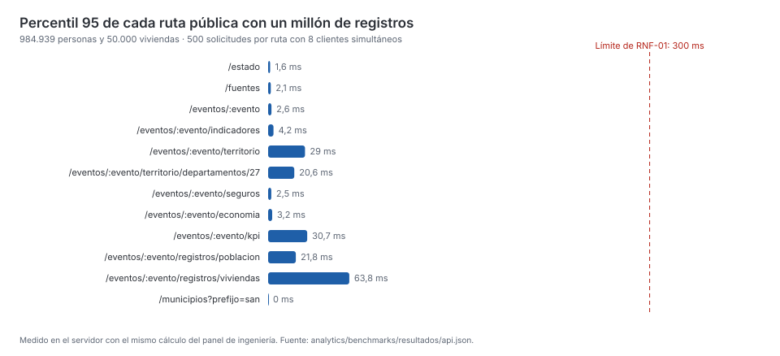
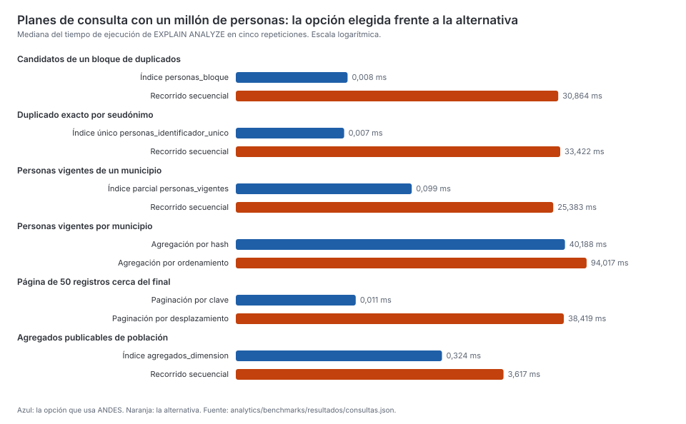
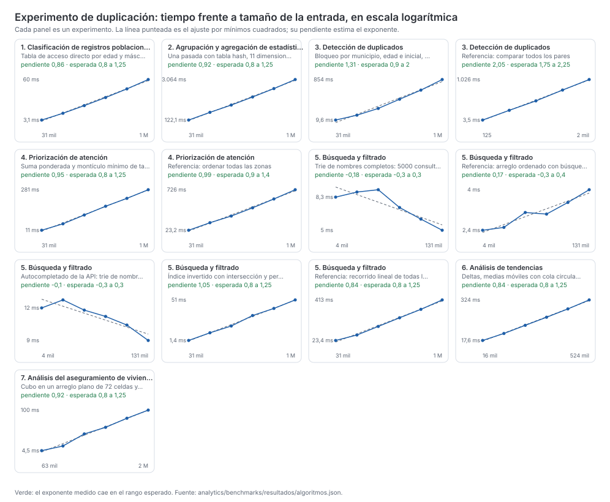

# Rendimiento

Mediciones de la fase 6 con un millón de registros, hechas el 19 de noviembre de 2026 en un Apple M4 de 10 núcleos y 16 GB, con Node.js 24.15.0 y PostgreSQL 18.7 en Docker. Cada cifra sale de un comando que cualquiera puede repetir y de un archivo de resultados en `analytics/benchmarks/resultados/`.

## Contenido

1. [Resumen](#1-resumen)
2. [API pública con un millón de registros](#2-api-pública-con-un-millón-de-registros)
3. [La optimización que encontró la medición](#3-la-optimización-que-encontró-la-medición)
4. [Planes de consulta](#4-planes-de-consulta)
5. [ETL](#5-etl)
6. [Algoritmos](#6-algoritmos)
7. [Modelo en estrella](#7-modelo-en-estrella)
8. [Cómo repetir las mediciones](#8-cómo-repetir-las-mediciones)

## 1. Resumen

| Requisito | Meta | Resultado | Cumple |
|---|---|---|---|
| RNF-01 | Percentil 95 de 300 ms o menos en las consultas del portal con un millón de registros | Entre 0,1 y 63,8 ms en las 12 rutas públicas | Sí |
| RNF-02 | 10.000 filas por segundo o más y menos de 300 MB al cargar un millón de filas | 14.576 filas por segundo y 259,6 MB | Sí |
| RNF-03 | Ningún algoritmo que recorra todos los registros supera O(n log n), salvo la comparación de duplicados probables acotada con bloques | 13 de 13 experimentos dentro de su rango | Sí |

## 2. API pública con un millón de registros

`npm run medir:api` crea la base de datos `andes_medicion_api`, carga con el ETL el archivo de un millón de personas del generador y 50.000 viviendas, y pide 500 veces cada ruta pública con 8 clientes simultáneos, después de 30 solicitudes de calentamiento. El archivo trae filas con errores y duplicados a propósito, así que quedan 984.939 personas registradas.

El percentil 95 «del servidor» es el que calcula el panel de ingeniería: el mismo servicio de métricas, conectado a una aplicación nueva por ruta. El del cliente incluye además el viaje por HTTP.

| Ruta | p95 del servidor (ms) | p50 del cliente (ms) | p95 del cliente (ms) | Bytes |
|---|---:|---:|---:|---:|
| `/estado` | 1,6 | 1,5 | 2,7 | 52 |
| `/fuentes` | 2,1 | 1,5 | 3,2 | 13.001 |
| `/eventos/:evento` | 2,6 | 1,8 | 2,9 | 1.260 |
| `/eventos/:evento/indicadores` | 4,2 | 3,6 | 6,0 | 26.296 |
| `/eventos/:evento/territorio` | 29,0 | 23,4 | 30,1 | 108.315 |
| `/eventos/:evento/territorio/departamentos/27` | 20,6 | 16,2 | 21,1 | 9.729 |
| `/eventos/:evento/seguros` | 2,5 | 1,7 | 3,0 | 1.048 |
| `/eventos/:evento/economia` | 3,2 | 1,8 | 4,1 | 2.297 |
| `/eventos/:evento/kpi` | 30,7 | 23,0 | 32,4 | 12.490 |
| `/eventos/:evento/registros/poblacion` | 21,8 | 21,1 | 26,6 | 3.985 |
| `/eventos/:evento/registros/viviendas` | 63,8 | 54,5 | 72,6 | 3.920 |
| `/municipios?prefijo=san` | menos de 0,1 | 0,6 | 0,9 | 1.060 |



Ninguna ruta pública recorre los registros: leen agregados que el ETL mantiene al cargar. Por eso el tiempo depende del número de categorías y no del número de personas. El buscador de municipios responde desde un trie en memoria.

En el servidor de desarrollo, el panel de ingeniería mostró un percentil 95 de 75,5 ms sobre las 152 solicitudes que recibió durante la revisión en el navegador.

## 3. La optimización que encontró la medición

La primera medición incumplió RNF-01 en las tres rutas que llegaron en la fase 5:

| Ruta | Antes (p95) | Después (p95) |
|---|---:|---:|
| `/eventos/:evento/kpi` | 1.938,2 ms | 30,7 ms |
| `/eventos/:evento/registros/poblacion` | 1.552,7 ms | 21,8 ms |
| `/eventos/:evento/registros/viviendas` | 1.187,5 ms | 63,8 ms |

La consulta de agregados tardaba 0,5 ms; el problema era otra. `EXPLAIN ANALYZE` mostró que la vista `analitica.categorias_de_registros`, que da el nombre de cada categoría, tardaba 463 ms: se armaba con `SELECT DISTINCT` sobre las dimensiones del esquema `bi`, que son productos cruzados de miles de filas, y PostgreSQL lanzaba procesos paralelos para cada rama de la unión. Arrancar esos procesos costaba decenas de milisegundos por rama, para leer unas pocas filas.

La vista se reescribió sobre los catálogos de `nucleo` y una lista fija de valores, sin pasar por `bi`. Bajó a 2 ms. Una prueba de integración comprueba que los nombres siguen siendo exactamente los del modelo en estrella, para que las dos fuentes no se separen.

La lección: una vista que se ve inofensiva puede esconder un costo fijo alto. Por eso la medición de la API queda como comando del proyecto y se repite antes de cada entrega.

## 4. Planes de consulta

`npm run medir:consultas` compara, sobre la base de un millón de registros, el plan que usa ANDES con su alternativa. La alternativa se fuerza dentro de una transacción con `SET LOCAL enable_indexscan = off` (y sus variantes) o `enable_hashagg = off`. Cada tiempo es la mediana del `Execution Time` de `EXPLAIN (ANALYZE, BUFFERS)` en cinco repeticiones, después de una de calentamiento.

| Consulta | Dónde se usa | Plan de ANDES | Alternativa | Veces más rápido |
|---|---|---|---|---:|
| Candidatos de un bloque de duplicados | ETL, algoritmo 3 | Índice `personas_bloque`: 0,008 ms | Recorrido secuencial: 30,864 ms | 3.858 |
| Duplicado exacto por seudónimo | ETL, algoritmo 3 | Índice único `personas_identificador_unico`: 0,007 ms | Recorrido secuencial: 33,422 ms | 4.775 |
| Personas vigentes de un municipio | Estadísticas por territorio | Índice parcial `personas_vigentes`: 0,099 ms | Recorrido secuencial: 25,383 ms | 256 |
| Personas vigentes por municipio | Recálculo de agregados, algoritmo 2 | Agregación por hash: 40,188 ms | Agregación por ordenamiento: 94,017 ms | 2,3 |
| Página de 50 registros cerca del final | Listas privadas | Paginación por clave: 0,011 ms | Paginación por desplazamiento: 38,419 ms | 3.493 |
| Agregados publicables de población | API pública | Índice `agregados_dimension`: 0,324 ms | Recorrido secuencial: 3,617 ms | 11 |



Lo que muestran, en el lenguaje de la sección 16 de la propuesta:

- **Índice frente a recorrido secuencial.** Buscar un bloque o un seudónimo con un árbol B es O(log n); recorrer la tabla es O(n). Con un millón de filas la diferencia pasa de tres órdenes de magnitud. Sin esos índices, el ETL haría un recorrido completo por cada fila cargada: un millón de recorridos de un millón de filas.
- **Agregación por hash frente a ordenamiento.** Agrupar con una tabla hash es O(n) esperado; ordenar primero es O(n log n). En la práctica, 2,3 veces más rápido.
- **Paginación por clave frente a desplazamiento.** `WHERE id > $1 ORDER BY id LIMIT 50` baja por el índice hasta la clave y lee 50 filas: O(log n + página). `OFFSET 700000` lee y descarta 700.000 filas: O(desplazamiento + página).
- **Índice parcial.** `personas_vigentes` solo indexa las filas vigentes, así que es más pequeño que uno completo y sirve justo a las consultas de las estadísticas.

## 5. ETL

Medido en la fase 4 con `npm run medir:etl`, sobre el mismo archivo de un millón de filas:

| Medida | Resultado |
|---|---|
| Duración | 68,6 s |
| Ritmo | 14.576 filas por segundo |
| Memoria máxima del proceso | 259,6 MB, con un montón limitado a 96 MB |
| Filas válidas, rechazadas y duplicados exactos | 989.978, 10.022 y 5.039, iguales a las del manifiesto |

En la fase 5, `npm run datos:demostracion` cargó 50.000 viviendas a 8.937 filas por segundo y con 246,5 MB. Cada vivienda escribe además en sus tablas hijas de afectación, aseguramiento, reclamación e indemnización, lo que explica buena parte de la diferencia con las personas.

## 6. Algoritmos

`npm run medir:algoritmos` ejecuta el experimento de duplicación de la fase 4: cada algoritmo con tamaños que se duplican, cinco repeticiones y la mediana. La pendiente de la recta en escala logarítmica estima el exponente. Los 13 experimentos cayeron en su rango esperado; el detalle de cada uno está en [ALGORITHMS.md](ALGORITHMS.md#resumen-de-resultados).



## 7. Modelo en estrella

Exportar las 21 vistas del esquema `bi` con 984.939 personas y 50.000 viviendas tomó 6,2 s y produjo 40 MB de CSV. La vista más grande, `hecho_personas_afectadas`, tiene 248.237 celdas. Es lo que paga cada actualización de Power BI en modo de importación.

## 8. Cómo repetir las mediciones

```bash
npm run medir:api
```

Prepara la base y carga los datos la primera vez, lo que toma un par de minutos. Con `-- --reutilizar` mide sobre la base ya cargada.

```bash
npm run medir:consultas
```

Necesita la base de `medir:api`.

```bash
npm run medir:graficas
```

Vuelve a dibujar las tres gráficas de `docs/graficas/` a partir de los archivos de resultados.

```bash
npm run medir:algoritmos
```

```bash
npm run medir:etl
```

Los tiempos cambian con el equipo. Lo que debe mantenerse son las relaciones: el percentil 95 lejos del límite, el exponente de cada algoritmo dentro de su rango y la diferencia de órdenes de magnitud entre un índice y un recorrido completo.
